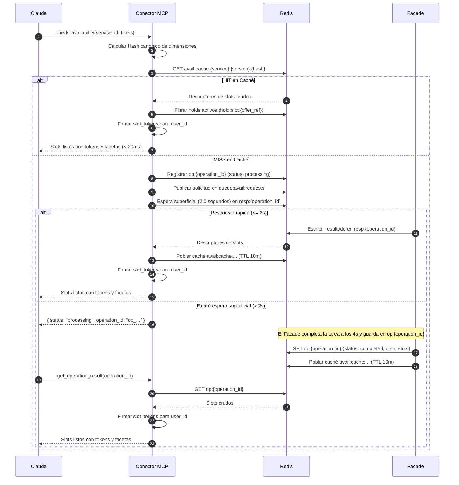
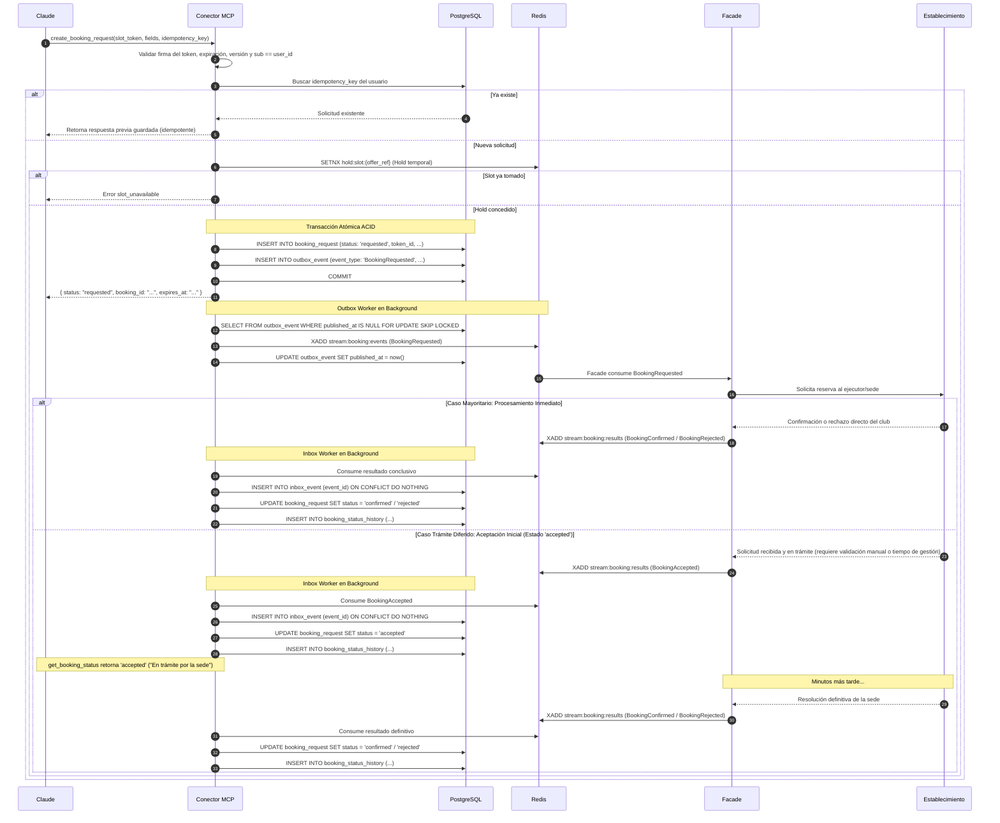

# Conector MCP de Atlas para Claude: Arquitectura Técnica y Event-Driven Design

> **Documento de Arquitectura y Diseño Técnico.**  
> **Fecha de consolidación:** 22 de octubre de 2026.  
> **Estado:** Aprobado para implementación.  
> **Contexto:** Evolución del diseño original incorporando comunicación 100% asíncrona basada en eventos (PostgreSQL / Redis), desacoplamiento vía Facade, caché determinista de disponibilidad con filtrado de holds, y patrón de espera superficial con fallback a polling para operaciones diferidas.

---

## Índice

1. [Visión General y Principios de Diseño](#1-visión-general-y-principios-de-diseño)
2. [Catálogo Oficial de Herramientas MCP (10 Tools)](#2-catálogo-oficial-de-herramientas-mcp-10-tools)
3. [Arquitectura de Comunicación Basada en Eventos (Zero-HTTP en MCP)](#3-arquitectura-de-comunicación-basada-en-eventos-zero-http-en-mcp)
4. [Estrategia de Disponibilidad: Caché, Holds y Operaciones Diferidas](#4-estrategia-de-disponibilidad-caché-holds-y-operaciones-diferidas)
5. [Flujos Técnicos Detallados](#5-flujos-técnicos-detallados)
6. [Modelo de Persistencia (PostgreSQL y Redis)](#6-modelo-de-persistencia-postgresql-y-redis)
7. [Organización de Código (Clean Architecture)](#7-organización-de-código-clean-architecture)

---

## 1. Visión General y Principios de Diseño

Atlas es una pasarela de reservas para clubes deportivos (pádel, golf, tenis), cines y servicios profesionales (talleres mecánicos, veterinarias, restaurantes). El **Conector MCP de Atlas** expone las capacidades del ecosistema a **Claude** como un servidor MCP seguro, predecible y altamente desacoplado.

El conector actúa como una **fachada inteligente con estado durable** que no realiza llamadas directas HTTP a servicios upstream, sino que coordina su trabajo mediante bases de datos locales (**PostgreSQL**) y un bus de mensajes (**Redis**).

### Principios Fundamentales:

1. **Abstracción por patrón de disponibilidad:**
   - `slot_object`: Padel, tenis, golf, restaurantes (slots atados a un objeto reservable físico).
   - `appointment_resource`: Talleres (mecánico), veterinarias (médico) (citas con recurso o profesional opcional).
   - `session_seats`: Cines o teatros (funciones con aforo o butacas específicas).
2. **Contratos autodescriptivos en tiempo de ejecución:**
   Un único tool (`get_service_contract`) entrega los campos de reserva (esquema JSON) y las dimensiones disponibles. No se crean tools específicos por categoría comercial.
3. **Tokens de oferta (`slot_token`) atados al usuario (`sub`):**
   La disponibilidad entrega slots con tokens opacos, firmados criptográficamente, con tiempo de expiración (TTL), versión de contrato y vinculados al usuario autenticado. Claude no puede inventar horarios ni reutilizar slots entre cuentas.
4. **Honestidad sobre la asincronía:**
   Una reserva nace siempre en estado `requested`. Las confirmaciones reales las realiza el establecimiento a través del Facade y retornan mediante eventos.
5. **Precios informativos (sin pasarela de pago):**
   Cumpliendo estrictamente las directrices del Directorio de Anthropic, el conector no cobra ni transacciona dinero. Los precios son puramente informativos (`pricing_mode`: `structured`, `text_only`, `none`).
6. **Autenticación OAuth 100% transversal:**
   Los 10 tools requieren autenticación OAuth. El `user_id` permite aplicar límites de uso, auditoría y aislamiento de datos.

---

## 2. Catálogo Oficial de Herramientas MCP (10 Tools)

Todas las herramientas exigen autenticación OAuth y cuentan con anotaciones estrictas (`readOnlyHint` o `destructiveHint`).

| # | Tool | Tipo / Hint | Propósito | Entradas Clave |
|---|---|---|---|---|
| 1 | `search_businesses` | Lectura (`readOnlyHint: true`) | Buscar establecimientos en la réplica local de catálogo | `query`, `category`, `zone`, `cursor`, `limit` |
| 2 | `get_business_details` | Lectura (`readOnlyHint: true`) | Información completa, ubicación, servicios y políticas | `business_id` |
| 3 | `get_service_contract` | Lectura (`readOnlyHint: true`) | Contrato vigente: campos de reserva y dimensiones | `service_id` |
| 4 | `get_dimension_options` | Lectura (`readOnlyHint: true`) | Opciones dinámicas de una dimensión en un contexto | `service_id`, `dimension`, `context` |
| 5 | `check_availability` | Lectura (`readOnlyHint: true`) | Consulta de slots con tokens, facetas y precios estimados | `service_id`, `filters`, `date_from`, `date_to`, `party_size` |
| 6 | `get_operation_result` | Lectura (`readOnlyHint: true`) | **(Nuevo)** Recuperar resultados de consultas diferidas o lentas | `operation_id` |
| 7 | `create_booking_request` | Escritura (Idempotente) | Solicitar una reserva diferida con hold interno | `slot_token`, `fields`, `idempotency_key` |
| 8 | `get_booking_status` | Lectura (`readOnlyHint: true`) | Consultar el estado y trazabilidad de una reserva | `booking_id` |
| 9 | `list_my_bookings` | Lectura (`readOnlyHint: true`) | Historial de reservas del usuario autenticado | `status_filter`, `cursor`, `limit` |
| 10 | `cancel_booking` | Destructiva (`destructiveHint: true`) | Solicitar la cancelación de una reserva | `booking_id`, `reason` |

---

## 3. Arquitectura de Comunicación Basada en Eventos (Zero-HTTP en MCP)

Por políticas de desacoplamiento y resiliencia, **el Conector MCP no realiza ninguna llamada síncrona HTTP hacia servicios externos**.

```
┌────────────────────────────────────────────────────────────────────────────────────────┐
│                                     CLAUDE / LLM                                       │
└───────────────────────────────────────────▲────────────────────────────────────────────┘
                                            │ Protocolo MCP (Tools 1 a 10)
┌───────────────────────────────────────────▼────────────────────────────────────────────┐
│                              CONECTOR MCP (ATLAS FACHADA)                              │
│                                                                                        │
│   ┌──────────────────────────┐   ┌─────────────────────────┐   ┌───────────────────┐   │
│   │     Catálogo Local       │   │  Cache-Aside & Hashing  │   │  Outbox / Inbox   │   │
│   │    (Copia en Postgres)   │   │      (Redis Client)     │   │     Workers       │   │
│   └─────────────┬────────────┘   └────────────┬────────────┘   └─────────┬─────────┘   │
└─────────────────┼─────────────────────────────┼──────────────────────────┼─────────────┘
                  │ Lectura local SQL           │ Async RPC & Pub/Sub      │ Outbox / Inbox
                  ▼                             ▼                          ▼
         ┌──────────────────┐          ┌─────────────────────────────────────────┐
         │ PostgreSQL Local │          │            REDIS MESSAGE BUS            │
         │ (Config/Contratos│          │  - Streams: stream:booking:events       │
         │  Reservas/Outbox)│          │  - Queues:  queue:avail:requests        │
         └──────────────────┘          │  - Cache:   avail:cache:...             │
                                       │  - Holds:   hold:slot:...               │
                                       └────────────────────▲────────────────────┘
                                                            │ Consume / Produce
                                               ┌────────────┴────────────┐
                                               │   FACADE CENTRALIZADO   │
                                               └────────────▲────────────┘
                                                            │ HTTP / Adaptadores
                                               ┌────────────┴────────────┐
                                               │ SERVICIOS / PROVEEDORES │
                                               └─────────────────────────┘
```

### Componentes y Roles:

* **Catálogo Local (PostgreSQL):** El MCP consulta los establecimientos y servicios desde su propia base de datos (mediante réplica o sincronización). No existe latencia de red para `search_businesses` ni `get_business_details`.
* **Redis Message Bus:** Actúa como canal de comunicación asíncrona entre el Conector MCP y el Facade.
* **Facade Centralizado:** Servicio externo encargado de orquestar la disponibilidad upstream y contactar a los clubes y proveedores.
* **Transactional Outbox / Inbox:** Mecanismo en PostgreSQL que garantiza entrega *al-menos-una-vez* y procesamiento idempotente de eventos de reservas y cancelaciones.

---

## 4. Estrategia de Disponibilidad: Caché, Holds y Operaciones Diferidas

La disponibilidad es el componente más variable: puede resolverse en milisegundos (si está en caché o upstream rápido) o tardar varios segundos (si el club tiene sistemas lentos o requiere cálculos pesados).

### 4.1 Hashing Canónico de Dimensiones (Cache-Aside)

Antes de enviar cualquier mensaje al bus, el conector calcula una clave determinista:

1. **Filtrado de dimensiones:** Solo participan las dimensiones con `apply_mode: upstream_param`.
2. **Normalización:** Se ordenan alfabéticamente las claves y se serializan a JSON compacto sin espacios.
3. **Fórmula de la clave en Redis:**
   $$\text{hash} = \text{SHA256}(\text{canonical\_filters})$$
   $$\text{Clave} = \texttt{avail:cache:\{service\_id\}:\{contract\_version\}:\{hash\}}$$
4. **TTL de la caché:** Entre **5 y 10 minutos** (300 a 600 segundos).

### 4.2 Filtrado de Holds Activos (Deduplicación en Memoria)

* En la caché de Redis se guardan los **descriptores de slots crudos** (sin `slot_token` específico de usuario).
* Al recuperar los slots de la caché (o al recibirlos del Facade), el conector consulta los **holds activos** (`hold:slot:{offer_ref}`) y descarta inmediatamente los slots bloqueados.
* Finalmente, genera y firma criptográficamente los `slot_token` **al vuelo** para el `user_id` que está haciendo la consulta.

### 4.3 Espera Superficial y Operaciones Diferidas (Tool #6: `get_operation_result`)

Para no bloquear a Claude ni exceder los límites de timeout:

1. **Espera superficial:** Al ocurrir un *Cache Miss*, el MCP publica la solicitud a Redis y realiza una espera no bloqueante de **1.5 a 2.5 segundos** sobre una clave de respuesta efímera.
2. **Camino Rápido (<= 2s):** Si el Facade responde a tiempo, la respuesta se guarda en caché, se filtran holds, se firman los tokens y se retorna inmediatamente a Claude.
3. **Camino Lento (> 2s):** Si expira la espera superficial, el MCP devuelve inmediatamente a Claude:
   ```json
   {
     "status": "processing",
     "operation_id": "op_8f9c2d1e-3a4b-...",
     "retry_after_seconds": 2,
     "message": "La disponibilidad está siendo consultada con el club. Utiliza 'get_operation_result' con este operation_id en unos momentos."
   }
   ```
4. **Resolución con `get_operation_result`:**
   Cuando Claude invoca `get_operation_result(operation_id)`:
   - Se valida que `operation_id` pertenezca al `user_id` autenticado.
   - Si el estado es `completed`, se retornan los slots firmados.
   - Si sigue `processing`, se indica un nuevo tiempo de reintento.
   - Si falló upstream, se entrega el error correspondiente (`upstream_timeout`).

---

## 5. Flujos Técnicos Detallados

### 5.1 Flujo de Disponibilidad (Caché + Espera Superficial + Polling)



---

### 5.2 Flujo de Reserva: `create_booking_request` (Transactional Outbox)



---

### 5.3 Máquina de Estados de la Reserva

```
  ┌──────────────────────────────────────────────────────────────┐
  │                         (nueva)                              │
  └────────────────────────────┬─────────────────────────────────┘
                               │ create_booking_request
                               ▼
  ┌──────────────────────────────────────────────────────────────┐
  │                        requested                             │
  └───┬─────────────┬─────────────┬─────────────┬────────────┬───┘
      │             │             │             │            │
      │ Accepted    │ Confirmed   │ Rejected    │ Failed     │ Expired / cancel
      ▼             │ (directo)   │             │            │
┌───────────┐       │             │             │            │
│ accepted  │       │             │             │            │
└───┬───────┘       │             │             │            │
    │               │             │             │            │
    ├───────────────┼─────────────┴─────────────┴────────────┘
    │               ▼
    │         ┌───────────┐ ┌───────────┐ ┌───────────┐ ┌───────────┐ ┌────────────────┐
    │         │ confirmed │ │ rejected  │ │  failed   │ │  expired  │ │cancel_requested│
    │         └─────┬─────┘ └───────────┘ └───────────┘ └─────┬─────┘ └───────┬────────┘
    │               │                                         │               │
    │               │ cancel_booking                          │ Confirmación  │ CancellationConfirmed
    │               │                                         │ tardía        │
    │               ▼                                         ▼               ▼
    │         ┌────────────────┐                        ┌───────────┐   ┌────────────┐
    │         │cancel_requested│                        │ confirmed │   │ cancelled  │
    │         └────────────────┘                        └───────────┘   └────────────┘
    ▼
 (Mismas transiciones hacia confirmed, rejected, failed, expired, cancel_requested)
```

#### Descripción Semántica del Estado `accepted`:
* **Significado:** El ejecutor conectado al Facade o sistema de la sede física ha aceptado la solicitud y la ha colocado en su pipeline interno de tramitación, pero aún no emite la confirmación concluyente (por ejemplo, validación de membresía, asignación manual de pista o cola de procesamiento del establecimiento).
* **Comportamiento hacia Claude / Usuario:** Si `get_booking_status` o `create_booking_request` devuelven `status: "accepted"`, Claude debe informar claramente al usuario:
  > *"Tu reserva ha sido recibida y aceptada por el establecimiento; actualmente se encuentra en trámite. Te informaremos tan pronto la sede emita la confirmación o puedes consultar nuevamente más adelante."*
* **Cancelación en Trámite:** El usuario tiene permitido invocar `cancel_booking` mientras la solicitud esté en `accepted` (pasa a `cancel_requested`).
* **Vencimiento en Trámite:** El temporizador `expires_at` se mantiene activo durante el estado `accepted`. Si no se recibe respuesta concluyente antes del TTL estipulado, pasa a `expired`.
* **Regla de confirmación tardía:** Si una solicitud pasa a `expired` por tiempo (viniendo de `requested` o `accepted`), pero el establecimiento confirma más tarde, la confirmación manda (`expired` $\to$ `confirmed`), ya que el negocio físico es la fuente de verdad inmutable.

---

## 6. Modelo de Persistencia (PostgreSQL y Redis)

### 6.1 Esquema de Base de Datos (PostgreSQL)

#### Configuración y Contratos
* `establishment_ref`: `id`, `catalog_establishment_id` (UNIQUE), `timezone`, `status`, `synced_at`.
* `service`: `id`, `establishment_ref_id`, `catalog_service_id` (UNIQUE), `slug`, `pattern` (`slot_object`, `appointment_resource`, `session_seats`), `status`.
* `service_contract_version`: `id`, `service_id`, `version_no`, `status` (`draft`, `published`, `retired`), `booking_fields_schema` (jsonb), `payment_policy` (jsonb), `cancellation_policy` (jsonb), `request_ttl_seconds`, `content_hash`, `published_at`.
  - *Índice parcial:* Una sola versión publicada por servicio: `CREATE UNIQUE INDEX ... WHERE status = 'published'`.
  - *Inmutabilidad:* Triggers que impiden modificar o borrar versiones publicadas.
* `contract_dimension`: Dimensiones (`key`, `values_source`, `apply_mode`, `required`, `allows_any`, `resolver_ref`).
* `contract_dimension_dependency`: Grafo acíclico de dependencias entre dimensiones (`depends_on`).
* `contract_dimension_value`: Valores estáticos para dimensiones `inline`.

#### Precios Informativos
* `service_pricing_policy`: `service_id` (PK), `pricing_mode` (`structured`, `text_only`, `none`), `currency`, `info_text`, `tax_included`.
* `service_price_rule`: Reglas evaluables (`weekdays`, `start_minute`, `end_minute`, `valid_from`, `valid_to`, `amount`, `calculation_basis`, `priority`).

#### Operación y Mensajería
* `user_link`: `id`, `oauth_issuer`, `oauth_subject` (UNIQUE), `phone_e164`, `created_at`.
* `booking_request`:
  - `id` (UUID PK), `user_id` (FK `user_link`), `service_id`, `contract_version_id`, `status`.
  - `idempotency_key` (UNIQUE con `user_id`), `request_fingerprint`, `token_id` (UNIQUE global).
  - `slot_start`, `slot_end`, `resource_ref`, `applied_filters` (jsonb), `fields` (jsonb cifrado), `price_estimate` (jsonb).
  - `expires_at`, `external_ref`, `version` (control de concurrencia optimista).
* `booking_status_history`: Registro inmutable de transiciones (`booking_id`, `from_status`, `to_status`, `cause`, `event_id`, `occurred_at`).
* `outbox_event`: `id` (event_id), `aggregate_id` (booking_id), `event_type`, `payload` (jsonb), `correlation_id`, `created_at`, `published_at`, `attempts`.
* `inbox_event`: `event_id` (PK), `event_type`, `aggregate_id`, `received_at`, `processed_at`.

---

### 6.2 Estructura de Claves en Redis

| Clave / Stream | Tipo | TTL | Propósito |
|---|---|---|---|
| `avail:cache:{service}:{ver}:{hash}` | String (JSON) | 5-10 min | Caché de descriptores de slots crudos para una combinación de filtros. |
| `hold:slot:{offer_ref}` | String | TTL del Hold | Hold temporal para evitar colisiones de reserva en vuelo. |
| `op:{operation_id}` | Hash / JSON | 10 min | Estado y resultado de una operación diferida (`processing`, `completed`, `failed`). |
| `resp:{operation_id}` | List / Channel | 60 seg | Clave efímera para el retorno de la espera superficial. |
| `queue:avail:requests` | Stream / List | Efímero | Cola de peticiones de disponibilidad hacia el Facade. |
| `stream:booking:events` | Redis Stream | Persistente | Eventos emitidos por el Outbox del MCP (`BookingRequested`, `CancellationRequested`). |
| `stream:booking:results` | Redis Stream | Persistente | Eventos emitidos por el Facade hacia el Inbox del MCP (`BookingConfirmed`, etc.). |

---

## 7. Organización de Código (Clean Architecture)

El código se distribuye en [src/](file:///c:/Users/pluto/source/repos/ENSO/atlas-mcp-conector/src) respetando separación de responsabilidades y arquitectura hexagonal:

```
src/
├── Domain/                         # Lógica pura e interfaces agnósticas
│   ├── Entities/                   # BookingRequest, ServiceContract, PriceRule
│   ├── ValueObjects/               # SlotToken, IdempotencyKey, CanonicalFilterHash
│   ├── Enums/                      # BookingStatus, AvailabilityPattern, PricingMode
│   ├── Events/                     # BookingRequestedEvent, BookingConfirmedEvent
│   └── Interfaces/                 # IBookingRepository, IOutboxRepository, IRedisBusClient
│
├── Application/                    # Casos de uso y orquestación
│   ├── UseCases/
│   │   ├── CheckAvailability/      # Lógica de Hash, Cache-Aside, Superficial Wait
│   │   ├── GetOperationResult/     # Consulta de operaciones diferidas
│   │   ├── CreateBookingRequest/   # Validación, Hold, Transacción Outbox
│   │   ├── CancelBooking/          # Validación de ventana y emisión de evento
│   │   ├── SearchBusinesses/       # Consulta a catálogo local
│   │   └── GetServiceContract/     # Proyección pública de contratos
│   ├── DTOs/                       # Modelos de entrada y salida de cada tool
│   └── Workers/                    # OutboxRelayWorker, InboxConsumerWorker
│
├── Infraestructure/                # Implementaciones tecnológicas
│   ├── Persistence/
│   │   ├── Postgres/               # SQLAlchemy 2.0 Async, Migraciones Alembic, Repositorios
│   │   └── Redis/                  # RedisAsyncClient, RedisBus, RedisCache, HoldManager
│   └── Security/                   # Firmador criptográfico de tokens, validadores OAuth
│
└── Presentation/                   # Punto de entrada MCP
    ├── Server.py                   # Inicialización del servidor FastMCP / MCP SDK
    ├── Tools/                      # Definición de los 10 Tools MCP con sus esquemas y anotaciones
    └── Middlewares/                # Extracción y validación de contexto OAuth
```

---

## 8. Resumen de Ventajas del Diseño Final

1. **Totalmente resiliente a caídas externas:** El servidor MCP no se bloquea si un proveedor externo se degrada.
2. **Respuesta instantánea para usuarios:** Gracias al caché de 5-10 minutos con hash determinista y lecturas locales de catálogo.
3. **Consistencia de datos absoluta:** Transacciones ACID en PostgreSQL con patrón Outbox garantizan cero pérdidas de reservas o dobles asignaciones.
4. **Cumplimiento estricto con las políticas de Claude:** No maneja dinero, usa contratos dinámicos, controla timeouts mediante operaciones diferidas y restringe el acceso con OAuth.
