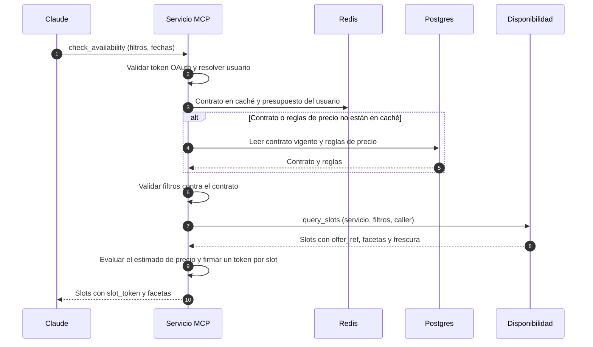
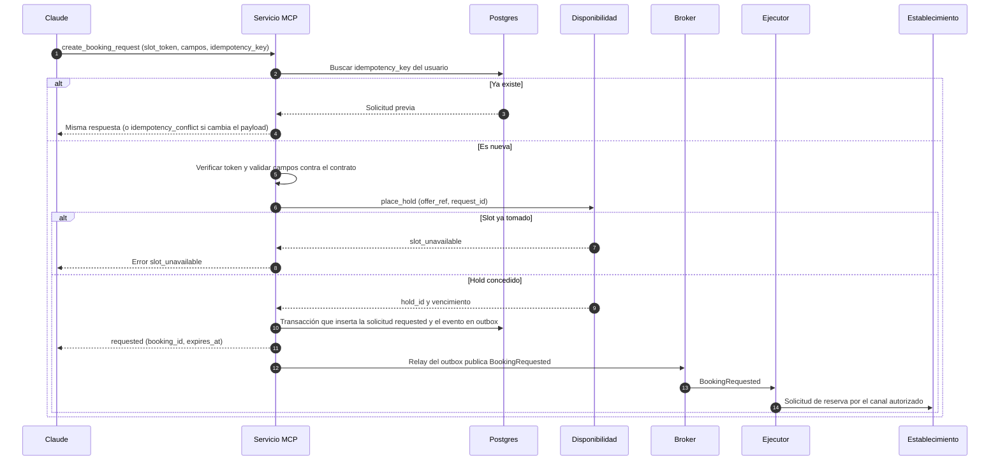
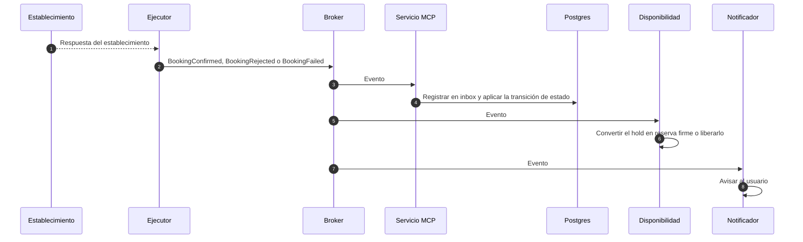
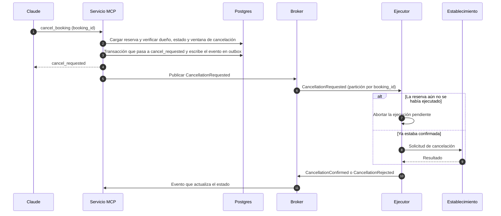
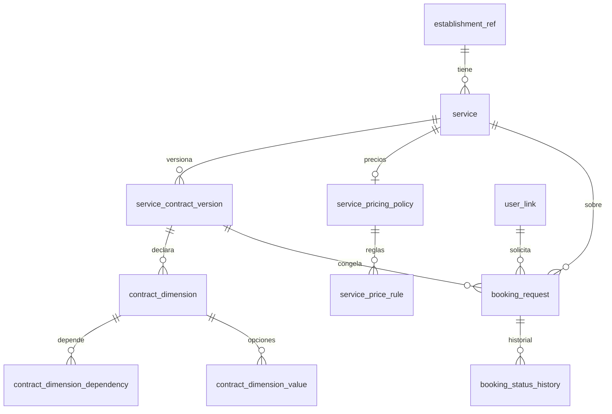

# Conector MCP de Atlas para Claude: documento de diseño

> Documento vivo. Estado: borrador. Última actualización: 16 de octubre de 2026.
> Alcance de esta versión: sección 1 (tools y contratos), sección 2 (flujos técnicos por caso de uso) y sección 3 (base de datos del MCP). Las demás secciones se irán agregando.

## Índice

1. [Tools y contratos](#1-tools-y-contratos)
2. [Flujos técnicos por caso de uso](#2-flujos-técnicos-por-caso-de-uso)
3. [Base de datos del MCP](#3-base-de-datos-del-mcp)
4. _(pendiente)_

---

## 1. Tools y contratos

### 1.1 Contexto y principios

Atlas es una pasarela de reservas para clubes (tenis, golf, padel), cines y otros servicios (veterinarias, talleres de autos). El backend gestiona las reservas haciendo **solicitudes diferidas** a cada establecimiento por un canal autorizado. El conector expone tres capacidades: información de establecimientos, disponibilidad y reservas (crear, ver estado, cancelar).

El catálogo es muy diverso, y la disponibilidad es la parte difícil porque cada establecimiento entrega los datos de forma distinta. Decisiones de diseño:

1. **Abstraer por patrón de disponibilidad, no por categoría de negocio.** La categoría es un dato (plantilla de contrato), no código. Patrones identificados:
   - Slot sobre objeto reservable: padel, golf, tenis, restaurantes.
   - Cita con recurso o profesional opcional: taller (mecánico), veterinaria (doctor).
   - Sesión con aforo o asientos: cine (función y butacas).
2. **Contratos autodescriptivos en tiempo de ejecución.** Un único tool devuelve el contrato de cada servicio (campos de reserva y dimensiones de disponibilidad). El tool es uno solo; lo que varía es la respuesta. Un tool por categoría multiplicaría las tools, empeoraría la elección de herramienta de Claude y la revisión de Anthropic las evaluaría una por una.
3. **Reserva ligada a un token de oferta.** La disponibilidad devuelve slots con un token opaco que ya codifica el contexto. La reserva recibe el token más los datos del cliente, así que el payload variable se reduce a los campos que el contrato describe y Claude no inventa horarios.
4. **Honestidad sobre la asincronía.** Una reserva es primero una solicitud al establecimiento. Los tools nunca deben responder «reservado» cuando solo hubo solicitud.

### 1.2 Catálogo de tools

Son 9 tools. Los de lectura llevan `readOnlyHint: true`. **Todos los tools requieren autenticación OAuth**, incluidos los de lectura y disponibilidad; no hay acceso anónimo ni autenticación diferida.

| # | Tool | Tipo | Auth | Propósito | Entradas clave |
|---|---|---|---|---|---|
| 1 | `search_businesses` | Lectura | OAuth | Buscar establecimientos | texto, categoría, zona, paginación |
| 2 | `get_business_details` | Lectura | OAuth | Ubicación, horarios, servicios (nombre y descripción), políticas y precios informativos | `business_id` |
| 3 | `get_service_contract` | Lectura | OAuth | Contrato del servicio: campos de reserva y dimensiones de disponibilidad | `service_id` |
| 4 | `get_dimension_options` | Lectura | OAuth | Valores disponibles de una dimensión dado un contexto | `service_id`, `dimension`, `context` |
| 5 | `check_availability` | Lectura | OAuth | Slots concretos con token, más facetas calculadas sobre ellos | `service_id`, filtros, fechas, personas |
| 6 | `create_booking_request` | Escritura, no destructiva, idempotente | OAuth | Solicitar una reserva | `slot_token`, campos del contrato, `idempotency_key` |
| 7 | `get_booking_status` | Lectura | OAuth | Estado de una reserva | `booking_id` |
| 8 | `list_my_bookings` | Lectura | OAuth | Reservas del usuario | filtro de estado, paginación |
| 9 | `cancel_booking` | Destructiva | OAuth | Solicitar cancelación | `booking_id` |

Notas:
- Lectura y escritura están separadas, y no existe un tool genérico con parámetro `method` ni `action`.
- Cada tool lleva `title` y la annotation correspondiente (`readOnlyHint` o `destructiveHint`). De ahí depende que Claude pida confirmación.
- Las descripciones deben ser factuales: qué hace el tool y qué precondiciones tiene (por ejemplo, «requiere un `slot_token` obtenido de `check_availability`»), sin instrucciones de comportamiento para Claude.
- `get_business_details` compone dos fuentes: información del establecimiento y de sus servicios (nombre y descripción) desde Catálogo, y contrato y precios informativos desde la base del MCP (sección 3).

### 1.3 El contrato de servicio

`get_service_contract` devuelve, para un servicio concreto:

- `pattern`: patrón de disponibilidad (`slot_object`, `appointment_resource`, `session_seats`).
- `contract_version`: versión, que viaja también dentro de cada token.
- `booking_fields`: campos que pide la reserva (JSON Schema).
- `availability_dimensions`: dimensiones por las que se puede consultar y filtrar.
- `payment_policy`: política de pago (informativa; el conector no procesa cobros).
- `cancellation_policy`: ventana y condiciones de cancelación.
- `request_expires_in_seconds`: plazo tras el cual una solicitud sin respuesta vence.

Fragmento de ejemplo para el taller:

```json
{
  "service_id": "taller-x:cambio-cristales",
  "pattern": "appointment_resource",
  "contract_version": "2026-10-15.1",
  "availability_dimensions": [
    {"key": "date", "values_source": "separate_query", "apply_mode": "upstream_param", "required": true},
    {"key": "mechanic", "values_source": "separate_query", "apply_mode": "upstream_param",
     "depends_on": ["date"], "allows_any": true, "reports_counts": false},
    {"key": "glass_type", "values_source": "inline", "apply_mode": "upstream_param",
     "values": [{"id": "parabrisas", "label": "Parabrisas", "description": "..."}]}
  ],
  "booking_fields": { "type": "object", "properties": { "...": "..." } }
}
```

Los contratos se almacenan en la base del MCP, versionados e inmutables (sección 3). `get_service_contract` devuelve una proyección pública que omite los campos internos (por ejemplo `resolver_ref`). El precio no forma parte del contrato: tiene su propio modelo informativo (sección 3.4).

### 1.4 Dimensiones de disponibilidad

Los filtros de disponibilidad suelen ser disponibilidad en sí mismos: primero se consulta qué mecánicos están disponibles un día para un servicio, y luego los horarios de uno de ellos. Por eso se modelan como **dimensiones** que se resuelven por etapas (fecha, recurso, opciones, hora), no como simples parámetros.

Cada dimensión declara dos ejes independientes, más algunas propiedades:

| Campo | Pregunta que responde | Valores |
|---|---|---|
| `values_source` | ¿De dónde salen las opciones para mostrarle al usuario? | `inline` (en el propio contrato), `slots` (atributo de los slots ya consultados), `separate_query` (consulta aparte) |
| `apply_mode` | Cuando el usuario elige un valor, ¿cómo se filtra la disponibilidad? | `post_filter` (se filtran los slots que ya tengo, sin llamada upstream), `upstream_param` (se vuelve a consultar al establecimiento con el filtro) |
| `depends_on` | ¿De qué dimensiones ya fijadas dependen sus valores? | lista de claves |
| `allows_any` | ¿Admite «cualquiera», resuelto al reservar? | booleano |
| `required` | ¿Hay que fijarla antes de consultar slots? | booleano |
| `reports_counts` | ¿La consulta de valores trae cupos de forma nativa? | booleano |
| `resolver_ref` | Clave opaca que Disponibilidad usa para resolver la dimensión (solo `separate_query`; interna, no se expone a Claude) | texto |

> Nombre abierto: `apply_mode` podría renombrarse a algo más explícito (por ejemplo `filter_strategy` con valores `local` y `upstream`). El concepto es el mismo.

Los dos ejes no siempre coinciden:

| Dimensión | `values_source` | `apply_mode` | Costo |
|---|---|---|---|
| Hoyos (golf) | `slots` | `post_filter` | Una sola llamada upstream; filtrar es gratis |
| Cancha (padel) | `separate_query` | `post_filter` | Lista desde el catálogo del club; cada slot ya trae `cancha_id` |
| Tipo de cristal (taller) | `inline` | `upstream_param` | Sin consulta extra para listar; filtrar cuesta una llamada |
| Mecánico (taller) | `separate_query` | `upstream_param` | Una llamada por cada valor que se explore |

Qué implica para el diseño:
- **Costo y N+1:** `post_filter` es gratis y puede explorarse cuanto se quiera; `upstream_param` cuesta una llamada por valor.
- **Caché:** con `post_filter` se cachea una sola consulta de slots y se filtra sobre ella. Con `upstream_param` la clave de caché incluye el valor del filtro.
- **Comportamiento de Claude:** las dimensiones `post_filter` pueden ofrecerse tras ver los slots («¿solo 18 hoyos?»); las `upstream_param` conviene preguntarlas antes de consultar horarios.
- **No asumir que las dimensiones son conmutativas.** El contrato declara los caminos que soporta (por ejemplo, «mecánicos por fecha» sí, «fechas por mecánico» no). `depends_on` puede invertirse según el negocio.

### 1.5 Flujos de ejemplo

**Golf** (`values_source: slots`, `apply_mode: post_filter`):

1. `check_availability(fecha)` devuelve los slots, cada uno con su atributo `holes`, más un bloque `facets` calculado sobre esos mismos slots (`{9: 12, 18: 20}`).
2. El usuario elige 18 hoyos.
3. Se filtra localmente, sin tocar al club. No hace falta `get_dimension_options`.

**Taller** (`values_source: separate_query`, `apply_mode: upstream_param`):

1. `get_service_contract(servicio)` indica que `mechanic` depende de `date`.
2. `get_dimension_options(servicio, "mechanic", {date})` devuelve los mecánicos de ese día.
3. `check_availability(fecha, mechanic=juan-perez)` hace una consulta upstream con ese parámetro y devuelve los slots con sus tokens.
4. `create_booking_request(slot_token, campos, idempotency_key)` crea la solicitud.

### 1.6 Formas de respuesta

`get_dimension_options`:

```json
{
  "dimension": "mechanic",
  "valid_for": {"service_id": "taller-x:cambio-cristales", "date": "2026-10-19"},
  "as_of": "2026-10-15T14:02:00-04:00",
  "complete": true,
  "options": [
    {"id": "juan-perez", "label": "Juan Pérez", "description": "..."}
  ]
}
```

- `valid_for` repite el contexto en el que los valores son válidos.
- Cada opción solo lleva un resumen de cupos (`availability_hint`) si el contrato marca `reports_counts: true`.
- Si falta una dimensión de `depends_on`, el error lo dice: `{"error": "missing_dependencies", "missing": ["date"]}`.

`check_availability`:

```json
{
  "service_id": "taller-x:cambio-cristales",
  "contract_version": "2026-10-15.1",
  "applied_filters": {"date": "2026-10-19", "mechanic": "juan-perez"},
  "as_of": "2026-10-15T14:02:00-04:00",
  "complete": true,
  "pricing": {"mode": "none", "informative": true,
              "note": "El establecimiento cotiza al momento de atender."},
  "slots": [
    {"slot_token": "st_...", "start": "2026-10-19T09:00", "end": "2026-10-19T10:30",
     "resource_label": "Juan Pérez", "attributes": {}, "expires_at": "2026-10-15T14:17:00-04:00"}
  ],
  "facets": {},
  "next_cursor": null
}
```

- `facets` se llena solo con dimensiones de origen `slots` (por ejemplo, hoyos en golf).
- `pricing` indica el modo de precios del servicio. Con `mode: structured`, cada slot lleva además un `estimate` calculado con la cantidad de personas de la consulta. Los precios son siempre informativos (sección 3.4).
- Las respuestas se paginan y las descripciones se comprimen, para mantenerse lejos del tope de resultado de Claude.

### 1.7 Token de oferta (slot token)

Es opaco para Claude y lleva, como mínimo:

- servicio y recurso (o «cualquiera», a resolver al reservar),
- hora de inicio y fin,
- filtros aplicados (o su hash de contexto),
- `contract_version`,
- vencimiento, derivado de la frescura de la información upstream,
- usuario al que se emitió (`sub`), porque todas las llamadas están autenticadas y así el token no se puede reutilizar desde otra cuenta.

Reglas:
- Si el contrato de un negocio cambia (un mecánico nuevo, una dimensión nueva), los tokens con versión anterior fallan con un error claro.
- `create_booking_request` exige `idempotency_key`, porque Claude puede reintentar una llamada.
- Con «cualquiera», el recurso concreto se resuelve al momento de reservar, igual que con los objetos reservables.

### 1.8 Estados de la reserva

Como las solicitudes al establecimiento son diferidas, el modelo de estados es explícito:

`requested` → `confirmed` | `rejected` | `failed` | `expired`

`confirmed` → `cancel_requested` → `cancelled`

La máquina de estados completa, con sus disparadores, está en la sección 2.11.

- Una solicitud sin respuesta vence tras un plazo definido por servicio.
- La confirmación puede traer datos asignados por el establecimiento (por ejemplo, el mecánico concreto si se pidió «cualquiera»).
- La disponibilidad es indicativa: el establecimiento es la fuente de verdad (walk-ins, teléfono). Las respuestas incluyen `as_of`.
- MCP no permite avisar al usuario después dentro del chat; el canal natural de notificación es WhatsApp si el usuario vincula su número.

### 1.9 Consideraciones técnicas

1. **N+1 contra el establecimiento.** Con `upstream_param`, cada mecánico que se explore cuesta una llamada. Mitigaciones: sin `reports_counts` no ofrecer comparaciones, tope de consultas upstream por conversación, caché con TTL corto por clave (servicio, contexto, dimensiones).
2. **Valores válidos solo en su contexto.** Juan puede estar disponible el lunes y no el martes. Si Claude cambia la fecha y reutiliza al mecánico, el error debe explicarlo y decir qué consultar de nuevo.
3. **«Cualquiera» puede no ser reservable.** Si los slots sin filtrar no están atados a un recurso, hay que confirmar con el establecimiento si acepta una solicitud sin recurso y lo asigna después. Si no, `allows_any: false`.
4. **Profundidad de dependencias.** Con más de dos o tres dimensiones dinámicas encadenadas, el recorrido son muchas llamadas. Si algún negocio lo exige, aplanar en el contrato.
5. **Validador de contratos al incorporar cada negocio.** Debe verificar que `depends_on` no tenga ciclos, que toda dimensión referenciada exista y que cada dimensión de origen `separate_query` tenga su resolvedor interno declarado. Es el paso de validación del proceso de publicación (sección 3.8).
6. **Resolvedores internos.** Cada dimensión de origen `separate_query` lleva en el contrato un `resolver_ref` opaco; Disponibilidad lo interpreta (endpoint, parámetros y forma de respuesta del establecimiento). El MCP no guarda detalles upstream y Claude nunca ve esa clave.
7. **Fallos parciales y lentitud upstream.** Usar un error reintentable (`upstream_timeout`) o `complete: false`, nunca una lista parcial presentada como completa.
8. **Tamaño de respuesta.** Paginar grupos y slots; mantener el total lejos del tope de resultado de Claude (alrededor de 150.000 caracteres en Claude.ai y Desktop).

### 1.10 Alineación con el Directorio de Conectores

| Tema | Aplicación al diseño |
|---|---|
| Separar lectura y escritura | Tools 1 a 5, 7 y 8 de solo lectura; 6 de escritura; 9 destructiva. Sin tool genérico con cuerpo libre |
| Annotations | `title` y `readOnlyHint` o `destructiveHint` en cada tool |
| Descripciones fieles | Una reserva es una solicitud, no una confirmación; la disponibilidad es indicativa |
| Precios | Siempre informativos (`informative: true`); la cotización final la hace el negocio. El conector no procesa cobros |
| Pagos | La Policy no permite mover dinero. El conector solo informa la política de pago y entrega el link externo; no procesa cobros ni penalizaciones por cancelación |
| Origen de la API | Se declara como proxeada con permiso; documentar la autorización de cada establecimiento |
| Autenticación | Todos los tools requieren OAuth (sin autenticación diferida). La cuenta de prueba para los revisores debe cubrir los 9 tools. Vincular la cuenta a un número de WhatsApp verificado permite unificar reservas de ambos canales |
| Privacidad | Pedir solo los campos que el contrato exige (mascotas, placa de vehículo) y no guardar contenido de la conversación |
| Cantidad de tools | 9 tools, un tamaño manejable para el contexto de Claude |

### 1.11 Pendientes de esta sección

- [ ] Contrato real de la consulta de mecánicos disponibles: entrada, salida, si trae cupos y tiempo de respuesta típico.
- [ ] Contrato de un establecimiento de golf, para contrastar el caso `slots` + `post_filter`.
- [ ] Definir si «cualquiera» es reservable en cada patrón (taller, veterinaria).
- [ ] Redactar los JSON Schema concretos de `get_service_contract`, `get_dimension_options` y `check_availability`.
- [ ] Decidir el nombre final de `apply_mode`.
- [ ] Definir el valor de `request_ttl_seconds` de cada servicio (el campo vive en la versión del contrato, sección 3.3).
- [ ] Patrón de sesión con asientos (cines): modelado de butacas y retención temporal. Queda para una sección posterior.
- [ ] Definir el alta de cuenta dentro del flujo OAuth para usuarios de Claude que aún no existen en Atlas.
- [ ] Elegir cómo se registra Claude como cliente OAuth (DCR, CIMD o credenciales de Anthropic) y preparar la cuenta de prueba para los revisores.

---

## 2. Flujos técnicos por caso de uso

### 2.1 Arquitectura y reparto de responsabilidades

El servicio MCP es una **fachada fina con estado durable de solicitudes**: valida, firma, deduplica y recuerda. La lógica de disponibilidad vive en Disponibilidad, la de catálogo en Catálogo y la de ejecución en el Ejecutor.

| Actor | Comunicación con el MCP | Responsabilidad |
|---|---|---|
| **Servicio MCP** | n/a | Contrato hacia Claude: validación OAuth, validación contra el contrato, tokens de slot, idempotencia, estado de las solicitudes, y dueño de los contratos y de los precios informativos |
| **Catálogo** | Síncrona | Información de los establecimientos y de sus servicios (nombre, descripción, horarios, ubicación) |
| **Disponibilidad** | Síncrona | Slots y facetas, resolvedores upstream, caché y presupuesto de llamadas al establecimiento, holds internos |
| **Ejecutor de reservas** | Asíncrona, por eventos | Efectuar reservas y cancelaciones ante el establecimiento y emitir el resultado |
| **Establecimiento** | Indirecta (vía Ejecutor y resolvedores) | Fuente de verdad |
| **Notificador** (opcional) | Asíncrona, consume eventos | Avisar al usuario, por ejemplo por WhatsApp |

Decisiones de arquitectura:
- **Los contratos y los precios informativos viven en la base del MCP** (sección 3). Catálogo no sirve contratos. La vista pública del contrato es una proyección que omite `resolver_ref`, una clave opaca que solo Disponibilidad interpreta; así el MCP no conoce los detalles upstream y Claude nunca los ve.
- **Mensajería:** broker con entrega al menos una vez, consumidores idempotentes y partición por `booking_id` para preservar el orden de los eventos de una misma reserva.

Estado propio del MCP:

| Almacén | Contenido | ¿Fuente de verdad? |
|---|---|---|
| Postgres dedicado | Establecimientos y servicios (referencias a Catálogo), contratos versionados e inmutables, precios informativos, solicitudes de reserva, historial de estados, outbox, inbox y vínculos de usuario (detalle en la sección 3) | Sí |
| Redis dedicado | Límites de uso y presupuestos upstream por usuario, caché de contratos por versión y de reglas de precio, marcas anti-replay de tokens, atajo de idempotencia | No: acelera, no decide |

### 2.2 Autenticación transversal

**Todos los tools exigen OAuth**, incluidos los de catálogo y disponibilidad. Consecuencias:

- **Primer paso de todo flujo:** validar el token de acceso y resolver el usuario (`user_id`). Sin token válido, la respuesta es un 401 con `WWW-Authenticate` que apunta a los metadatos del recurso protegido (descubrimiento OAuth de Claude, RFC 9728).
- **No se usa autenticación diferida.** El usuario inicia sesión al conectar el conector. Para la revisión del directorio, la cuenta de prueba debe cubrir los 9 tools.
- **Límites y presupuestos por usuario**, no por IP ni por sesión anónima. El `user_id` se propaga en las llamadas síncronas (`caller`) para presupuestos y auditoría.
- **Los tokens de slot se atan al usuario** (`sub`), así que no pueden reutilizarse desde otra cuenta.
- **Alta de cuenta:** un usuario de Claude sin cuenta en Atlas debe poder registrarse durante el flujo de consentimiento OAuth. Está por definir; verificar el número de WhatsApp en el alta ayuda a frenar cuentas masivas.
- **Registro de Claude como cliente OAuth:** DCR, CIMD o credenciales de Anthropic. Para alto tráfico se recomiendan CIMD o credenciales de Anthropic antes que DCR.
- Pendiente: dónde vive el servidor de autorización y la tabla `user_links`.

### 2.3 Flujo A: catálogo (`search_businesses`, `get_business_details`, `get_service_contract`)

1. **MCP** valida el token OAuth, resuelve el usuario y valida las entradas.
2. **MCP** consulta su caché en Redis (TTL corto; los contratos se cachean por `contract_version_id`, que es inmutable).
3. En caso de fallo de caché:
   - `search_businesses` y `get_business_details`: **MCP → Catálogo** (síncrono) para la información del establecimiento y de sus servicios.
   - `get_service_contract`: **MCP** lee el contrato vigente de su propio Postgres y construye la proyección pública (sin `resolver_ref`).
   - `get_business_details` además agrega, desde Postgres, los servicios activos y un resumen de precios informativos.
4. **MCP** da forma a la respuesta (compacta y paginada) y la devuelve. No escribe en Postgres.

### 2.4 Flujo B: `get_dimension_options`

1. **MCP** valida el token y resuelve el usuario.
2. **MCP** valida la dimensión y el contexto contra el contrato en caché (`depends_on` presentes). Si falta algo, responde `missing_dependencies` sin tocar la red.
3. **MCP** consulta el presupuesto del usuario en Redis.
4. **MCP → Disponibilidad:** `resolve_options(servicio, dimensión, contexto, caller)`.
5. **Disponibilidad** usa su caché o el resolvedor upstream, y devuelve opciones, `as_of`, `complete` y cupos si el resolvedor los trae.
6. **MCP** añade `valid_for` y responde.

### 2.5 Flujo C: `check_availability`

1. **MCP** valida el token y resuelve el usuario.
2. **MCP** valida los filtros contra el contrato (dimensiones conocidas, `depends_on`, `required`).
3. **MCP** descuenta presupuesto en Redis para las dimensiones `upstream_param`.
4. **MCP → Disponibilidad:** `query_slots`. **Disponibilidad** aplica los `post_filter` sobre su caché, calcula las facetas de las dimensiones de origen `slots` y devuelve descriptores de slot (`offer_ref`, hora, recurso, atributos, frescura).
5. Si el servicio tiene `pricing_mode: structured`, **MCP** evalúa el estimado informativo de cada slot con las reglas de precio (en caché).
6. **MCP** firma un token por slot y responde. El token envuelve el `offer_ref`, la `contract_version`, el hash de contexto, el usuario (`sub`) y el vencimiento (el menor entre la frescura upstream y un tope).

Los tokens no necesitan almacenamiento, así que este flujo no escribe en Postgres.



### 2.6 Flujo D: `create_booking_request` (el más delicado)

1. **MCP** valida el token y resuelve el usuario.
2. **MCP** busca `(usuario, idempotency_key)` en Postgres. Si existe con el mismo payload, devuelve la respuesta guardada. Si existe con otro payload, responde `idempotency_conflict`.
3. **MCP** verifica firma, vencimiento, usuario y `contract_version` del token, y valida los campos contra `booking_fields`.
4. **MCP → Disponibilidad:** `place_hold(offer_ref, request_id)`. **Disponibilidad** coloca un **hold interno** con TTL igual al plazo de la solicitud. Si el slot ya fue tomado (por cualquier canal), responde `slot_unavailable` de inmediato.
5. **MCP**, en **una sola transacción** de Postgres: inserta la solicitud (`requested`, con `token_id` único, la `contract_version_id` con que se validó y, opcionalmente, el estimado informativo vigente) y un evento `BookingRequested` en el outbox.
6. **MCP** responde `requested` con `booking_id` y `expires_at`.
7. Un relay publica el outbox al broker. Si el proceso cae tras el commit, el relay lo recupera.
8. **Ejecutor** consume `BookingRequested`, hace la solicitud al establecimiento por el canal autorizado y publica el resultado (ver 2.7).

El `token_id` único en Postgres es el guardián real contra el doble uso de un mismo slot. Redis solo acelera el rechazo.



### 2.7 Flujo E: resultado asíncrono

1. **Ejecutor** recibe la respuesta del establecimiento y publica `BookingConfirmed`, `BookingRejected` o `BookingFailed`.
2. **MCP** consume el evento y lo registra en el **inbox** (`event_id` único) para tolerar entregas duplicadas.
3. **MCP** aplica la transición de estado solo si es válida desde el estado actual (ver 2.11).
4. **Disponibilidad** convierte el hold en reserva firme, o lo libera si fue rechazada o falló. Puede consumir el mismo evento directamente.
5. El **Notificador** avisa al usuario (por ejemplo, por WhatsApp).



### 2.8 Flujo F: `get_booking_status` y `list_my_bookings`

1. **MCP** valida el token y resuelve el usuario.
2. **MCP** consulta su propio Postgres filtrando por dueño. No llama a ningún otro servicio.
3. Responde con el estado y el `as_of` del último evento recibido.

Notas:
- Paginación por cursor.
- `booking_id` no adivinable (por ejemplo UUID o ULID) más verificación de dueño en cada lectura, para evitar accesos a reservas ajenas.
- Limitación actual: el MCP solo conoce las reservas que él originó. Si las reservas de otros canales (por ejemplo WhatsApp) deben aparecer en `list_my_bookings`, el MCP debe alimentar su modelo de lectura con eventos de todos los canales (ver 2.15).

### 2.9 Flujo G: `cancel_booking`

1. **MCP** valida el token, carga la reserva y verifica dueño, estado que permita cancelar y la política del contrato (ventana de cancelación).
2. **MCP**, en una transacción: pasa a `cancel_requested` y escribe `CancellationRequested` en el outbox. Responde `cancel_requested`.
3. **Ejecutor** consume el evento. Si la reserva aún no se había ejecutado, aborta la ejecución pendiente. Si ya estaba confirmada, solicita la cancelación al establecimiento.
4. **Ejecutor** publica `CancellationConfirmed` o `CancellationRejected`. En este último caso la reserva vuelve a `confirmed`.

La carrera clave es cancelar una solicitud que el Ejecutor aún no ejecutó. La partición por `booking_id` preserva el orden: si `CancellationRequested` llega antes de ejecutar, el Ejecutor aborta en lugar de reservar.



### 2.10 Flujo H: expiración y confirmación tardía

Un job en el MCP detecta las solicitudes `requested` vencidas y las marca `expired`. Pero el Ejecutor podría confirmar después. Regla propuesta: **si el establecimiento confirma tarde, esa confirmación manda** (es la fuente de verdad). Por eso `expired` puede transicionar a `confirmed`, y se notifica al usuario. Sin esa regla quedan reservas reales que el sistema cree vencidas.

### 2.11 Máquina de estados

| Desde | Hacia | Disparador |
|---|---|---|
| (nueva) | `requested` | `create_booking_request` aceptado |
| `requested` | `confirmed` | `BookingConfirmed` |
| `requested` | `rejected` | `BookingRejected` (decisión del establecimiento) |
| `requested` | `failed` | `BookingFailed` (fallo técnico tras reintentos). Estado propuesto |
| `requested` | `expired` | Job de expiración |
| `expired` | `confirmed` | Confirmación tardía: el establecimiento manda |
| `requested` o `confirmed` | `cancel_requested` | `cancel_booking` aceptado |
| `cancel_requested` | `cancelled` | `CancellationConfirmed` (incluye el aborto previo a la ejecución) |
| `cancel_requested` | `confirmed` | `CancellationRejected` sobre una reserva ya confirmada |

Reglas:
- Una transición inválida desde el estado actual se ignora y se registra.
- Un evento duplicado no cambia el estado (inbox).
- Se distingue `rejected` de `failed` porque el mensaje al usuario es distinto.

### 2.12 Eventos mínimos

| Evento | Productor → consumidores | Campos clave |
|---|---|---|
| `BookingRequested` | MCP → Ejecutor | `booking_id`, `offer_ref`, campos, `contract_version`, `correlation_id`, `expires_at` |
| `BookingConfirmed`, `BookingRejected`, `BookingFailed` | Ejecutor → MCP, Disponibilidad, Notificador | `booking_id`, motivo, datos asignados por el establecimiento |
| `CancellationRequested` | MCP → Ejecutor | `booking_id`, motivo |
| `CancellationConfirmed`, `CancellationRejected` | Ejecutor → MCP, Notificador | `booking_id` |

Entrega al menos una vez, consumidores idempotentes por `event_id` y partición por `booking_id`.

### 2.13 Consideraciones transversales

- **Timeouts y degradación:** tiempos límite en las llamadas síncronas y cortacircuitos. Si Catálogo cae, el MCP sirve contratos desde caché (obsoletos pero válidos); para el resto responde `upstream_timeout` reintentable.
- **Trazabilidad:** un `correlation_id` desde la llamada de Claude hasta los eventos, para depurar un flujo que cruza cuatro servicios.
- **Datos personales:** el snapshot de los campos del cliente (mascota, placa) se guarda mínimo, cifrado y con política de retención.
- **Abuso:** al exigir OAuth, los límites y presupuestos upstream se aplican por usuario. El riesgo pasa a la creación masiva de cuentas, de ahí la verificación del número de WhatsApp en el alta.
- **Observabilidad:** métricas por flujo (latencia, tasa de `slot_unavailable`, edad de las solicitudes `requested`, retraso del outbox).

### 2.14 Cómo lo resuelven otros

- **Outbox e inbox** para publicar y consumir eventos sin perder ni duplicar (relays propios o herramientas tipo Debezium). Es un patrón estándar de microservicios.
- **Idempotency keys** al estilo de Stripe.
- **Holds temporales** como en ticketing.
- **ATP de SAP y reservas de stock de Odoo:** comprobar disponibilidad y asignarla son pasos distintos, con una cantidad reservada explícita. Aquí esa reserva explícita es el hold.

Conviene verificar los detalles en la documentación de cada uno antes de copiar nada.

### 2.15 Puntos abiertos de esta sección

- [ ] **Fuente de verdad de las reservas.** Si las hechas por WhatsApp viven en un backend aparte, `list_my_bookings` mostraría solo las del MCP. Definir si el Ejecutor (o un registro central) es el registro único.
- [ ] Ubicación del servidor de autorización OAuth y de la tabla `user_links`; quién verifica el número de WhatsApp.
- [ ] Alta de cuenta dentro del flujo de consentimiento OAuth.
- [ ] Dueño del hold: Disponibilidad parece lo natural, pero hay que confirmar su TTL y qué pasa con los holds de otros canales.
- [ ] Elección del broker (debe garantizar orden por clave).
- [ ] Plazo de expiración por servicio y regla definitiva de confirmación tardía.
- [ ] Confirmar si el Notificador ya existe y qué eventos consume.
- [ ] Sincronización con Catálogo: cómo se entera el MCP cuando un servicio o un establecimiento se desactiva o cambia de zona horaria (ver 3.11).

---

## 3. Base de datos del MCP

Esta sección define las entidades del Postgres dedicado del servicio MCP. Los contratos de los servicios y los precios informativos viven aquí; Catálogo solo aporta la información de los establecimientos y de sus servicios (nombre y descripción).

### 3.1 Principios

1. **Los contratos son versiones inmutables.** Una vez publicada, una versión no se edita: se crea otra. Los tokens de slot y las reservas apuntan a la versión exacta con la que se crearon, así que cambiar un contrato nunca altera lo que ya está en vuelo.
2. **Dimensiones relacionales, campos de reserva como JSON Schema.** Las dimensiones forman un grafo (`depends_on`) que necesita integridad referencial. Los campos de reserva son dinámicos y se validan con una librería de JSON Schema.
3. **Sin claves foráneas hacia otros servicios.** Catálogo se referencia con identificadores externos. No se duplican nombres ni descripciones: `service` no tiene `name`.
4. **Se desactiva, no se borra.** Las reservas apuntan a servicios y versiones, así que todo lleva `status` y las FK son `ON DELETE RESTRICT` (salvo los hijos de un borrador).
5. **Los precios tienen vigencia por fechas, separada de la versión del contrato.** Cambiar un precio no invalida tokens ni crea una versión de contrato.
6. **Fechas en `timestamptz` (UTC).** La zona horaria del establecimiento se usa para evaluar reglas de precio y para presentar horarios.

### 3.2 Visión general



`outbox_event` e `inbox_event` no tienen FK: se enlazan con `booking_request` solo por `aggregate_id`.

### 3.3 Configuración: establecimientos, servicios y contratos

| Entidad | Campos clave | Restricciones e índices |
|---|---|---|
| `establishment_ref` | `id`, `catalog_establishment_id`, `status`, `timezone` (IANA, ej. `America/Santo_Domingo`), `synced_at` | `UNIQUE (catalog_establishment_id)`. Solo ancla y duplica lo mínimo (zona horaria y estado) |
| `service` | `id`, `establishment_ref_id`, `catalog_service_id`, `slug`, `pattern`, `status` (`draft`, `active`, `inactive`) | `UNIQUE (catalog_service_id)`, `UNIQUE (establishment_ref_id, slug)`. `pattern` con `CHECK` en `slot_object`, `appointment_resource`, `session_seats`. Sin nombre ni descripción |
| `service_contract_version` | `id`, `service_id`, `version_no`, `status` (`draft`, `published`, `retired`), `booking_fields_schema` (jsonb), `payment_policy` (jsonb), `cancellation_policy` (jsonb), `request_ttl_seconds`, `meta_schema_version`, `content_hash`, `published_at` | `UNIQUE (service_id, version_no)`. Índice único parcial `UNIQUE (service_id) WHERE status = 'published'`: una sola versión vigente por servicio |
| `contract_dimension` | `id`, `contract_version_id`, `key`, `position`, `label`, `description`, `values_source`, `apply_mode`, `required`, `allows_any`, `reports_counts`, `resolver_ref` | `UNIQUE (contract_version_id, key)`. `CHECK` en `values_source` y `apply_mode`. `resolver_ref` obligatorio si el origen es `separate_query` |
| `contract_dimension_dependency` | `dimension_id`, `depends_on_dimension_id`, `contract_version_id` | PK compuesta, `CHECK` de que no sea ella misma. FK compuestas que garantizan que ambas dimensiones pertenecen a la misma versión. La ausencia de ciclos se valida al publicar |
| `contract_dimension_value` | `id`, `dimension_id`, `value_key`, `label`, `description`, `position`, `contract_version_id` | `UNIQUE (dimension_id, value_key)`. Solo para dimensiones de origen `inline` |

Decisiones:
- **La versión vigente se resuelve con el índice parcial**, no con una columna `active_version_id` en `service`. Así se evita una FK circular entre `service` y `service_contract_version`.
- **Política de pago, ventana de cancelación y plazo de expiración van dentro de la versión.** Cambian con el contrato y deben quedar congeladas con cada reserva.
- **`resolver_ref` es una clave opaca.** El MCP no guarda cómo se consulta el establecimiento; Disponibilidad la interpreta. La proyección pública del contrato la omite.
- **Las plantillas por categoría se copian, no se enlazan.** Crear un servicio puede partir de una plantilla que se copia a un borrador; un enlace vivo rompería la inmutabilidad.
- **Una sola versión por servicio, con dos partes** (disponibilidad y reserva). Si el ritmo de cambios de una de las partes lo exige, se puede separar más adelante.
- **Inmutabilidad reforzada en la base**: unos triggers (ver 3.7) impiden modificar una versión publicada o sus dimensiones. Son una red de seguridad, no sustituyen la validación de la aplicación.

### 3.4 Precios informativos

Los precios son siempre informativos: la cotización final la hace el negocio. Algunos servicios (por ejemplo, el taller) no tienen precio de referencia hasta que el cliente es atendido. Por eso cada servicio declara un `pricing_mode`:

| Modo | Significado | Ejemplo |
|---|---|---|
| `structured` | Hay reglas evaluables: se puede dar un estimado para un horario y una cantidad de personas | Padel, golf, cine |
| `text_only` | Solo hay información en texto libre | «Desde RD$X, según el vehículo» |
| `none` | No hay precio de referencia; el negocio cotiza al atender | Taller de autos |

**`service_pricing_policy`** (1 a 1 con `service`)

| Campo | Notas |
|---|---|
| `service_id` | PK y FK |
| `pricing_mode` | `CHECK` en `structured`, `text_only`, `none` |
| `currency` | ISO 4217. Obligatoria si el modo es `structured` |
| `tax_included` | Nulable: muchas veces no se sabe |
| `info_text` | Obligatorio si el modo es `text_only` |
| `disclaimer_override` | Reemplaza el aviso estándar de «precio informativo» |
| `updated_at`, `updated_by` | Auditoría de autoría |

**`service_price_rule`** (evolución de `ServiceRate`)

| Campo | Notas |
|---|---|
| `id`, `service_id`, `label` | `label` es el nombre mostrable (ej. «Tarifa nocturna») |
| `weekdays` | `smallint[]`, valores 1 a 7 (ISO) |
| `start_minute`, `end_minute` | Minutos desde medianoche, `0 <= start < end <= 1440`. Una franja que cruza medianoche se divide en dos reglas al guardar |
| `valid_from`, `valid_to` | Vigencia por fechas; `valid_to` nulo significa vigente |
| `min_party_size`, `max_party_size` | Nulables |
| `min_duration_min`, `max_duration_min` | Nulables, para tarifas por duración |
| `dimension_conditions` | jsonb nulable, forma `{clave_dimensión: [valores]}`. Reservada para cuando un caso real la pida |
| `amount`, `calculation_basis` | `numeric(12,2)` y `per_booking` o `per_person` |
| `is_starting_price`, `priority` | «Desde»; prioridad entera, por defecto 0 |
| `created_at/by`, `updated_at/by` | Auditoría de autoría |

Diferencias respecto a la clase `ServiceRate` original: minutos en lugar de `time` (que no puede representar las 24:00), vigencia por fechas, rangos de personas y duración, prioridad, etiqueta y moneda a nivel de política.

**Cambiar un precio** es cerrar la regla vieja (`valid_to`) e insertar una nueva, no editarla. Eso da historial y permite programar cambios futuros.

**Evaluación** (función pura: servicio, hora de inicio, personas, duración):
1. Convertir la hora de inicio a la zona horaria del establecimiento.
2. Filtrar las reglas cuya vigencia, día, franja, rango de personas y duración coinciden.
3. Tomar la de mayor prioridad.
4. Calcular el monto (`per_person` multiplica por la cantidad de personas).
5. Devolver el estimado junto con el `rule_id`.

Reglas de resolución: la tarifa se resuelve por la **hora de inicio, sin prorrateo**. Para servicios `structured`, al guardar se exige que las franjas cubran el horario laboral sin huecos y que no haya solapamientos con la misma prioridad. Si no hay regla aplicable, el estimado es nulo con una nota: no se inventa.

**Forma de la respuesta hacia Claude:**

```json
"pricing": {"mode": "structured", "informative": true, "currency": "DOP",
  "estimate": {"amount": 1500.00, "basis": "per_booking", "label": "Tarifa nocturna"},
  "note": "Precio informativo; el establecimiento confirma la cotización final."}
```

```json
"pricing": {"mode": "none", "informative": true,
  "note": "El establecimiento cotiza al momento de atender."}
```

En `check_availability`, con `mode: structured`, el estimado va por slot. No se necesita un décimo tool: `get_business_details` trae un resumen de franjas por servicio.

**No cubierto todavía:** extras y alquileres (carrito de golf, equipo), precios por tipo de cliente (socio e invitado) y descuentos. Extensión prevista: un campo `rate_kind` (`base`, `addon`) y el tipo de cliente como condición, solo cuando un caso real lo pida.

### 3.5 Operación

| Entidad | Campos clave | Restricciones e índices |
|---|---|---|
| `user_link` | `id`, `oauth_issuer`, `oauth_subject`, `phone_e164`, `phone_verified_at` | `UNIQUE (oauth_issuer, oauth_subject)`. Solo el vínculo; el perfil vive en el servidor de autorización |
| `booking_request` | `id`, `user_id`, `service_id`, `contract_version_id`, `status`, `status_reason`, `idempotency_key`, `request_fingerprint`, `token_id`, `offer_ref`, `hold_id`, `slot_start`, `slot_end`, `resource_ref`, `applied_filters` (jsonb), `fields` (jsonb), `price_estimate` (jsonb), `expires_at`, `external_ref`, `assigned_details` (jsonb), `last_event_at`, `version`, `created_at`, `updated_at` | `UNIQUE (user_id, idempotency_key)`, `UNIQUE (token_id)`, `CHECK` de estados. Índice `(user_id, created_at DESC, id DESC)` para paginar con cursor; índice parcial sobre `expires_at WHERE status = 'requested'` para el job de expiración |
| `booking_status_history` | `id`, `booking_id`, `from_status`, `to_status`, `cause`, `event_id`, `occurred_at` | Solo se agrega, nunca se edita. Alimenta el `as_of` y la depuración |

Detalles:
- **`token_id` único** es el guardián contra el doble uso de un slot (los tokens no se almacenan).
- **`request_fingerprint`** es un hash del payload normalizado, para distinguir un reintento legítimo (mismo contenido) de un `idempotency_conflict`.
- **La idempotencia solo cubre solicitudes aceptadas.** Un rechazo por validación o `slot_unavailable` no deja fila, así que reintentar no tiene efectos secundarios.
- **`slot_end` es nulable**: algunos servicios (golf, restaurantes) solo tienen hora de entrada o una duración estimada.
- **`price_estimate`** es opcional y solo informativo: guarda el estimado vigente al reservar, con el `rule_id`.
- **Concurrencia optimista**: columna `version` y transiciones con `UPDATE ... WHERE status = <esperado>`, verificando el número de filas afectadas.

### 3.6 Mensajería

| Entidad | Campos clave | Notas |
|---|---|---|
| `outbox_event` | `id` (= `event_id`), `aggregate_id` (= `booking_id`, clave de partición), `event_type`, `payload` (jsonb), `correlation_id`, `created_at`, `published_at`, `attempts` | Índice parcial `WHERE published_at IS NULL`. El relay lee con `FOR UPDATE SKIP LOCKED` |
| `inbox_event` | `event_id` (PK), `event_type`, `aggregate_id`, `received_at`, `processed_at` | La PK deduplica. Se inserta en la misma transacción que la transición de estado |

### 3.7 DDL (PostgreSQL)

```sql
-- =========================================================
-- Configuración: establecimientos, servicios y contratos
-- =========================================================

CREATE TABLE establishment_ref (
    id                        uuid PRIMARY KEY DEFAULT gen_random_uuid(),
    catalog_establishment_id  text        NOT NULL UNIQUE,
    status                    text        NOT NULL DEFAULT 'active'
                              CHECK (status IN ('active', 'inactive')),
    timezone                  text        NOT NULL,          -- IANA, ej. America/Santo_Domingo
    synced_at                 timestamptz NOT NULL DEFAULT now(),
    created_at                timestamptz NOT NULL DEFAULT now()
);

CREATE TABLE service (
    id                    uuid PRIMARY KEY DEFAULT gen_random_uuid(),
    establishment_ref_id  uuid        NOT NULL REFERENCES establishment_ref (id) ON DELETE RESTRICT,
    catalog_service_id    text        NOT NULL UNIQUE,
    slug                  text        NOT NULL,
    pattern               text        NOT NULL
                          CHECK (pattern IN ('slot_object', 'appointment_resource', 'session_seats')),
    status                text        NOT NULL DEFAULT 'draft'
                          CHECK (status IN ('draft', 'active', 'inactive')),
    created_at            timestamptz NOT NULL DEFAULT now(),
    updated_at            timestamptz NOT NULL DEFAULT now(),
    UNIQUE (establishment_ref_id, slug)
);

CREATE TABLE service_contract_version (
    id                     uuid PRIMARY KEY DEFAULT gen_random_uuid(),
    service_id             uuid        NOT NULL REFERENCES service (id) ON DELETE RESTRICT,
    version_no             integer     NOT NULL CHECK (version_no > 0),
    status                 text        NOT NULL DEFAULT 'draft'
                           CHECK (status IN ('draft', 'published', 'retired')),
    booking_fields_schema  jsonb       NOT NULL DEFAULT '{}'::jsonb,   -- JSON Schema
    payment_policy         jsonb       NOT NULL DEFAULT '{}'::jsonb,
    cancellation_policy    jsonb       NOT NULL DEFAULT '{}'::jsonb,
    request_ttl_seconds    integer     NOT NULL CHECK (request_ttl_seconds > 0),
    meta_schema_version    integer     NOT NULL DEFAULT 1,
    content_hash           text,
    published_at           timestamptz,
    created_at             timestamptz NOT NULL DEFAULT now(),
    UNIQUE (service_id, version_no),
    CHECK (status = 'draft' OR (published_at IS NOT NULL AND content_hash IS NOT NULL))
);

-- Una sola versión vigente por servicio
CREATE UNIQUE INDEX uq_contract_one_published_per_service
    ON service_contract_version (service_id)
    WHERE status = 'published';

CREATE TABLE contract_dimension (
    id                   uuid PRIMARY KEY DEFAULT gen_random_uuid(),
    contract_version_id  uuid     NOT NULL REFERENCES service_contract_version (id) ON DELETE CASCADE,
    key                  text     NOT NULL,
    position             smallint NOT NULL DEFAULT 0,
    label                text     NOT NULL,
    description          text,
    values_source        text     NOT NULL
                         CHECK (values_source IN ('inline', 'slots', 'separate_query')),
    apply_mode           text     NOT NULL
                         CHECK (apply_mode IN ('post_filter', 'upstream_param')),
    required             boolean  NOT NULL DEFAULT false,
    allows_any           boolean  NOT NULL DEFAULT false,
    reports_counts       boolean  NOT NULL DEFAULT false,
    resolver_ref         text,                                   -- clave opaca, interna
    UNIQUE (contract_version_id, key),
    UNIQUE (id, contract_version_id),
    CHECK (values_source <> 'separate_query' OR resolver_ref IS NOT NULL)
);

CREATE TABLE contract_dimension_dependency (
    contract_version_id      uuid NOT NULL,
    dimension_id             uuid NOT NULL,
    depends_on_dimension_id  uuid NOT NULL,
    PRIMARY KEY (dimension_id, depends_on_dimension_id),
    CHECK (dimension_id <> depends_on_dimension_id),
    FOREIGN KEY (dimension_id, contract_version_id)
        REFERENCES contract_dimension (id, contract_version_id) ON DELETE CASCADE,
    FOREIGN KEY (depends_on_dimension_id, contract_version_id)
        REFERENCES contract_dimension (id, contract_version_id) ON DELETE CASCADE
);

CREATE TABLE contract_dimension_value (
    id                   uuid PRIMARY KEY DEFAULT gen_random_uuid(),
    contract_version_id  uuid     NOT NULL,
    dimension_id         uuid     NOT NULL,
    value_key            text     NOT NULL,
    label                text     NOT NULL,
    description          text,
    position             smallint NOT NULL DEFAULT 0,
    UNIQUE (dimension_id, value_key),
    FOREIGN KEY (dimension_id, contract_version_id)
        REFERENCES contract_dimension (id, contract_version_id) ON DELETE CASCADE
);

-- Red de seguridad: una versión publicada es inmutable (solo puede pasar a 'retired')
CREATE FUNCTION trg_contract_version_guard() RETURNS trigger AS $$
BEGIN
    IF TG_OP = 'DELETE' THEN
        IF OLD.status <> 'draft' THEN
            RAISE EXCEPTION 'No se puede borrar la versión % (no es borrador)', OLD.id;
        END IF;
        RETURN OLD;
    END IF;
    IF OLD.status <> 'draft' THEN
        IF NOT (OLD.status = 'published' AND NEW.status = 'retired'
                AND (to_jsonb(NEW) - 'status') = (to_jsonb(OLD) - 'status')) THEN
            RAISE EXCEPTION 'La versión % es inmutable', OLD.id;
        END IF;
    END IF;
    RETURN NEW;
END;
$$ LANGUAGE plpgsql;

CREATE TRIGGER contract_version_guard
    BEFORE UPDATE OR DELETE ON service_contract_version
    FOR EACH ROW EXECUTE FUNCTION trg_contract_version_guard();

CREATE FUNCTION trg_contract_children_draft_only() RETURNS trigger AS $$
DECLARE
    v_version uuid;
    v_status  text;
BEGIN
    IF TG_OP = 'DELETE' THEN
        v_version := OLD.contract_version_id;
    ELSE
        v_version := NEW.contract_version_id;
    END IF;
    SELECT status INTO v_status FROM service_contract_version WHERE id = v_version;
    -- Si la versión ya no existe (se está borrando un borrador), se permite
    IF v_status IS NOT NULL AND v_status <> 'draft' THEN
        RAISE EXCEPTION 'La versión de contrato % no es borrador y es inmutable', v_version;
    END IF;
    IF TG_OP = 'DELETE' THEN
        RETURN OLD;
    END IF;
    RETURN NEW;
END;
$$ LANGUAGE plpgsql;

CREATE TRIGGER contract_dimension_draft_only
    BEFORE INSERT OR UPDATE OR DELETE ON contract_dimension
    FOR EACH ROW EXECUTE FUNCTION trg_contract_children_draft_only();

CREATE TRIGGER contract_dependency_draft_only
    BEFORE INSERT OR UPDATE OR DELETE ON contract_dimension_dependency
    FOR EACH ROW EXECUTE FUNCTION trg_contract_children_draft_only();

CREATE TRIGGER contract_value_draft_only
    BEFORE INSERT OR UPDATE OR DELETE ON contract_dimension_value
    FOR EACH ROW EXECUTE FUNCTION trg_contract_children_draft_only();

-- =========================================================
-- Precios informativos
-- =========================================================

CREATE TABLE service_pricing_policy (
    service_id           uuid PRIMARY KEY REFERENCES service (id) ON DELETE RESTRICT,
    pricing_mode         text NOT NULL
                         CHECK (pricing_mode IN ('structured', 'text_only', 'none')),
    currency             char(3),
    tax_included         boolean,
    info_text            text,
    disclaimer_override  text,
    updated_at           timestamptz NOT NULL DEFAULT now(),
    updated_by           uuid,
    CHECK (pricing_mode <> 'structured' OR currency IS NOT NULL),
    CHECK (pricing_mode <> 'text_only'  OR info_text IS NOT NULL)
);

CREATE TABLE service_price_rule (
    id                    uuid PRIMARY KEY DEFAULT gen_random_uuid(),
    service_id            uuid     NOT NULL
                          REFERENCES service_pricing_policy (service_id) ON DELETE RESTRICT,
    label                 text     NOT NULL,
    weekdays              smallint[] NOT NULL,
    start_minute          smallint NOT NULL,
    end_minute            smallint NOT NULL,
    valid_from            date     NOT NULL,
    valid_to              date,
    min_party_size        smallint,
    max_party_size        smallint,
    min_duration_min      smallint,
    max_duration_min      smallint,
    dimension_conditions  jsonb,
    amount                numeric(12, 2) NOT NULL CHECK (amount >= 0),
    calculation_basis     text     NOT NULL
                          CHECK (calculation_basis IN ('per_booking', 'per_person')),
    is_starting_price     boolean  NOT NULL DEFAULT false,
    priority              smallint NOT NULL DEFAULT 0,
    created_at            timestamptz NOT NULL DEFAULT now(),
    created_by            uuid,
    updated_at            timestamptz NOT NULL DEFAULT now(),
    updated_by            uuid,
    CHECK (start_minute >= 0 AND end_minute <= 1440 AND start_minute < end_minute),
    CHECK (cardinality(weekdays) > 0
           AND weekdays <@ ARRAY[1, 2, 3, 4, 5, 6, 7]::smallint[]),
    CHECK (valid_to IS NULL OR valid_from <= valid_to),
    CHECK (min_party_size IS NULL OR max_party_size IS NULL OR min_party_size <= max_party_size),
    CHECK (min_duration_min IS NULL OR max_duration_min IS NULL OR min_duration_min <= max_duration_min)
);

CREATE INDEX ix_price_rule_lookup
    ON service_price_rule (service_id, valid_from, valid_to);

-- =========================================================
-- Operación
-- =========================================================

CREATE TABLE user_link (
    id                 uuid PRIMARY KEY DEFAULT gen_random_uuid(),
    oauth_issuer       text        NOT NULL,
    oauth_subject      text        NOT NULL,
    phone_e164         text        CHECK (phone_e164 ~ '^\+[1-9][0-9]{6,14}$'),
    phone_verified_at  timestamptz,
    created_at         timestamptz NOT NULL DEFAULT now(),
    UNIQUE (oauth_issuer, oauth_subject),
    CHECK (phone_verified_at IS NULL OR phone_e164 IS NOT NULL)
);

CREATE TABLE booking_request (
    id                   uuid PRIMARY KEY DEFAULT gen_random_uuid(),
    user_id              uuid        NOT NULL REFERENCES user_link (id) ON DELETE RESTRICT,
    service_id           uuid        NOT NULL REFERENCES service (id) ON DELETE RESTRICT,
    contract_version_id  uuid        NOT NULL REFERENCES service_contract_version (id) ON DELETE RESTRICT,
    status               text        NOT NULL DEFAULT 'requested'
                         CHECK (status IN ('requested', 'confirmed', 'rejected', 'failed',
                                           'expired', 'cancel_requested', 'cancelled')),
    status_reason        text,
    idempotency_key      text        NOT NULL,
    request_fingerprint  text        NOT NULL,
    token_id             text        NOT NULL UNIQUE,
    offer_ref            text        NOT NULL,
    hold_id              text,
    slot_start           timestamptz NOT NULL,
    slot_end             timestamptz,
    resource_ref         text,
    applied_filters      jsonb       NOT NULL DEFAULT '{}'::jsonb,
    fields               jsonb       NOT NULL DEFAULT '{}'::jsonb,   -- datos personales: minimizar y cifrar
    price_estimate       jsonb,                                      -- solo informativo
    expires_at           timestamptz NOT NULL,
    external_ref         text,
    assigned_details     jsonb,
    last_event_at        timestamptz,
    version              integer     NOT NULL DEFAULT 1,
    created_at           timestamptz NOT NULL DEFAULT now(),
    updated_at           timestamptz NOT NULL DEFAULT now(),
    UNIQUE (user_id, idempotency_key),
    CHECK (slot_end IS NULL OR slot_end > slot_start)
);

CREATE INDEX ix_booking_user_created
    ON booking_request (user_id, created_at DESC, id DESC);

CREATE INDEX ix_booking_expiry
    ON booking_request (expires_at)
    WHERE status = 'requested';

CREATE INDEX ix_booking_service_slot
    ON booking_request (service_id, slot_start);

CREATE TABLE booking_status_history (
    id           bigint GENERATED ALWAYS AS IDENTITY PRIMARY KEY,
    booking_id   uuid        NOT NULL REFERENCES booking_request (id) ON DELETE RESTRICT,
    from_status  text,
    to_status    text        NOT NULL,
    cause        text        NOT NULL,   -- ej. 'user_request', 'event:BookingConfirmed', 'expiry_job'
    event_id     uuid,
    occurred_at  timestamptz NOT NULL DEFAULT now()
);

CREATE INDEX ix_status_history_booking
    ON booking_status_history (booking_id, id);

-- =========================================================
-- Mensajería
-- =========================================================

CREATE TABLE outbox_event (
    id              uuid PRIMARY KEY,                 -- = event_id
    aggregate_id    uuid        NOT NULL,             -- = booking_id (clave de partición)
    event_type      text        NOT NULL,
    payload         jsonb       NOT NULL,
    correlation_id  text,
    created_at      timestamptz NOT NULL DEFAULT now(),
    published_at    timestamptz,
    attempts        integer     NOT NULL DEFAULT 0
);

CREATE INDEX ix_outbox_pending
    ON outbox_event (created_at)
    WHERE published_at IS NULL;

CREATE TABLE inbox_event (
    event_id      uuid PRIMARY KEY,
    event_type    text        NOT NULL,
    aggregate_id  uuid,
    received_at   timestamptz NOT NULL DEFAULT now(),
    processed_at  timestamptz
);
```

Notas sobre el DDL:
- Si `fields` o `phone_e164` se cifran en la aplicación, cambia `fields` a `bytea` más un identificador de clave, y quita el `CHECK` del teléfono (o guarda además un hash para búsquedas).
- Las restricciones de franjas sin huecos y sin solapamientos de `service_price_rule` se validan al guardar, en la aplicación. Si se quiere garantía en la base, hay que normalizar los días en filas y usar una restricción de exclusión con `btree_gist`.
- Un servicio con un `service_price_rule` solo tiene sentido si su política es `structured`: también se valida en la aplicación.

### 3.8 Autoría y publicación de contratos

Los contratos se crean como borradores y pasan por un flujo de publicación:

1. **Borrador:** se crea `service_contract_version` con estado `draft` y sus dimensiones, dependencias y valores.
2. **Validación:** JSON Schema de `booking_fields_schema` válido; dependencias sin ciclos; toda dimensión referenciada existe; las dimensiones `separate_query` tienen `resolver_ref`; las `inline` tienen valores; y las reglas de precio que usan `dimension_conditions` siguen referenciando claves existentes.
3. **Publicación**, en una sola transacción: se retira la versión vigente anterior (`retired`) y se publica la nueva, calculando `content_hash` y `published_at`. El índice parcial garantiza una sola vigente.

Opción recomendada: **contratos como código.** Los contratos se mantienen como archivos en un repositorio, se validan en integración continua y un cargador idempotente (por `content_hash`) los importa a la base. Así, cambiar un contrato pasa por revisión y pruebas.

Efectos de publicar una versión nueva:
- Los tokens emitidos con la versión anterior fallan con un error claro.
- Las `booking_request` existentes no cambian: conservan su `contract_version_id`.
- Como las versiones son inmutables, su caché en Redis no se invalida nunca; solo el puntero «versión vigente del servicio» necesita un TTL corto o invalidación explícita.

### 3.9 Concurrencia, retención y datos personales

- **Transiciones de estado:** `UPDATE booking_request SET status = :nuevo, version = version + 1 ... WHERE id = :id AND status = ANY(:esperados)`, comprobando que se afectó una fila. Un evento duplicado o tardío no pisa un estado.
- **Relay del outbox:** lee con `FOR UPDATE SKIP LOCKED`. Con varios relays en paralelo, los eventos de una misma reserva podrían publicarse fuera de orden; hay que asignar cada `aggregate_id` a un solo relay (por ejemplo, por hash) o procesar por agregado.
- **Purga:** el outbox se purga tras publicar y el inbox pasado un plazo mayor que la ventana de reentrega del broker.
- **Datos personales:** `fields` y `phone_e164` son datos personales. Minimizar lo que se pide, cifrar, definir retención y verificar los requisitos de la Ley 172-13 de la República Dominicana con asesoría legal.
- **Crecimiento:** `booking_request` y `booking_status_history` podrían particionarse por fecha más adelante; no hace falta al inicio.

### 3.10 Cómo lo resuelven otros

- **Versionado de contratos:** según recuerdo, en Odoo las preguntas de una cita se editan en el lugar y las respuestas guardan referencia a la pregunta, de modo que un cambio puede reescribir el significado de datos históricos. SAP maneja datos maestros dependientes del tiempo con intervalos de validez. Las versiones inmutables de este diseño se parecen más al segundo enfoque.
- **Precios:** SAP usa la técnica de condiciones (registros con clave, período de validez y escalas por cantidad, resueltos por una secuencia de acceso con prioridad). Odoo usa listas de precios con reglas por cantidad mínima y rango de fechas. `service_price_rule` es una versión reducida de ambas ideas.
- **Mensajería:** outbox e inbox son un patrón estándar de microservicios para publicar y consumir eventos sin perder ni duplicar.

Conviene verificar los detalles en la documentación de cada uno antes de copiar nada.

### 3.11 Puntos abiertos de esta sección

- [ ] ¿Los establecimientos publican precios distintos por duración o por tipo de cliente (socio e invitado)? De eso depende si esas condiciones entran desde el inicio.
- [ ] La validación de cobertura de franjas necesita el horario laboral, que vive en Catálogo: decidir si el validador lo consulta o se relaja a una advertencia.
- [ ] Sincronización con Catálogo: cómo se entera el MCP cuando un servicio o establecimiento se desactiva o cambia de zona horaria (evento o consulta periódica).
- [ ] Cifrado y retención de `fields` y `phone_e164`; revisión legal.
- [ ] Autoría de contratos y precios: contratos como código, interfaz de administración, o ambos.
- [ ] Una versión por contrato o dos partes versionadas por separado.
- [ ] Extras y alquileres (`rate_kind`) y precios por tipo de cliente.
- [ ] Enviar o no el estimado informativo al establecimiento en `BookingRequested`, dejando claro que no es vinculante.
