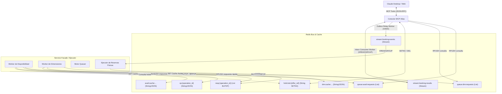

# Especificación de Integración Redis: Conector MCP Atlas ↔ Servicio Facade / Ejecutor

> **Documento de Arquitectura e Integración Técnica.**  
> **Fecha:** 27 de octubre de 2026.  
> **Estado:** Aprobado para implementación en el servicio Facade (ATLAS-BACKEND).  
> **Propósito:** Definir exhaustivamente todos los canales de comunicación, eventos, estructuras JSON, mecanismos en Redis y comportamientos esperados que el servicio Facade / Ejecutor debe implementar para interactuar bidireccionalmente con el Conector MCP de Atlas para Claude.

---

## 1. Visión General de la Arquitectura

El sistema se compone de dos grandes subsistemas desacoplados a través de **Redis**:

1. **Conector MCP de Atlas (este proyecto):**  
   Fachada hacia Claude que expone las 10 herramientas del Model Context Protocol (MCP). Gestiona la autenticación OAuth 2.0 con PKCE, contratos dinámicos de catálogo, acuñación y verificación de tokens criptográficos de slots (`slot_token`), control de antelación y transacciones durables con PostgreSQL mediante **Transactional Outbox / Inbox**.

2. **Servicio Facade / Disponibilidad y Ejecutor (el servicio a implementar):**  
   Servicio upstream encargado de consultar y resolver la disponibilidad real contra los establecimientos físicos (clubes de pádel/golf, talleres, cines, veterinarias), gestionar el sistema **Queuer** (slots virtuales estimados), orquestar la reserva física contra cada pasarela y publicar los resultados.



---

## 2. Canales RPC: Disponibilidad y Dimensiones (Redis Lists)

Para las consultas de lectura pesada o dinámica hacia upstream, el MCP utiliza un patrón **RPC desacoplado con espera superficial (~2.0 segundos)**.

---

### 2.1 Consulta de Disponibilidad de Slots (`check_availability`)

#### A. Recepción de Solicitud
* **Canal:** `queue:avail:requests`
* **Tipo de estructura Redis:** Redis List
* **Mecanismo:** MCP envía mediante `RPUSH`. El Facade debe escuchar mediante `BLPOP` o `BRPOP`.
* **Clave de estado inicial creada por MCP:** `op:{operation_id}` con TTL de 600 segundos y valor:
  ```json
  {
    "status": "processing",
    "operation_id": "op-550e8400-e29b-41d4-a716-446655440000",
    "created_at": "2026-10-27T15:00:00Z"
  }
  ```

#### B. Estructura del Mensaje Recibido en `queue:avail:requests`
```json
{
  "operation_id": "op-550e8400-e29b-41d4-a716-446655440000",
  "type": "availability_request",
  "payload": {
    "service_id": 20,
    "combo_code": "PADEL_INDOOR",
    "user_uuid": "c4d7e231-1829-4d6b-9c71-332998822001",
    "user_phone": "+18095551234",
    "date_from": "2026-10-28",
    "date_to": "2026-10-28",
    "filters": {
      "surface": "cristal",
      "indoor": true
    },
    "party_size": 4,
    "contract_version": "v1.0"
  },
  "created_at": "2026-10-27T15:00:00Z"
}
```

#### C. Qué debe devolver el Facade
El Facade debe resolver los slots contra el club/sede física (o generar slots virtuales Queuer) y responder:

1. **Respuesta Rápida (≤ 2.0 segundos):**  
   Empujar la respuesta a la lista efímera `resp:{operation_id}`:
   * **Comando Redis:** `RPUSH resp:{operation_id} '<json_payload>'`
   * **Obligatorio:** Asignar expiración de seguridad: `EXPIRE resp:{operation_id} 60`

2. **Respuesta Diferida (> 2.0 segundos):**  
   Si la consulta upstream supera los 2 segundos, el MCP ya habrá devuelto `{ "status": "processing", "operation_id": "..." }` a Claude. Al terminar, el Facade debe:
   * Actualizar el estado en `op:{operation_id}` (vía `SET op:{operation_id} '<json_state>' EX 600`).
   * Adicionalmente, hacer `RPUSH resp:{operation_id} '<json_payload>'` (patrón de *Lazy Sync* defensivo).

3. **Poblado de la Caché (Cache-Aside):**  
   Para optimizar futuras consultas idénticas antes de que venzan:
   * **Clave:** `avail:cache:{service_id}:{contract_version}:{filter_hash}`
   * **TTL:** 600 segundos (10 min).
   * **Comando:** `SET avail:cache:{service_id}:{contract_version}:{filter_hash} '<json_data>' EX 600`

#### D. Estructura JSON de la Respuesta de Disponibilidad
```json
{
  "operation_id": "op-550e8400-e29b-41d4-a716-446655440000",
  "status": "completed",
  "result_type": "availability",
  "service_id": 20,
  "contract_version": "v1.0",
  "as_of": "2026-10-27T15:00:01.500000Z",
  "slots": [
    {
      "offer_ref": "off-padel-court1-1800",
      "slot_start": "2026-10-28T18:00:00Z",
      "slot_end": "2026-10-28T19:30:00Z",
      "resource_ref": "court-1",
      "resource_name": "Pista Panorámica 1",
      "is_estimated": false,
      "slot_type": "official",
      "notice": null,
      "attributes": {
        "surface": "cristal",
        "indoor": true
      }
    },
    {
      "offer_ref": "est-queuer-slot-1000",
      "slot_start": "2026-10-29T10:00:00Z",
      "slot_end": "2026-10-29T11:30:00Z",
      "resource_ref": null,
      "resource_name": "Horario Estimado Queuer",
      "is_estimated": true,
      "slot_type": "estimated",
      "notice": "Horario estimado del Queuer. La sede publica los turnos oficiales el día anterior.",
      "attributes": {
        "surface": "cristal"
      }
    }
  ],
  "facets": {
    "surface": {
      "cristal": 2,
      "muro": 1
    },
    "indoor": {
      "true": 2,
      "false": 1
    }
  }
}
```

> **Reglas Clave para Slots:**
> - `offer_ref`: Identificador opaco y único del horario ofrecido.
> - `is_estimated`: Si es `false`, el MCP exigirá y tomará un hold atómico en Redis al momento de reservar. Si es `true` (Queuer), el MCP **no** colocará hold y marcará la reserva como en trámite.
> - `slot_token`: El Facade **no** genera el `slot_token`. El Conector MCP lo firma y cifra criptográficamente al recibir los slots.

#### E. Respuesta de Error / Fallo Upstream
Si el proveedor externo falla, da timeout o no se puede procesar la consulta:
```json
{
  "operation_id": "op-550e8400-e29b-41d4-a716-446655440000",
  "status": "failed",
  "error": "Error de conexión con la pasarela del club de pádel. Intente más tarde."
}
```
*Si fue diferido (>2s)*, escribir esto en `op:{operation_id}` con `SET op:{operation_id} '<json>' EX 600`.  
*Si fue rápido (≤2s)*, empujar a `resp:{operation_id}` con `RPUSH` + `EXPIRE 60`.

---

### 2.2 Consulta de Opciones de Dimensión (`get_dimension_options`)

Aplica para dimensiones cuyo contrato declara `values_source = "separate_query"` (por ejemplo: lista de mecánicos disponibles en un taller para una fecha dada, o lista de pistas activas).

#### A. Recepción de Solicitud
* **Canal:** `queue:dim:requests`
* **Tipo de estructura Redis:** Redis List
* **Mecanismo:** MCP envía mediante `RPUSH`. Facade consume mediante `BLPOP` o `BRPOP`.

#### B. Estructura del Mensaje Recibido
```json
{
  "operation_id": "op-dim-77889900-1122-3344-5566-778899aabbcc",
  "type": "dimension_request",
  "payload": {
    "service_id": 20,
    "combo_code": "TALLER_MEC_RAPIDA",
    "user_uuid": "c4d7e231-1829-4d6b-9c71-332998822001",
    "user_phone": "+18095551234",
    "dimension_key": "mechanic",
    "context": {
      "date": "2026-10-28"
    },
    "context_hash": "a1b2c3d4e5f6...",
    "resolver_ref": "ext-mechanics-api"
  },
  "created_at": "2026-10-27T15:00:00Z"
}
```

#### C. Qué debe devolver el Facade
1. **Respuesta Rápida (≤ 2.0s):**
   * Empujar a `resp:{operation_id}` con `RPUSH`.
   * Ejecutar `EXPIRE resp:{operation_id} 60`.
2. **Respuesta Diferida (> 2.0s):**
   * Actualizar `op:{operation_id}` con `SET ... EX 600`.
3. **Poblado de Caché:**
   * **Clave:** `dim:cache:{service_id}:{dimension_key}:{context_hash}`
   * **Comando:** `SET dim:cache:{service_id}:{dimension_key}:{context_hash} '<json_options>' EX 600`

#### D. Estructura JSON de la Respuesta de Dimensión
```json
{
  "operation_id": "op-dim-77889900-1122-3344-5566-778899aabbcc",
  "status": "completed",
  "result_type": "dimension_options",
  "dimension_key": "mechanic",
  "options": [
    {
      "value_key": "mech-juan",
      "label": "Juan Pérez",
      "description": "Especialista en frenos y suspensión",
      "position": 1
    },
    {
      "value_key": "mech-carlos",
      "label": "Carlos Gómez",
      "description": "Electricidad y diagnóstico",
      "position": 2
    }
  ],
  "context_hash": "a1b2c3d4e5f6...",
  "expires_in_seconds": 600
}
```

#### E. Respuesta de Error / Fallo Upstream
Si no es posible obtener las opciones de dimensión del backend o servicio externo:
```json
{
  "operation_id": "op-dim-77889900-1122-3344-5566-778899aabbcc",
  "status": "failed",
  "error": "Error al consultar las opciones de dimensión en el proveedor del taller."
}
```
*Si fue diferido (>2s)*: `SET op:{operation_id} '<json>' EX 600`.  
*Si fue rápido (≤2s)*: `RPUSH resp:{operation_id} '<json>'` + `EXPIRE resp:{operation_id} 60`.

---

## 3. Canales Event-Driven: Ciclo de Vida de Reservas (Redis Streams)

Las reservas no utilizan colas efímeras con BLPOP: **se procesan mediante eventos durables y transaccionales sobre Redis Streams**.

| Dirección | Stream de Redis | Productor | Consumidor |
|---|---|---|---|
| **MCP → Facade** | `stream:booking:events` | `OutboxRelayWorker` (MCP) | Consumer Group del Facade |
| **Facade → MCP** | `stream:booking:results` | Ejecutor / Facade | `InboxConsumerWorker` (MCP: `mcp_inbox_group`) |

---

### 3.1 Eventos Emitidos por el Conector MCP (`stream:booking:events`)

El Facade debe crear un Consumer Group (ej. `xgroup_create stream:booking:events facade_group $ mkstream`) y consumir con `XREADGROUP`.

#### Evento A: `BookingRequested`
Emitido inmediatamente tras guardarse la solicitud de reserva en PostgreSQL.

```json
{
  "event_id": "9b1deb4d-3b7d-4bad-9bdd-2b0d7b3dcb6d",
  "aggregate_id": "b3e36e65-2244-4f01-9a99-123456789abc",
  "event_type": "BookingRequested",
  "correlation_id": "idemp-client-key-9911",
  "payload": {
    "booking_id": "b3e36e65-2244-4f01-9a99-123456789abc",
    "user_uuid": "c4d7e231-1829-4d6b-9c71-332998822001",
    "user_phone": "+18095551234",
    "service_id": 20,
    "combo_code": "PADEL_INDOOR",
    "contract_version_id": "8f3b2100-3322-4411-8899-001122334455",
    "token_id": "tok-9921",
    "offer_ref": "off-padel-court1-1800",
    "slot_start": "2026-10-28T18:00:00Z",
    "slot_end": "2026-10-28T19:30:00Z",
    "is_estimated": false,
    "applied_filters": {
      "surface": "cristal",
      "indoor": true
    },
    "fields": {
      "player_count": 4,
      "notes": "Pelotas nuevas requeridas"
    },
    "expires_at": "2026-10-27T15:15:00Z"
  },
  "created_at": "2026-10-27T15:00:00Z"
}
```

> **Variaciones del Payload según el Patrón:**
> 1. **Servicios bajo demanda (`on_demand_request`, ej. veterinaria):**
>    - `token_id`: `null`
>    - `offer_ref`: `null`
>    - `slot_start`: `null`
>    - `slot_end`: `null`
>    - `fields`: contiene los campos del formulario (ej. `{"pet_name": "Max", "symptoms": "Fiebre"}`).
> 2. **Servicios Queuer:**
>    - `is_estimated`: `true`
>    - El horario es orientativo; el Queuer se encarga de cazar el turno oficial.

---

#### Evento B: `CancellationRequested`
Emitido cuando el usuario solicita cancelar una reserva activa desde Claude.

```json
{
  "event_id": "11223344-5566-7788-9900-aabbccddeeff",
  "aggregate_id": "b3e36e65-2244-4f01-9a99-123456789abc",
  "event_type": "CancellationRequested",
  "correlation_id": "b3e36e65-2244-4f01-9a99-123456789abc",
  "payload": {
    "booking_id": "b3e36e65-2244-4f01-9a99-123456789abc",
    "user_uuid": "c4d7e231-1829-4d6b-9c71-332998822001",
    "user_phone": "+18095551234",
    "service_id": 20,
    "combo_code": "PADEL_INDOOR",
    "external_ref": "CONF-CLUB-9921",
    "reason": "Imprevisto personal de trabajo."
  },
  "created_at": "2026-10-27T16:00:00Z"
}
```

---

### 3.2 Eventos de Respuesta que el Facade DEBE Emitir (`stream:booking:results`)

El Conector MCP cuenta con un worker continuo ([`InboxConsumerWorker`](file:///c:/Users/pluto/source/repos/ENSO/atlas-mcp-conector/src/mcp/infrastructure/workers/inbox_consumer_worker.py)) suscrito al Consumer Group `mcp_inbox_group` en `stream:booking:results`.

El Facade debe publicar mediante:
```python
await redis.xadd(
    "stream:booking:results",
    {"payload": json.dumps(envelope, ensure_ascii=False)}
)
```

#### Envelope Obligatorio para todos los eventos hacia `stream:booking:results`:
```json
{
  "event_id": "<UUID_v4_unico_del_evento>",
  "aggregate_id": "<booking_id_uuid>",
  "event_type": "<NombreDelEvento>",
  "payload": { ... }
}
```

---

#### 1. Evento `BookingAccepted`
Indica que el establecimiento aceptó tramitar la solicitud o que el sistema Queuer la puso en cola para auto-reserva al día siguiente. La reserva pasa a estado `accepted` ("En trámite").

```json
{
  "event_id": "aa11bb22-cc33-dd44-ee55-ff6677889900",
  "aggregate_id": "b3e36e65-2244-4f01-9a99-123456789abc",
  "event_type": "BookingAccepted",
  "payload": {
    "booking_id": "b3e36e65-2244-4f01-9a99-123456789abc",
    "external_ref": "QUEUER-JOB-5541",
    "assigned_details": {
      "queue_position": 1,
      "notice": "Solicitud en cola. Se confirmará automáticamente mañana al abrirse los horarios."
    }
  }
}
```

---

#### 2. Evento `BookingConfirmed`
Indica que la reserva fue completada exitosamente ante el establecimiento. La reserva pasa a estado `confirmed`.  
*Acción automática del MCP:* Transiciona la reserva y **libera automáticamente el hold en Redis**.

```json
{
  "event_id": "bb22cc33-dd44-ee55-ff66-001122334455",
  "aggregate_id": "b3e36e65-2244-4f01-9a99-123456789abc",
  "event_type": "BookingConfirmed",
  "payload": {
    "booking_id": "b3e36e65-2244-4f01-9a99-123456789abc",
    "external_ref": "PADEL-CONF-88219",
    "assigned_details": {
      "court_assigned": "Pista Central Panorámica",
      "court_number": 1,
      "access_pin": "4921#"
    }
  }
}
```

---

#### 3. Evento `BookingRejected`
El establecimiento rechazó la solicitud (ej. no hay disponibilidad en la sede física o no cumple requisitos). La reserva pasa a `rejected`.  
*Acción automática del MCP:* Transiciona y **libera automáticamente el hold en Redis**.

```json
{
  "event_id": "cc33dd44-ee55-ff66-7788-112233445566",
  "aggregate_id": "b3e36e65-2244-4f01-9a99-123456789abc",
  "event_type": "BookingRejected",
  "payload": {
    "booking_id": "b3e36e65-2244-4f01-9a99-123456789abc",
    "reason": "La pista seleccionada entró en mantenimiento preventivo por lluvia."
  }
}
```

---

#### 4. Evento `BookingFailed`
Ocurrió un error técnico irrecuperable en la comunicación con la pasarela física. La reserva pasa a `failed`.  
*Acción automática del MCP:* Transiciona y **libera automáticamente el hold en Redis**.

```json
{
  "event_id": "dd44ee55-ff66-7788-8899-223344556677",
  "aggregate_id": "b3e36e65-2244-4f01-9a99-123456789abc",
  "event_type": "BookingFailed",
  "payload": {
    "booking_id": "b3e36e65-2244-4f01-9a99-123456789abc",
    "reason": "Timeout persistente contra la pasarela del club tras 3 reintentos."
  }
}
```

---

#### 5. Evento `CancellationConfirmed`
La sede confirmó la cancelación. La reserva pasa a `cancelled`.  
*Acción automática del MCP:* Transiciona y libera holds asociados.

```json
{
  "event_id": "ee55ff66-7788-9900-aabb-334455667788",
  "aggregate_id": "b3e36e65-2244-4f01-9a99-123456789abc",
  "event_type": "CancellationConfirmed",
  "payload": {
    "booking_id": "b3e36e65-2244-4f01-9a99-123456789abc"
  }
}
```

---

#### 6. Evento `CancellationRejected`
La sede denegó la cancelación (ej. fuera de la ventana permitida según política). La reserva regresa a `confirmed`.

```json
{
  "event_id": "ff667788-8899-aabb-ccdd-445566778899",
  "aggregate_id": "b3e36e65-2244-4f01-9a99-123456789abc",
  "event_type": "CancellationRejected",
  "payload": {
    "booking_id": "b3e36e65-2244-4f01-9a99-123456789abc",
    "reason": "La política del club exige cancelar con al menos 2 horas de antelación."
  }
}
```

---

## 4. Gestión de Concurrencia y Holds (`hold:slot:{offer_ref}`)

Para evitar que dos usuarios reserven el mismo slot simultáneamente:

1. **Adquisición por MCP:**  
   Antes de persistir una reserva estándar con `slot_token`, el MCP ejecuta:
   ```text
   SET hold:slot:{offer_ref} {booking_id} NX EX {request_ttl_seconds}
   ```
   Si la clave ya existe, el MCP rechaza la solicitud de inmediato con `"El horario seleccionado ya no está disponible o ha sido bloqueado por otro usuario."`.

2. **Comportamiento del Facade:**  
   Si el Facade realiza verificaciones de disponibilidad en tiempo real o mantiene inventario propio, puede consultar la existencia de `hold:slot:{offer_ref}` para descartar slots bloqueados.

3. **Liberación del Hold:**  
   El MCP libera el hold mediante un script Lua atómico que verifica que el contenido sea exactamente el `booking_id`:
   ```lua
   if redis.call("get", KEYS[1]) == ARGV[1] then
       return redis.call("del", KEYS[1])
   else
       return 0
   end
   ```
   Esta liberación se dispara de manera automática al procesar `BookingConfirmed`, `BookingRejected`, `BookingFailed` o `CancellationConfirmed`.

---

## 5. Tabla Maestra de Claves y Canales en Redis

| Objeto / Canal | Tipo Redis | Productor | Consumidor | TTL / Política | Propósito |
|---|---|---|---|---|---|
| `queue:avail:requests` | List | MCP | Facade | Sin TTL | Peticiones de consulta de slots |
| `queue:dim:requests` | List | MCP | Facade | Sin TTL | Peticiones de opciones de dimensión |
| `resp:{operation_id}` | List | Facade | MCP | 60 seg | Respuesta rápida (BLPOP ~2s) |
| `op:{operation_id}` | String (JSON) | MCP / Facade | MCP | 600 seg | Estado de operación diferida |
| `avail:cache:{s_id}:{ver}:{hash}` | String (JSON) | Facade | MCP | 600 seg | Caché determinista de slots |
| `dim:cache:{s_id}:{dim}:{hash}` | String (JSON) | Facade | MCP | 600 seg | Caché determinista de dimensiones |
| `hold:slot:{offer_ref}` | String (UUID) | MCP | MCP / Facade | `request_ttl_seconds` | Hold atómico anti-colisiones |
| `stream:booking:events` | Stream | MCP (`OutboxRelay`) | Facade | Retención por Stream | Eventos `BookingRequested`, `CancellationRequested` |
| `stream:booking:results` | Stream | Facade | MCP (`InboxConsumer`) | Retención por Stream | Eventos `BookingAccepted`, `BookingConfirmed`, `BookingRejected`, etc. |

---

## 6. Algoritmo de Hashing Canónico para Cachés

Para que las claves de caché de `context_hash` y `filter_hash` coincidan exactamente entre el MCP y el Facade:

1. Tomar el diccionario de filtros o contexto (ej. `{"surface": "cristal", "indoor": true}`).
2. Serializar a JSON ordenando alfabéticamente las claves y eliminando espacios superfluos:
   ```python
   canonical_json = json.dumps(data, sort_keys=True, separators=(",", ":"), ensure_ascii=True)
   ```
3. Calcular el hash SHA-256 en minúsculas:
   ```python
   hash_digest = hashlib.sha256(canonical_json.encode("utf-8")).hexdigest()
   ```

---

## 7. Checklist de Implementación para el Servicio Facade

- [ ] Escuchar en `queue:avail:requests` y resolver slots oficiales o virtuales estimados (Queuer).
- [ ] Devolver la respuesta a `resp:{operation_id}` dentro de los 2.0s cuando sea posible, o actualizar `op:{operation_id}` si es diferido.
- [ ] Escuchar en `queue:dim:requests` y resolver opciones de dimensiones dependientes.
- [ ] Crear el Consumer Group en `stream:booking:events` y consumir solicitudes de reserva `BookingRequested`.
- [ ] Gestionar la cola del Queuer emitiendo `BookingAccepted` para reservas estimadas.
- [ ] Ejecutar reservas físicas contra los clubes/cines y emitir `BookingConfirmed` o `BookingRejected` a `stream:booking:results`.
- [ ] Consumir solicitudes de cancelación `CancellationRequested` y responder con `CancellationConfirmed` o `CancellationRejected`.

---

## 8. Esqueleto Python de Referencia (Código Turnkey para el Facade)

A continuación se presenta un ejemplo reproducible de cómo estructurar los consumidores en el servicio Facade con `redis-py` asíncrono:

```python
import asyncio
import json
import logging
import uuid
from typing import Any
import redis.asyncio as aioredis

logger = logging.getLogger("atlas.facade")

class AtlasFacadeService:
    def __init__(self, redis_url: str = "redis://localhost:6379/0"):
        self.redis = aioredis.from_url(redis_url, decode_responses=True)

    # -------------------------------------------------------------
    # 1. WORKER DE DISPONIBILIDAD (RPC via List)
    # -------------------------------------------------------------
    async def run_availability_worker(self):
        logger.info("Iniciando worker de disponibilidad en 'queue:avail:requests'...")
        while True:
            try:
                # BLPOP bloqueante con timeout
                item = await self.redis.blpop(["queue:avail:requests"], timeout=2)
                if not item:
                    continue
                
                _, raw_data = item
                request = json.loads(raw_data)
                operation_id = request["operation_id"]
                payload = request["payload"]

                # Resolver slots contra la API física o Queuer
                slots_response = await self._resolve_slots(payload, operation_id)

                # 1. Escribir respuesta rápida (resp:{op_id}) con TTL 60s
                resp_key = f"resp:{operation_id}"
                await self.redis.rpush(resp_key, json.dumps(slots_response))
                await self.redis.expire(resp_key, 60)

                # 2. Actualizar estado por si el cliente cayó en Lazy-Sync diferido
                op_key = f"op:{operation_id}"
                await self.redis.set(op_key, json.dumps(slots_response), ex=600)

                # 3. Poblar caché determinista si no hubo error
                if slots_response.get("status") == "completed":
                    cache_key = f"avail:cache:{payload['service_id']}:{payload.get('contract_version', 'v1')}:{payload.get('filter_hash', 'default')}"
                    await self.redis.set(cache_key, json.dumps({"slots": slots_response["slots"]}), ex=600)

            except Exception as err:
                logger.error(f"Error procesando disponibilidad: {err}")
                await asyncio.sleep(1)

    async def _resolve_slots(self, payload: dict[str, Any], operation_id: str) -> dict[str, Any]:
        # Extracción de identificadores clave recibidos del Conector MCP
        service_id = payload["service_id"]
        combo_code = payload.get("combo_code")       # Identificador de modalidad/combo en pasarela externa
        user_uuid = payload.get("user_uuid")
        user_phone = payload.get("user_phone")       # Teléfono del usuario obtenido del JWT (+1809...)

        logger.info(f"Resolviendo slots para servicio={service_id}, combo={combo_code}, user_phone={user_phone}")

        # Simulación de resolución real contra el establecimiento
        return {
            "operation_id": operation_id,
            "status": "completed",
            "result_type": "availability",
            "service_id": service_id,
            "slots": [
                {
                    "offer_ref": f"off-{service_id}-court1-1800",
                    "slot_start": f"{payload['date_from']}T18:00:00Z",
                    "slot_end": f"{payload['date_from']}T19:30:00Z",
                    "resource_ref": "court-1",
                    "resource_name": "Pista Panorámica 1",
                    "is_estimated": False,
                    "slot_type": "official",
                    "notice": None,
                    "attributes": payload.get("filters", {})
                }
            ]
        }

    # -------------------------------------------------------------
    # 2. WORKER DE RESERVAS (Event-Driven via Redis Streams)
    # -------------------------------------------------------------
    async def run_booking_executor_worker(self):
        stream_in = "stream:booking:events"
        group_name = "facade_executor_group"
        consumer_name = f"facade_exec_{uuid.uuid4().hex[:6]}"

        try:
            await self.redis.xgroup_create(stream_in, group_name, id="0", mkstream=True)
        except Exception:
            pass  # Ya existe

        logger.info(f"Iniciando ejecutor de reservas en stream '{stream_in}'...")
        while True:
            try:
                entries = await self.redis.xreadgroup(
                    group_name, consumer_name, {stream_in: ">"}, count=10, block=2000
                )
                if not entries:
                    continue

                for _, messages in entries:
                    for msg_id, raw_fields in messages:
                        payload_str = raw_fields.get("payload")
                        if payload_str:
                            event = json.loads(payload_str)
                            await self._handle_booking_event(event)

                        # Confirmar lectura (ACK)
                        await self.redis.xack(stream_in, group_name, msg_id)

            except Exception as err:
                logger.error(f"Error en bucle de reservas: {err}")
                await asyncio.sleep(1)

    async def _handle_booking_event(self, event: dict[str, Any]):
        event_type = event.get("event_type")
        payload = event.get("payload", {})
        booking_id = payload.get("booking_id")
        combo_code = payload.get("combo_code")   # Identificador de modalidad/combo
        user_phone = payload.get("user_phone")   # Teléfono de contacto del usuario

        logger.info(f"Procesando evento '{event_type}' para booking={booking_id}, combo={combo_code}, user_phone={user_phone}")

        if event_type == "BookingRequested":
            is_estimated = payload.get("is_estimated", False)
            if is_estimated:
                # Caso Queuer: Aceptar la solicitud para el día anterior
                result_event = {
                    "event_id": str(uuid.uuid4()),
                    "aggregate_id": booking_id,
                    "event_type": "BookingAccepted",
                    "payload": {
                        "booking_id": booking_id,
                        "external_ref": f"QUEUER-{uuid.uuid4().hex[:8].upper()}",
                        "assigned_details": {
                            "queue_status": "en_cola",
                            "notice": "Reserva en trámite automático por el Queuer."
                        }
                    }
                }
            else:
                # Caso oficial: Reserva física inmediata
                result_event = {
                    "event_id": str(uuid.uuid4()),
                    "aggregate_id": booking_id,
                    "event_type": "BookingConfirmed",
                    "payload": {
                        "booking_id": booking_id,
                        "external_ref": f"CONF-{uuid.uuid4().hex[:8].upper()}",
                        "assigned_details": {
                            "court_assigned": "Pista Panorámica 1",
                            "access_code": "1234#"
                        }
                    }
                }

            # Publicar resultado al stream de resultados del MCP
            await self.redis.xadd(
                "stream:booking:results",
                {"payload": json.dumps(result_event, ensure_ascii=False)}
            )
            logger.info(f"Publicado resultado '{result_event['event_type']}' para booking {booking_id}")
```

