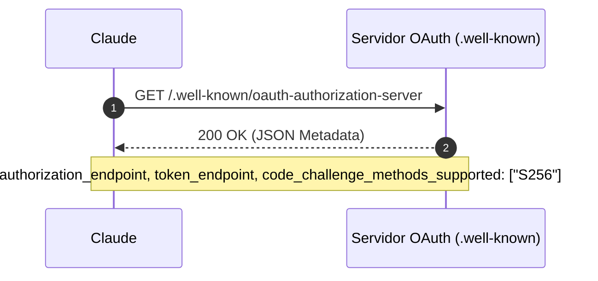
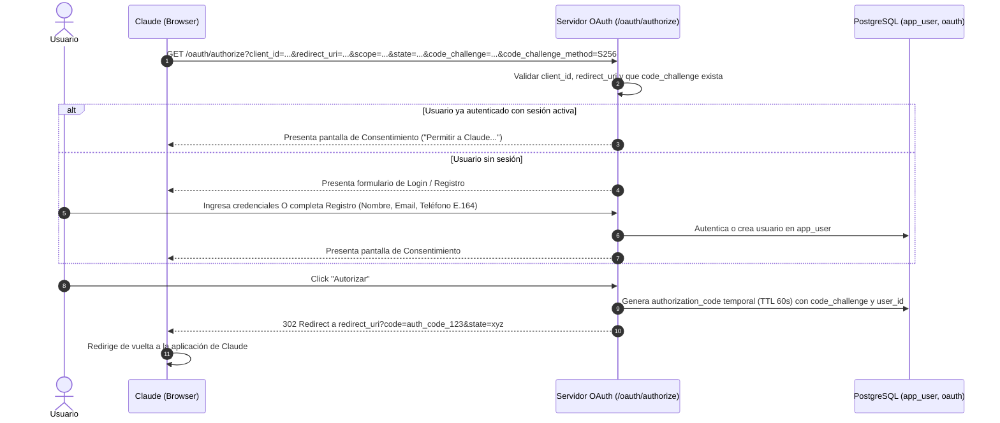
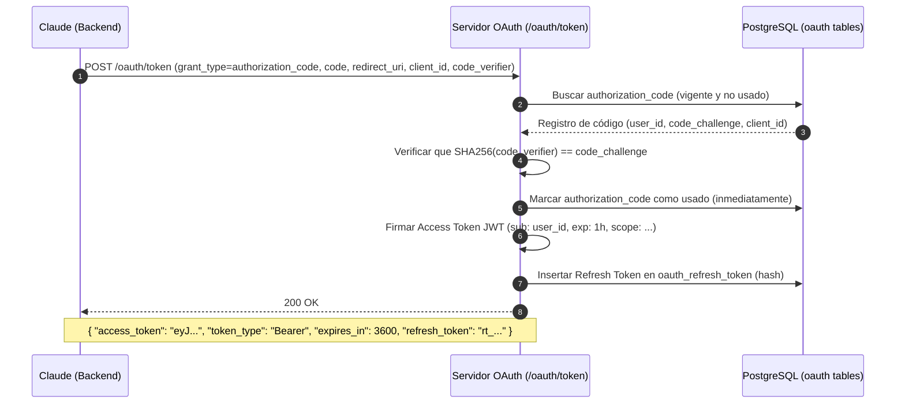

# Servidor de Autorización OAuth 2.0 y Gestión de Usuarios para Atlas MCP

> **Documento de Diseño Técnico y Especificación de Flujos.**  
> **Fecha de creación:** 22 de octubre de 2026.  
> **Estado:** Aprobado para implementación.  
> **Contexto:** Especificación del servidor de autorización OAuth 2.0 integrado en el proyecto para autenticación de Claude, registro de usuarios (onboarding), consentimiento y emisión de tokens.

---

## Índice

1. [Visión General y Justificación](#1-visión-general-y-justificación)
2. [Estándares y RFCs Soportados](#2-estándares-y-rfcs-soportados)
3. [Catálogo de Endpoints OAuth 2.0](#3-catálogo-de-endpoints-oauth-20)
4. [Flujos Técnicos Detallados (Diagramas de Secuencia)](#4-flujos-técnicos-detallados-diagramas-de-secuencia)
5. [Modelo de Persistencia de Usuarios y OAuth (PostgreSQL)](#5-modelo-de-persistencia-de-usuarios-y-oauth-postgresql)
6. [Mecanismo de Onboarding y Verificación](#6-mecanismo-de-onboarding-y-verificación)
7. [Validación de Tokens en el Conector MCP](#7-validación-de-tokens-en-el-conector-mcp)
8. [Estructura del Módulo en Código (`src/Auth/`)](#8-estructura-del-módulo-en-código-srcauth)

---

## 1. Visión General y Justificación

Originalmente se contempló delegar la autenticación en un servicio externo de identidad. Sin embargo, para garantizar **control total del ciclo de vida**, eliminar dependencias externas y asegurar la compatibilidad exacta con los requerimientos de Claude y el proceso de revisión de Anthropic, **el servidor de autorización OAuth 2.0 se implementa como un módulo propio dentro de este proyecto**.

### Objetivos Principales:
1. **Flujo de Autorización Nativo para Claude:** Implementar Authorization Code Flow con **PKCE** (RFC 7636) estricto.
2. **Descubrimiento Automático:** Exponer metadatos OAuth 2.0 (RFC 8414 y RFC 9728) para que Claude descubra automáticamente las URLs del servidor.
3. **Onboarding Express de Usuarios:** Permitir que usuarios nuevos que conectan desde Claude puedan registrarse y verificar su número de WhatsApp/teléfono sin abandonar el flujo.
4. **Cuentas de Prueba para Revisores:** Garantizar cuentas preconfiguradas con acceso completo para la aprobación en el Directorio de Conectores de Anthropic.

---

## 2. Estándares y RFCs Soportados

| RFC | Título | Aplicación en el Conector |
|---|---|---|
| **RFC 6749** | The OAuth 2.0 Authorization Framework | Flujo base de Authorization Code y Refresh Tokens. |
| **RFC 7636** | Proof Key for Code Exchange (PKCE) | **Obligatorio**. Solo método `S256` permitido; previene interceptación de códigos. |
| **RFC 8414** | OAuth 2.0 Authorization Server Metadata | Endpoint de descubrimiento `/.well-known/oauth-authorization-server`. |
| **RFC 9728** | OAuth 2.0 Protected Resource Metadata | Cabeceras `WWW-Authenticate` y descubrimiento de recursos protegidos para MCP. |
| **RFC 7591** | OAuth 2.0 Dynamic Client Registration (DCR) | Endpoint `/oauth/register` para clientes dinámicos como Claude. |
| **RFC 7519** | JSON Web Token (JWT) | Formato de los `access_token` firmados criptográficamente. |
| **RFC 7009** | OAuth 2.0 Token Revocation | Endpoint `/oauth/revoke` para invalidar sesiones desconectadas. |

---

## 3. Catálogo de Endpoints OAuth 2.0

| Endpoint | Método | Autenticación | Propósito |
|---|---|---|---|
| `/.well-known/oauth-authorization-server` | `GET` | Pública | Descubrimiento de metadatos (URLs, PKCE, scopes soportados). |
| `/.well-known/openid-configuration` | `GET` | Pública | Alias estándar de compatibilidad para clientes OpenID Connect. |
| `/.well-known/jwks.json` | `GET` | Pública | Claves públicas para verificación de firmas de Access Tokens. |
| `/oauth/register` | `POST` | Pública / Token | Dynamic Client Registration (DCR) para Claude. |
| `/oauth/authorize` | `GET` / `POST` | Sesión web | Pantalla de inicio de sesión, alta de usuario y consentimiento. |
| `/oauth/token` | `POST` | Basic / Client Secret / PKCE | Emisión y canje de tokens (`authorization_code` y `refresh_token`). |
| `/oauth/revoke` | `POST` | Client Auth | Revocación explícita de tokens (desconexión). |
| `/oauth/userinfo` | `GET` | Bearer Token | Información básica del perfil (`sub`, `email`, `phone_e164`). |

---

## 4. Flujos Técnicos Detallados (Diagramas de Secuencia)

### 4.1 Flujo 1: Descubrimiento de Metadatos (Discovery)

Cuando Claude detecta el servidor MCP o el usuario ingresa la URL:



Respuesta JSON estándar:
```json
{
  "issuer": "https://mcp.atlas.com",
  "authorization_endpoint": "https://mcp.atlas.com/oauth/authorize",
  "token_endpoint": "https://mcp.atlas.com/oauth/token",
  "registration_endpoint": "https://mcp.atlas.com/oauth/register",
  "revocation_endpoint": "https://mcp.atlas.com/oauth/revoke",
  "jwks_uri": "https://mcp.atlas.com/.well-known/jwks.json",
  "response_types_supported": ["code"],
  "grant_types_supported": ["authorization_code", "refresh_token"],
  "code_challenge_methods_supported": ["S256"],
  "scopes_supported": ["bookings:read", "bookings:write", "profile"]
}
```

---

### 4.2 Flujo 2: Autorización, Login / Onboarding y Consentimiento



---

### 4.3 Flujo 3: Canje de Código por Tokens con PKCE (`/oauth/token`)



---

### 4.4 Flujo 4: Renovación de Token (`refresh_token`)

Cuando el `access_token` expira (ej. cada hora), Claude renueva sin interacción del usuario:

1. Claude llama a `POST /oauth/token` con `grant_type=refresh_token&refresh_token=rt_...&client_id=...`.
2. El servidor valida que el hash del `refresh_token` exista y no esté revocado.
3. **Rotación de Refresh Tokens:** Se revoca el refresh token usado y se emite uno nuevo junto con el nuevo `access_token`.

---

## 5. Modelo de Persistencia de Usuarios y OAuth (PostgreSQL)

Se crean tablas dedicadas dentro de la base de datos de PostgreSQL del conector:

```sql
-- =========================================================
-- Usuarios del Sistema
-- =========================================================

CREATE TABLE app_user (
    id                 uuid PRIMARY KEY DEFAULT gen_random_uuid(),
    email              text NOT NULL UNIQUE,
    phone_e164         text NOT NULL UNIQUE CHECK (phone_e164 ~ '^\+[1-9][0-9]{6,14}$'),
    password_hash      text NOT NULL,
    full_name          text NOT NULL,
    is_active          boolean NOT NULL DEFAULT true,
    phone_verified_at  timestamptz,
    created_at         timestamptz NOT NULL DEFAULT now(),
    updated_at         timestamptz NOT NULL DEFAULT now()
);

CREATE INDEX ix_app_user_lookup ON app_user (email, phone_e164);

-- =========================================================
-- Clientes OAuth (Claude Desktop, Claude Web, etc.)
-- =========================================================

CREATE TABLE oauth_client (
    client_id           text PRIMARY KEY,
    client_secret_hash  text,                                -- Nulo para clientes públicos con PKCE
    client_name         text NOT NULL,
    redirect_uris       text[] NOT NULL,
    is_confidential     boolean NOT NULL DEFAULT false,
    created_at          timestamptz NOT NULL DEFAULT now()
);

-- =========================================================
-- Códigos de Autorización Temporales
-- =========================================================

CREATE TABLE oauth_authorization_code (
    code                  text PRIMARY KEY,
    client_id             text NOT NULL REFERENCES oauth_client (client_id) ON DELETE CASCADE,
    user_id               uuid NOT NULL REFERENCES app_user (id) ON DELETE CASCADE,
    redirect_uri          text NOT NULL,
    scope                 text NOT NULL DEFAULT 'bookings:read bookings:write profile',
    code_challenge        text NOT NULL,
    code_challenge_method text NOT NULL CHECK (code_challenge_method = 'S256'),
    expires_at            timestamptz NOT NULL,
    used_at               timestamptz,
    created_at            timestamptz NOT NULL DEFAULT now()
);

CREATE INDEX ix_auth_code_expiry ON oauth_authorization_code (expires_at) WHERE used_at IS NULL;

-- =========================================================
-- Refresh Tokens con Rotación
-- =========================================================

CREATE TABLE oauth_refresh_token (
    token_hash   text PRIMARY KEY,
    client_id    text NOT NULL REFERENCES oauth_client (client_id) ON DELETE CASCADE,
    user_id      uuid NOT NULL REFERENCES app_user (id) ON DELETE CASCADE,
    scope        text NOT NULL,
    revoked_at   timestamptz,
    expires_at   timestamptz NOT NULL,
    created_at   timestamptz NOT NULL DEFAULT now()
);

CREATE INDEX ix_refresh_token_lookup ON oauth_refresh_token (user_id, client_id) WHERE revoked_at IS NULL;
```

---

## 6. Mecanismo de Onboarding y Verificación

Para prevenir cuentas masivas o abusos (Sybil attacks) desde Claude:

1. **Formato E.164 obligatorio:** El número telefónico debe cumplir la norma internacional (ej. `+18091234567`).
2. **Verificación vía WhatsApp / SMS:**
   - Durante el registro, se envía un código OTP de 6 dígitos.
   - Una vez confirmado, se actualiza `phone_verified_at = now()`.
   - Si no se verifica, el usuario no puede emitir reservas (solo consultas).
3. **Cuentas de Prueba Pre-Aprobadas:**
   - Para las pruebas de Anthropic y entornos de homologación, se suministran credenciales fijas pre-verificadas (ej. `reviewer@anthropic.com` / `+18090000000`).

---

## 7. Validación de Tokens en el Conector MCP

El conector MCP integra un **Middleware de Autenticación**:

```
[Claude MCP Request]
        │
        ▼
   Header: Authorization: Bearer <jwt>
        │
        ├── ¿Falta token o mal formado? ───> 401 Unauthorized (WWW-Authenticate)
        │
        ▼
   Validar JWT:
   - Firma criptográfica válida (clave pública local)
   - Expiración: exp > now()
   - Issuer: issuer == "https://mcp.atlas.com"
        │
        ├── ¿Inválido o expirado? ─────────> 401 Unauthorized (error="invalid_token")
        │
        ▼
   Extraer Claims:
   - user_id = jwt.sub
   - scopes  = jwt.scope
        │
        ▼
   Inyectar Contexto:
   - RequestContext.user_id = user_id
        │
        ▼
   Ejecutar Tool MCP solicitado (1 a 10)
```

---

## 8. Estructura del Módulo en Código (`src/Auth/`)

El servidor OAuth se implementa como un módulo cohesivo con FastAPI/Starlette, desacoplado del motor MCP:

```
src/Auth/
├── Domain/
│   ├── Entities/
│   │   ├── AppUser.py
│   │   ├── OAuthClient.py
│   │   └── AuthorizationCode.py
│   ├── ValueObjects/
│   │   ├── Email.py
│   │   ├── PhoneNumberE164.py
│   │   └── PKCEChallenge.py
│   └── Interfaces/
│       ├── IUserRepository.py
│       └── IOAuthTokenRepository.py
│
├── Application/
│   ├── UseCases/
│   │   ├── AuthenticateUserUseCase.py
│   │   ├── RegisterUserUseCase.py
│   │   ├── GenerateAuthorizationCodeUseCase.py
│   │   ├── ExchangeCodeForTokenUseCase.py
│   │   ├── RefreshTokenUseCase.py
│   │   └── RevokeTokenUseCase.py
│   └── Services/
│       ├── TokenService.py            # Generación y firma de JWTs (PyJWT / cryptography)
│       └── PasswordHasher.py          # Hashing con bcrypt / argon2
│
├── Infraestructure/
│   └── Persistence/
│       ├── Repositories/              # Implementación SQLAlchemy de User y OAuth
│       └── Models/                    # Mapeo ORM de tablas app_user, oauth_*
│
└── Presentation/
    ├── App.py                         # Sub-aplicación FastAPI con endpoints OAuth
    ├── Routes/
    │   ├── DiscoveryRoutes.py         # /.well-known/oauth-authorization-server
    │   ├── AuthorizeRoutes.py         # /oauth/authorize (HTML / GET y POST)
    │   ├── TokenRoutes.py             # /oauth/token, /oauth/revoke
    │   └── RegisterRoutes.py          # /oauth/register (DCR)
    └── Templates/                     # Plantillas Jinja2 limpias y accesibles
        ├── login.html
        ├── register.html
        └── consent.html
```

---

## 9. Resumen de Integración

Con esta arquitectura:
* El conector expone tanto los **servicios HTTP de OAuth** (`/oauth/authorize`, `/oauth/token`, etc.) como el **servidor de tools MCP** en una solución unificada.
* La base de usuarios vive en PostgreSQL junto con el resto del sistema, simplificando la gestión de copias de seguridad, consistencia y transaccionalidad.
* Se garantiza el 100% de cumplimiento con las directrices de Anthropic para el Directorio de Conectores.
