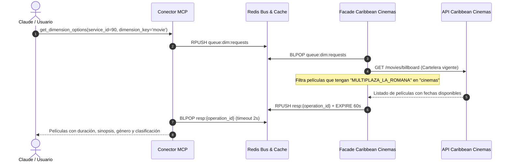
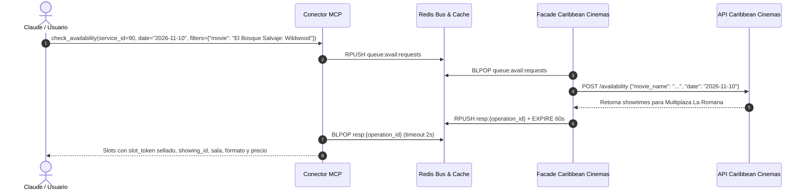

# Guía de Integración Facade / Upstream: Caribbean Cinemas Multiplaza La Romana (Servicio ID: 90)

> **Documento de Especificación de Mensajería e Integración.**  
> **Establecimiento:** Caribbean Cinemas (`id: 91`, `code: 'cc'`)  
> **Servicio:** Caribbean Multiplaza La Romana  
> **Service ID:** `90`  
> **Combo Code:** `cc_multiplaza_la_romana`  
> **Site ID Upstream:** `89`  
> **Patrón:** `slot_object` (cada función/tanda horaria `showing_id` constituye un slot)  
> **Destinatario:** Desarrolladores e ingenieros del servicio Facade / Ejecutor Upstream de Atlas.

---

## 1. Ficha Técnica y Contrato del Servicio

Caribbean Cinemas opera como una cadena/marca paraguas a nivel de establecimiento, donde **cada cine físico es un servicio individual con su propio contrato en Atlas** (ej. Multiplaza La Romana = `service_id: 90`). Este modelo desacoplado permite aislar salas, precios y disponibilidad específicos de cada localidad preservando la base de integración.

### 1.1 Parámetros Generales
| Parámetro | Valor | Descripción |
| :--- | :--- | :--- |
| **`service_id`** | `90` | Identificador único del cine Multiplaza La Romana en Atlas. |
| **`combo_code`** | `cc_multiplaza_la_romana` | Código identificador en el bus de mensajería Redis. |
| **`site_id`** | `89` | Identificador interno de sede en el API de Caribbean Cinemas. |
| **`pattern`** | `slot_object` | Reserva y compra por tanda/función específica (`showing_id`). |
| **`request_ttl_seconds`**| `600` (10 min) | Vigencia del slot token y tiempo para confirmar la compra. |
| **`payment_policy`** | `payment_link` | Se remite enlace seguro digital para emisión de boletos con QR. |
| **`cancellation_policy`**| No permitida | Entradas confirmadas y emitidas no admiten cancelación ni reembolso. |
| **`currency`** | `DOP` | Pesos dominicanos. |
| **`rule_type`** | `None` | Sin esquema restrictivo de antelación; consulta cartelera real. |
| **`has_scheduler`** | `false` | No aplica Queuer de captura previa; tandas inmediatas. |

---

### 1.2 Dimensiones del Contrato (`applied_filters`)

1. **`movie` (Película en Cartelera - Requerida):**
   * `values_source`: `'separate_query'`
   * `apply_mode`: `'upstream_param'`
   * `resolver_ref`: `'cc_movies'`
   * Permite consultar la cartelera vigente proyectada en este cine específico antes de solicitar tandas.
2. **`party_size` (Cantidad de Boletos - Opcional):**
   * `values_source`: `'inline'` (1 a 10 personas)
   * `apply_mode`: `'upstream_param'`
   * Permite calcular el precio total proyectado en la disponibilidad (`party_size * 350.00`).

---

### 1.3 Esquema Tarifario Oficial (Por Persona en DOP)

Multiplaza La Romana cuenta con tarifas por butaca individual:
* **Tarifa General / Adulto:** **RD$ 350.00 DOP** (Tarifa automática por defecto).
* **Tarifa Niños:** **RD$ 200.00 DOP** (Informativa / sujeta a validación en taquilla).

> [!NOTE]
> **Manejo de `ticket_type`:**  
> Por diseño, el campo `ticket_type` **no se expone en el contrato al usuario/agente**. El conector cotiza con la tarifa general (RD$ 350.00) y el Facade computa automáticamente `ticket_type: "Regular"` al invocar el API del cine.

---

## 2. Flujo 1: Consulta de Cartelera Vigente (`get_dimension_options`)

Antes de pedir disponibilidad para un día, el usuario o agente puede explorar las películas que se proyectan en Multiplaza La Romana mediante `get_dimension_options(service_id=90, dimension_key='movie')`.



### 2.1 Mensaje que Recibe el Facade (`queue:dim:requests`)
```json
{
  "service_id": 90,
  "combo_code": "cc_multiplaza_la_romana",
  "user_uuid": "c4d7e231-1829-4d6b-9c71-332998822001",
  "user_phone": "+18095551234",
  "dimension_key": "movie",
  "context": {
    "date": "2026-11-10"
  },
  "context_hash": "a1b2c3d4e5f6...",
  "resolver_ref": "cc_movies"
}
```

### 2.2 Endpoint Upstream del Cine (Cartelera)
El API del cine responde con objetos como este:
```json
[
  {
    "id": "498214",
    "name": "El Bosque Salvaje: Wildwood",
    "synopsis": "Más allá de los límites de la ciudad de Portland...",
    "duration": 131,
    "genre": "Animación",
    "rating": "R/12",
    "poster_image": "https://indy-systems.imgix.net/luwn1ig17s9g0a0wwbyzw6owvfvn",
    "url_slug": "wildwood",
    "trailer_url": "https://www.youtube.com/watch?v=1KfKStJutDM",
    "dates_with_public_showing": [
      "2026-11-10",
      "2026-11-11"
    ],
    "cinemas": [
      "MULTIPLAZA_LA_ROMANA",
      "DOWNTOWN_CENTER",
      "GALERIA_360"
    ]
  }
]
```

### 2.3 Respuesta que el Facade debe Devolver en `resp:{operation_id}`
El Facade filtra las películas proyectadas en Multiplaza La Romana y devuelve las opciones normalizadas:
```json
{
  "status": "completed",
  "options": [
    {
      "value_key": "El Bosque Salvaje: Wildwood",
      "label": "El Bosque Salvaje: Wildwood",
      "description": "Duración: 131 min | Género: Animación | Clasificación: R/12. Fechas: 2026-11-10, 2026-11-11.",
      "position": 1
    },
    {
      "value_key": "La Equina Ta en Candela",
      "label": "La Equina Ta en Candela",
      "description": "Duración: 85 min | Género: Comedia | Clasificación: R/12. Fechas: 2026-11-10, 2026-11-11.",
      "position": 2
    }
  ]
}
```

---

## 3. Flujo 2: Consulta de Disponibilidad de Tandas (`check_availability`)



### 3.1 Mensaje que Recibe el Facade (`queue:avail:requests`)
```json
{
  "operation_id": "op_avail_cc_la_romana_01",
  "type": "availability_request",
  "payload": {
    "service_id": 90,
    "combo_code": "cc_multiplaza_la_romana",
    "user_uuid": "c4d7e231-1829-4d6b-9c71-332998822001",
    "user_phone": "+18095551234",
    "user_email": "juan.perez@gmail.com",
    "date": "2026-11-10",
    "filters": {
      "movie": "El Bosque Salvaje: Wildwood",
      "party_size": 2
    },
    "contract_version": "2026-11-10.1",
    "filter_hash": "c8e10b429fa014e7a891001bfa24e819"
  }
}
```

### 3.2 Llamada Upstream al API de Caribbean Cinemas
El Facade ejecuta la petición upstream:
```json
POST /cinema/availability
{
  "movie_name": "El Bosque Salvaje: Wildwood",
  "date": "2026-11-10",
  "site_id": 89
}
```

Respuesta del API del cine:
```json
{
  "status": "exitoso",
  "found": true,
  "cinema": "MULTIPLAZA_LA_ROMANA",
  "site_id": 89,
  "date": "2026-11-10",
  "movie": {
    "id": "498214",
    "name": "El Bosque Salvaje: Wildwood",
    "duration": 131
  },
  "showtimes": [
    {
      "showing_id": "1093912",
      "time_local": "18:40",
      "time_utc": "2026-11-10T22:40:00Z",
      "screen_id": "755599",
      "seats_remaining": 101,
      "has_seat_chart": true,
      "formats": ["doblada-al-espaol"],
      "available": true,
      "price_card_id": "849314"
    }
  ]
}
```

### 3.3 Respuesta del Facade en `resp:{operation_id}`
El Facade transforma cada elemento de `showtimes` en un slot con la siguiente estructura:
```json
{
  "status": "completed",
  "slots": [
    {
      "offer_ref": "1093912",
      "slot_start": "2026-11-10T18:40:00-04:00",
      "slot_end": "2026-11-10T20:51:00-04:00",
      "is_estimated": false,
      "attributes": {
        "showing_id": "1093912",
        "screen_id": "755599",
        "movie_title": "El Bosque Salvaje: Wildwood",
        "format": "doblada-al-espaol",
        "seats_remaining": 101,
        "has_seat_chart": true,
        "price_card_id": "849314"
      }
    }
  ]
}
```
* **`offer_ref`**: Debe ser obligatoriamente el `showing_id`.
* **`slot_end`**: Calculado sumando la duración de la película (131 min).
* **`attributes`**: Se sellan criptográficamente dentro del `SlotToken` y estarán disponibles intactos en el evento de reserva.

---

## 4. Flujo 3: Selección de Asientos y la Tool `get_seat_map`

### 4.1 Modos de Asignación de Asientos (`seat_mode`)
El contrato define dos modalidades en `booking_fields_schema`:

1. **`seat_mode: "mejor"` (Por Defecto / Modo Rápido):**
   * El usuario o agente indica únicamente `seat_count: 2`.
   * **No es necesario invocar el mapa de asientos.**
   * El motor de Caribbean Cinemas asigna automáticamente las mejores butacas contiguas en el centro de la sala.
2. **`seat_mode: "seleccion"` (Modo Butacas Específicas):**
   * El usuario solicita ver los asientos o elegir una ubicación exacta (ej. fila F, butacas 6 y 7).
   * El agente invoca la tool de mapa de asientos y envía `seat_labels: ["F6", "F7"]`.

### 4.2 Especificación de la Consulta del Mapa de Butacas
Para consultar las butacas de una tanda, el conector despacha la petición sobre la cola `queue:seatmap:requests` con el siguiente sobre canónico:
```json
{
  "operation_id": "op_seat_778899aa1122",
  "type": "seat_map_request",
  "payload": {
    "service_id": 90,
    "combo_code": "cc_multiplaza_la_romana",
    "showing_id": "1093912",
    "user_uuid": "c4d7e231-1829-4d6b-9c71-332998822001",
    "user_phone": "+18095551234"
  },
  "created_at": "2026-11-10T14:20:00Z"
}
```

El Facade consulta el plano de la sala en Caribbean Cinemas y responde mediante `RPUSH` en la lista efímera `resp:{operation_id}` (con `EXPIRE 60s`):
```json
{
  "status": "completed",
  "service_id": 90,
  "showing_id": "1093912",
  "screen_name": "Sala 4",
  "seats_remaining": 101,
  "seat_mode_options": ["mejor", "seleccion"],
  "recommended_seats": ["F6", "F7"],
  "available_seats": ["E4", "E5", "E6", "F6", "F7", "F8", "G5", "G6"],
  "rows": {
    "F": [
      {"label": "F1", "status": "occupied"},
      {"label": "F2", "status": "occupied"},
      {"label": "F5", "status": "available"},
      {"label": "F6", "status": "available", "recommended": true},
      {"label": "F7", "status": "available", "recommended": true}
    ]
  }
}
```

> [!TIP]
> **Caché en Redis de Asientos:**  
> Tras recibir la respuesta del Facade, el Conector MCP guarda el plano en Redis con la clave `mcp:seat:cache:{service_id}:{showing_id}` (ej. `mcp:seat:cache:90:1093912`) con un TTL de 90 segundos para servir consultas subsiguientes en Fast-Path (< 5ms).


---

## 5. Flujo 4: Creación de la Reserva (`create_booking_request`)

Una vez seleccionado el turno y los asientos, el agente invoca `create_booking_request`. El conector MCP almacena la solicitud en estado `requested` y registra el evento `BookingRequested` en el Outbox.

### 5.1 Evento Emitido en Outbox (`BookingRequested`)
El Outbox Relay Worker extrae el evento y lo publica en el canal de eventos:
```json
{
  "event_id": "evt_book_req_99887766",
  "event_type": "BookingRequested",
  "timestamp": "2026-11-10T14:30:00Z",
  "payload": {
    "booking_id": "9c8c153c-449d-44cb-92eb-b12fc0fd1a62",
    "user_uuid": "c4d7e231-1829-4d6b-9c71-332998822001",
    "user_phone": "+18095551234",
    "user_email": "juan.perez@gmail.com",
    "service_id": 90,
    "combo_code": "cc_multiplaza_la_romana",
    "contract_version_id": "eb15ef3c-a2b4-4384-b799-cb8305f23e1e",
    "token_id": "tok_cc_1093912",
    "offer_ref": "1093912",
    "slot_start": "2026-11-10T18:40:00-04:00",
    "slot_end": "2026-11-10T20:51:00-04:00",
    "is_estimated": false,
    "projected_total": 700.0,
    "applied_filters": {
      "movie": "El Bosque Salvaje: Wildwood",
      "movie_title": "El Bosque Salvaje: Wildwood",
      "showing_id": "1093912",
      "screen_id": "755599",
      "format": "doblada-al-espaol"
    },
    "fields": {
      "seat_count": 2,
      "seat_mode": "mejor",
      "seat_labels": ["F6", "F7"],
      "first_name": "Juan",
      "last_name": "Pérez"
    },
    "expires_at": "2026-11-10T14:40:00Z"
  }
}
```

### 5.2 Mapeo al Payload de Caribbean Cinemas
El Facade toma los datos anteriores y construye la solicitud de compra / bloqueo para el API del cine:
```json
POST /cinema/booking
{
  "movie_title": "El Bosque Salvaje: Wildwood",
  "time": "18:40",
  "date": "2026-11-10",
  "showtime_format": "doblada-al-espaol",
  "showing_id": "1093912",
  "seat_count": 2,
  "seat_mode": "mejor",
  "seat_labels": ["F6", "F7"],
  "ticket_type": "Regular",
  "email": "juan.perez@gmail.com",
  "first_name": "Juan",
  "last_name": "Pérez",
  "phone": "18095551234"
}
```
* **`ticket_type`**: El Facade inyecta fijamente `"Regular"` (o la tarifa general del cine).
* **`seat_labels`**: Si `seat_mode == "mejor"`, puede enviarse vacío `[]` o con las butacas preferidas.

---

## 6. Ciclo de Vida de Eventos Upstream hacia el Conector

Tras comunicarse con Caribbean Cinemas, el Facade debe emitir uno de los siguientes eventos en la cola de Inbox del Conector MCP (`queue:events:inbox` o Redis Stream):

### 6.1 Confirmación Exitosa (`BookingConfirmed`)
```json
{
  "event_id": "evt_conf_554433",
  "event_type": "BookingConfirmed",
  "booking_id": "9c8c153c-449d-44cb-92eb-b12fc0fd1a62",
  "external_ref": "CC-TKT-1093912-8821",
  "confirmed_at": "2026-11-10T14:30:15Z",
  "payment_link": "https://caribbeancinemas.com/pay/CC-TKT-1093912-8821",
  "seats_assigned": ["F6", "F7"]
}
```
* Transiciona la reserva a `confirmed` y libera el hold en Redis.
* El usuario recibe el número de ticket y el enlace de pago o boleta digital.

### 6.2 Rechazo Upstream (`BookingRejected`)
```json
{
  "event_id": "evt_rej_554434",
  "event_type": "BookingRejected",
  "booking_id": "9c8c153c-449d-44cb-92eb-b12fc0fd1a62",
  "reason": "Las butacas seleccionadas acaban de ser ocupadas por otro usuario en taquilla."
}
```

### 6.3 Alerta de Confirmación por Discrepancia (`BookingNoticeRaised`)
Si ocurre una variación imprevista en el precio o en los asientos disponibles, el Facade emite:
```json
{
  "event_id": "evt_notice_554435",
  "event_type": "BookingNoticeRaised",
  "booking_id": "9c8c153c-449d-44cb-92eb-b12fc0fd1a62",
  "notice_type": "price_discrepancy",
  "previous_value": 700.0,
  "new_value": 800.0,
  "currency": "DOP",
  "action_required": true,
  "message": "La tarifa por entrada para este formato especial es de RD$ 400.00 (Total: RD$ 800.00). ¿Deseas confirmar?"
}
```
* La reserva se pausa en estado `requires_confirmation`.
* El usuario revisa el aviso y reanuda usando la tool `resolve_booking_notice` (`accepted: true`).
* El conector emite `BookingResumed` para que el Facade complete la compra.

