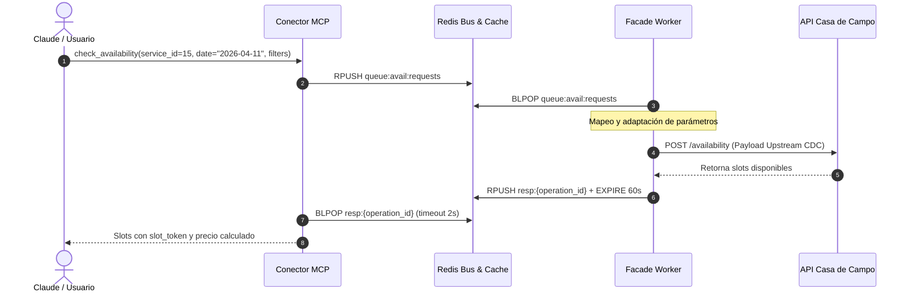
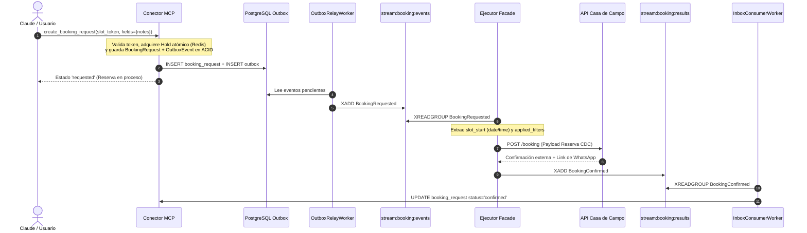

# Guía de Integración Facade / Upstream: Casa de Campo GOLF (Servicio ID: 15)

> **Documento de Especificación de Mensajería e Integración.**  
> **Servicio:** Casa de Campo GOLF  
> **Service ID:** `15`  
> **Patrón:** `slot_object`  
> **Destinatario:** Desarrolladores e ingenieros del servicio Facade / Ejecutor Upstream de Atlas.

---

## 1. Ficha Técnica y Contrato del Servicio

El servicio de Golf en Casa de Campo opera bajo el patrón de turnos fijos (`slot_object`), donde la disponibilidad se consulta por campo, categoría de acceso y cantidad de jugadores, y la reserva física se confirma contra un tee time seleccionado.

### 1.1 Parámetros Generales
| Parámetro | Valor | Descripción |
| :--- | :--- | :--- |
| **`service_id`** | `15` | Identificador único en el catálogo de servicios de Atlas. |
| **`pattern`** | `slot_object` | Reserva por turnos horarios específicos (tee times). |
| **`request_ttl_seconds`** | `900` (15 min) | Vigencia del slot token criptográfico y del hold atómico en Redis. |
| **`payment_policy`** | `payment_link` (WhatsApp) | Casa de Campo envía un enlace de pago oficial por WhatsApp tras reservar. |
| **`cancellation_policy`** | 24 horas antes | Cancelación permitida sin penalidad hasta 24h antes del turno. |
| **`currency`** | `USD` | Moneda estándar de facturación. |

---

### 1.2 Dimensiones del Contrato (`applied_filters`)
El conector MCP expone 3 dimensiones requeridas para este servicio:

1. **`course` (Campo de Golf):**
   * `'TEETH OF THE DOG'` &rarr; Teeth of the Dog (18 hoyos par 72, Pete Dye).
   * `'THE LINKS'` &rarr; The Links (18 hoyos par 71).
   * `'DYE FORE MARINA'` &rarr; Dye Fore - Marina (9 hoyos vista a la marina).
   * `'DYE FORE CHAVON'` &rarr; Dye Fore - Chavón (9 hoyos sobre acantilado del río Chavón).

2. **`season` (Tipo de Acceso / Condición de Estancia):**
   * `'CDC HOTEL GUEST'` &rarr; Huésped registrado del Hotel Casa de Campo.
   * `'CDC PRIVATE VILLA GUEST'` &rarr; Huésped o residente de Villa Privada.
   * `'CDC JUNIOR GOLFER'` &rarr; Golfista Junior (menor de edad).

3. **`party_size` (Cantidad de Jugadores):**
   * `'1'`, `'2'`, `'3'`, `'4'` (Valores numéricos en string en los filtros de MCP).

---

### 1.3 Matriz de Precios Informativos (Por Jugador en USD)
El conector MCP calcula el precio total multiplicando la tarifa unitaria por `party_size`:

| Campo (`course`) | Acceso (`season`) | Tarifa Unitaria (USD) | Base |
| :--- | :--- | :---: | :--- |
| **TEETH OF THE DOG** | `CDC PRIVATE VILLA GUEST` | $649.00 | por persona |
| **TEETH OF THE DOG** | `CDC HOTEL GUEST` | $531.00 | por persona |
| **TEETH OF THE DOG** | `CDC JUNIOR GOLFER` | $324.00 | por persona |
| **THE LINKS** | `CDC PRIVATE VILLA GUEST` | $413.00 | por persona |
| **THE LINKS** | `CDC HOTEL GUEST` | $324.00 | por persona |
| **THE LINKS** | `CDC JUNIOR GOLFER` | **$177.50** | por persona *(Tarifa base)* |
| **DYE FORE MARINA** | `CDC PRIVATE VILLA GUEST` | $531.00 | por persona |
| **DYE FORE MARINA** | `CDC HOTEL GUEST` | $413.00 | por persona |
| **DYE FORE MARINA** | `CDC JUNIOR GOLFER` | $253.70 | por persona |
| **DYE FORE CHAVON** | `CDC PRIVATE VILLA GUEST` | $531.00 | por persona |
| **DYE FORE CHAVON** | `CDC HOTEL GUEST` | $413.00 | por persona |
| **DYE FORE CHAVON** | `CDC JUNIOR GOLFER` | $253.70 | por persona |

---

## 2. Flujo 1: Consulta de Disponibilidad (`check_availability`)



### 2.1 Mensaje que Recibe el Facade (`queue:avail:requests`)
El conector MCP inserta mediante `RPUSH` en la lista Redis `queue:avail:requests`:

```json
{
  "operation_id": "op_avail_e83fa109b4c2",
  "type": "availability_request",
  "payload": {
    "service_id": 15,
    "combo_code": "CDC_GOLF",
    "user_uuid": "c4d7e231-1829-4d6b-9c71-332998822001",
    "user_phone": "+18095551234",
    "user_email": "juan.perez@example.com",
    "date": "2026-04-11",
    "filters": {
      "course": "THE LINKS",
      "season": "CDC HOTEL GUEST",
      "party_size": 2
    },
    "contract_version": "2026-11-03.1",
    "filter_hash": "a4f8d2b901ec4e578bb7690184b2efc0"
  },
  "created_at": "2026-11-03T17:30:00Z"
}
```

### 2.2 Mapeo Facade &rarr; Upstream Casa de Campo
El Facade debe adaptar los filtros de Atlas a las claves que espera el API de Casa de Campo:

| Campo API Casa de Campo | Origen en Payload MCP | Tipo | Ejemplo |
| :--- | :--- | :--- | :--- |
| **`date_str`** | `payload.date` | `string` (YYYY-MM-DD) | `"2026-04-11"` |
| **`golf_course`** | `payload.filters.course` | `string` | `"THE LINKS"` |
| **`season`** | `payload.filters.season` | `string` | `"CDC HOTEL GUEST"` |
| **`players`** | `payload.filters.party_size` | `integer` | `2` |
| **`phone`** | `payload.user_phone` | `string` | `"+18095551234"` |

#### Payload enviado por el Facade al API Upstream:
```json
{
  "date_str": "2026-04-11",
  "golf_course": "THE LINKS",
  "season": "CDC HOTEL GUEST",
  "players": 2,
  "phone": "+18095551234"
}
```

### 2.3 Respuesta del Facade hacia MCP (`resp:{operation_id}`)
El Facade responde en `resp:{operation_id}` (vía `RPUSH` con `EXPIRE 60`):

```json
{
  "operation_id": "op_avail_e83fa109b4c2",
  "status": "completed",
  "result_type": "availability",
  "service_id": 15,
  "contract_version": "2026-11-03.1",
  "filter_hash": "a4f8d2b901ec4e578bb7690184b2efc0",
  "as_of": "2026-11-03T17:30:01Z",
  "slots": [
    {
      "offer_ref": "cdc-links-20260411-0730",
      "slot_start": "2026-04-11T07:30:00-04:00",
      "slot_end": "2026-04-11T12:00:00-04:00",
      "resource_ref": "THE LINKS",
      "resource_name": "The Links - Tee Time 07:30 AM",
      "is_estimated": false,
      "slot_type": "official",
      "attributes": {
        "course": "THE LINKS",
        "holes": 18,
        "season": "CDC HOTEL GUEST",
        "players": 2
      }
    },
    {
      "offer_ref": "cdc-links-20260411-0810",
      "slot_start": "2026-04-11T08:10:00-04:00",
      "slot_end": "2026-04-11T12:40:00-04:00",
      "resource_ref": "THE LINKS",
      "resource_name": "The Links - Tee Time 08:10 AM",
      "is_estimated": false,
      "slot_type": "official",
      "attributes": {
        "course": "THE LINKS",
        "holes": 18,
        "season": "CDC HOTEL GUEST",
        "players": 2
      }
    }
  ]
}
```

---

## 3. Flujo 2: Ciclo de Reserva (`create_booking_request`)



### 3.1 Evento Emitido por MCP (`stream:booking:events`)
El `OutboxRelayWorker` de MCP publica en el stream `stream:booking:events`:

* **`event_type`:** `"BookingRequested"`
* **Payload:**

```json
{
  "event_id": "7b8e1f02-a19c-4b62-95f3-c5b89a01e33d",
  "aggregate_id": "d4e21a88-91c0-482a-b732-ee192b0c3fa1",
  "event_type": "BookingRequested",
  "correlation_id": "idemp-client-key-88219",
  "payload": {
    "booking_id": "d4e21a88-91c0-482a-b732-ee192b0c3fa1",
    "user_uuid": "c4d7e231-1829-4d6b-9c71-332998822001",
    "user_phone": "+18095551234",
    "user_email": "juan.perez@example.com",
    "service_id": 15,
    "combo_code": "CDC_GOLF",
    "contract_version_id": "f5127b8a-912c-47bc-bb39-01c9a87d2ef1",
    "token_id": "tok_b4c9103e8fa1",
    "offer_ref": "cdc-teeth-20260411-0730",
    "slot_start": "2026-04-11T07:30:00-04:00",
    "slot_end": "2026-04-11T12:00:00-04:00",
    "is_estimated": false,
    "applied_filters": {
      "course": "TEETH OF THE DOG",
      "season": "CDC HOTEL GUEST",
      "party_size": 2
    },
    "fields": {
      "notes": "Requerimos 2 sets de palos para diestros"
    },
    "expires_at": "2026-11-03T17:45:00Z"
  },
  "created_at": "2026-11-03T17:30:00Z"
}
```

---

### 3.2 Mapeo Facade / Ejecutor &rarr; Upstream Casa de Campo (Payload de Reserva)

El Ejecutor construye el payload exacto requerido por Casa de Campo extrayendo los componentes de `slot_start` y `applied_filters`:

| Campo Upstream CDC | Origen en `BookingRequested` | Extracción / Transformación |
| :--- | :--- | :--- |
| **`date`** | `payload.slot_start` | Parte de fecha ISO (`"YYYY-MM-DD"`) &rarr; `"2026-04-11"` |
| **`time`** | `payload.slot_start` | Hora y minuto (`"HH:MM"`) &rarr; `"07:30"` |
| **`players`** | `payload.applied_filters.party_size` | Convertido a entero (`int`) &rarr; `2` |
| **`course`** | `payload.applied_filters.course` | String idéntico &rarr; `"TEETH OF THE DOG"` |
| **`season`** | `payload.applied_filters.season` | String idéntico &rarr; `"CDC HOTEL GUEST"` |

#### Payload enviado a Casa de Campo:
```json
{
  "date": "2026-04-11",
  "time": "07:30",
  "players": 2,
  "course": "TEETH OF THE DOG",
  "season": "CDC HOTEL GUEST"
}
```

> [!NOTE]
> **Datos de Contacto del Usuario:**
> El evento `BookingRequested` incluye automáticamente los datos de contacto del usuario autenticado en Atlas:
> * `payload.user_phone` (`"+18095551234"`): Teléfono al que Casa de Campo enviará el enlace de pago seguro vía WhatsApp.
> * `payload.user_email` (`"juan.perez@example.com"`): Correo electrónico para el envío de confirmación digital, voucher y recibo oficial del club.

---

### 3.3 Respuesta del Ejecutor hacia MCP (`stream:booking:results`)

Una vez que el Ejecutor recibe la respuesta de Casa de Campo, emite el resultado al stream `stream:booking:results`.

#### A. Caso Exitoso (`BookingConfirmed` o `BookingAccepted`)
```json
{
  "event_id": "c1a93e88-4210-410a-b283-f39001182abc",
  "aggregate_id": "d4e21a88-91c0-482a-b732-ee192b0c3fa1",
  "event_type": "BookingConfirmed",
  "correlation_id": "idemp-client-key-88219",
  "payload": {
    "booking_id": "d4e21a88-91c0-482a-b732-ee192b0c3fa1",
    "service_id": 15,
    "status": "confirmed",
    "external_ref": "CDC-TEE-99812",
    "message": "Reserva confirmada exitosamente en Teeth of the Dog. Se ha enviado un enlace de pago oficial a tu WhatsApp para formalizar el turno.",
    "payment_info": {
      "channel": "whatsapp",
      "currency": "USD",
      "recipient_phone": "+18095551234"
    }
  },
  "created_at": "2026-11-03T17:30:05Z"
}
```

#### B. Caso Rechazado por el Club (`BookingRejected`)
Si el tee time fue ocupado en el lapso o el club rechaza la solicitud:
```json
{
  "event_id": "e581029c-1122-4a0b-8877-bb2233445566",
  "aggregate_id": "d4e21a88-91c0-482a-b732-ee192b0c3fa1",
  "event_type": "BookingRejected",
  "correlation_id": "idemp-client-key-88219",
  "payload": {
    "booking_id": "d4e21a88-91c0-482a-b732-ee192b0c3fa1",
    "service_id": 15,
    "status": "rejected",
    "reason": "El tee time de las 07:30 AM ya no se encuentra disponible en Teeth of the Dog. Por favor consulte horarios alternativos."
  },
  "created_at": "2026-11-03T17:30:05Z"
}
```

---

## 4. Flujo 3: Cancelación de Reserva (`cancel_booking`)

Si el usuario solicita cancelar su reserva con `cancel_booking` desde Claude:

### 4.1 Evento `CancellationRequested` en `stream:booking:events`
```json
{
  "event_id": "a9812c30-410a-4a0b-9912-cc8811223344",
  "aggregate_id": "d4e21a88-91c0-482a-b732-ee192b0c3fa1",
  "event_type": "CancellationRequested",
  "correlation_id": "d4e21a88-91c0-482a-b732-ee192b0c3fa1",
  "payload": {
    "booking_id": "d4e21a88-91c0-482a-b732-ee192b0c3fa1",
    "user_uuid": "c4d7e231-1829-4d6b-9c71-332998822001",
    "user_phone": "+18095551234",
    "user_email": "juan.perez@example.com",
    "service_id": 15,
    "combo_code": "CDC_GOLF",
    "external_ref": "CDC-TEE-99812",
    "reason": "Cambio en itinerario de viaje."
  },
  "created_at": "2026-11-03T18:00:00Z"
}
```

### 4.2 Resultado del Ejecutor en `stream:booking:results`
```json
{
  "event_id": "b11029c0-9988-4411-aa33-dd4455667788",
  "aggregate_id": "d4e21a88-91c0-482a-b732-ee192b0c3fa1",
  "event_type": "BookingCancelled",
  "correlation_id": "d4e21a88-91c0-482a-b732-ee192b0c3fa1",
  "payload": {
    "booking_id": "d4e21a88-91c0-482a-b732-ee192b0c3fa1",
    "service_id": 15,
    "status": "cancelled",
    "message": "La reserva en Teeth of the Dog fue cancelada exitosamente."
  },
  "created_at": "2026-11-03T18:00:03Z"
}
```

---

## 5. Resumen de Canales de Redis para el Facade

| Función | Canal Redis | Tipo | Sentido |
| :--- | :--- | :--- | :--- |
| **Petición Disponibilidad** | `queue:avail:requests` | Redis List (`BLPOP`) | MCP &rarr; Facade |
| **Respuesta Disponibilidad** | `resp:{operation_id}` | Redis List (`RPUSH`) | Facade &rarr; MCP |
| **Caché Opcional Canónica** | `avail:cache:15:{version}:{hash}` | String / JSON (`SET EX 600`) | Facade / MCP |
| **Eventos de Reserva** | `stream:booking:events` | Redis Stream (`XREADGROUP`) | MCP &rarr; Ejecutor |
| **Resultados de Reserva** | `stream:booking:results` | Redis Stream (`XADD`) | Ejecutor &rarr; MCP |

