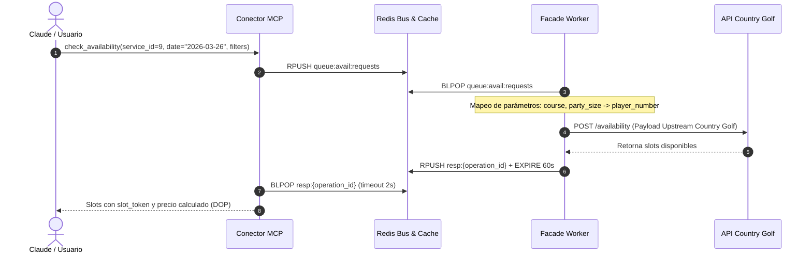
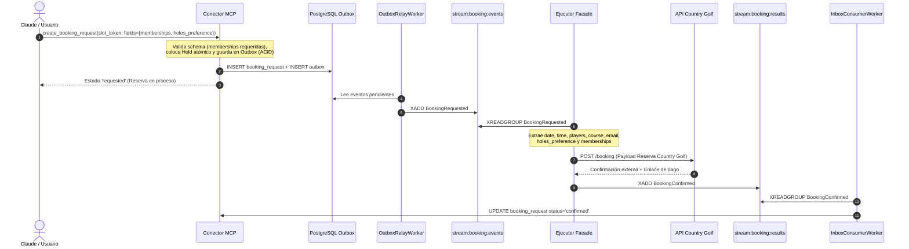

# Guía de Integración Facade / Upstream: Country Golf (Servicio ID: 9)

> **Documento de Especificación de Mensajería e Integración.**  
> **Servicio:** Country Golf  
> **Service ID:** `9`  
> **Patrón:** `slot_object`  
> **Destinatario:** Desarrolladores e ingenieros del servicio Facade / Ejecutor Upstream de Atlas.

---

## 1. Ficha Técnica y Contrato del Servicio

El servicio de Golf en Country Golf opera bajo el patrón de turnos fijos (`slot_object`), donde la disponibilidad se consulta por campo, preferencia de hoyos (9 o 18) y cantidad de jugadores, y la reserva requiere obligatoriamente registrar un número de membresía o carnet de socio por cada jugador.

### 1.1 Parámetros Generales
| Parámetro | Valor | Descripción |
| :--- | :--- | :--- |
| **`service_id`** | `9` | Identificador único en el catálogo de servicios de Atlas. |
| **`pattern`** | `slot_object` | Reserva por turnos horarios específicos (tee times). |
| **`request_ttl_seconds`** | `900` (15 min) | Vigencia del slot token criptográfico y del hold atómico en Redis. |
| **`payment_policy`** | `payment_link` | El club envía un enlace de pago seguro para formalizar la reserva. |
| **`cancellation_policy`** | 24 horas antes | Cancelación permitida sin penalidad hasta 24h antes del turno. |
| **`currency`** | `DOP` | Moneda oficial en pesos dominicanos. |

---

### 1.2 Dimensiones del Contrato (`applied_filters`)
El conector MCP expone 3 dimensiones para este servicio:

1. **`course` (Campo de Golf):**
   * `'Campo Senior'` &rarr; Campo principal y tradicional (18 hoyos).
   * `'Los Robles'` &rarr; Campo ejecutivo Los Robles.
   * `apply_mode`: `'upstream_param'` (requerido para consultar disponibilidad al API del club).

2. **`holes_preference` (Preferencia de Hoyos):**
   * `'18'` &rarr; Recorrido completo de 18 hoyos.
   * `'9'` &rarr; Recorrido corto de 9 hoyos.
   * `apply_mode`: `'upstream_param'` (se envía como parámetro upstream al Facade para que filtre los turnos antes de responder, garantizando la cotización de tarifa exacta).

3. **`party_size` (Cantidad de Jugadores):**
   * `'1'`, `'2'`, `'3'`, `'4'`.
   * `apply_mode`: `'upstream_param'` (el Facade lo adapta a `player_number` en disponibilidad y `players` en reserva).

---

### 1.3 Matriz de Precios Oficiales (Por Jugador en DOP)
El conector MCP calcula el precio total multiplicando la tarifa unitaria por `party_size`:

| Campo (`course`) | Recorrido (`holes_preference`) | Tarifa Unitaria (DOP) | Base |
| :--- | :--- | :---: | :--- |
| **Campo Senior** | `18` Hoyos | **$1,750.00 DOP** | por persona |
| **Campo Senior** | `9` Hoyos | **$1,300.00 DOP** | por persona |
| **Los Robles** | `9` Hoyos | **$875.00 DOP** | por persona |
| **Los Robles** | `18` Hoyos | **$870.00 DOP** | por persona *(Tarifa base)* |

---

## 2. Flujo 1: Consulta de Disponibilidad (`check_availability`)



### 2.1 Mensaje que Recibe el Facade (`queue:avail:requests`)
El conector MCP inserta mediante `RPUSH` en la lista Redis `queue:avail:requests`:

```json
{
  "operation_id": "op_avail_f92ca100b7d1",
  "type": "availability_request",
  "payload": {
    "service_id": 9,
    "combo_code": "COUNTRY_GOLF",
    "user_uuid": "c4d7e231-1829-4d6b-9c71-332998822001",
    "user_phone": "+18095551234",
    "user_email": "rbordav@gmail.com",
    "date": "2026-03-26",
    "filters": {
      "course": "Campo Senior",
      "holes_preference": "18",
      "party_size": 1
    },
    "contract_version": "2026-11-04.1",
    "filter_hash": "c8e10b429fa014e7a891001bfa24e819"
  },
  "created_at": "2026-11-04T09:10:00Z"
}
```

### 2.2 Mapeo Facade &rarr; Upstream Country Golf
El Facade adapta la solicitud a los campos exactos del API de Country Golf:

| Campo API Country Golf / Filtro Facade | Origen en Payload MCP | Tipo | Ejemplo |
| :--- | :--- | :--- | :--- |
| **`start`** | `payload.date` | `string` (datetime ISO) | `"2026-03-26T00:00:00"` |
| **`player_number`** | `payload.filters.party_size` | `integer` | `1` |
| **`phone`** | `payload.user_phone` | `string` | `"+18095551234"` |
| **`course`** | `payload.filters.course` | `string` | `"Campo Senior"` |
| **`holes_preference`** | `payload.filters.holes_preference` | `string` (`"9"` o `"18"`) | `"18"` |

> [!TIP]
> **Filtrado previo en el Facade:**  
> Como `holes_preference` viaja con `apply_mode: upstream_param`, el Facade debe utilizar este valor para filtrar los slots que devuelve hacia el conector MCP, garantizando que el motor de precios aplique la regla exacta de 9 o 18 hoyos según corresponda.

#### Payload enviado por el Facade al API Upstream:
```json
{
  "start": "2026-03-26T00:00:00",
  "player_number": 1,
  "phone": "+18095551234",
  "course": "Campo Senior"
}
```

### 2.3 Respuesta del Facade hacia MCP (`resp:{operation_id}`)
```json
{
  "operation_id": "op_avail_f92ca100b7d1",
  "status": "completed",
  "result_type": "availability",
  "service_id": 9,
  "contract_version": "2026-11-04.1",
  "filter_hash": "c8e10b429fa014e7a891001bfa24e819",
  "as_of": "2026-11-04T09:10:01Z",
  "slots": [
    {
      "offer_ref": "cg-senior-20260326-1330",
      "slot_start": "2026-03-26T13:30:00-04:00",
      "slot_end": "2026-03-26T17:30:00-04:00",
      "resource_ref": "Campo Senior",
      "resource_name": "Campo Senior - Tee Time 01:30 PM",
      "is_estimated": false,
      "slot_type": "official",
      "attributes": {
        "course": "Campo Senior",
        "holes": 18
      }
    }
  ]
}
```

---

## 3. Flujo 2: Ciclo de Reserva (`create_booking_request`)



### 3.1 Evento Emitido por MCP (`stream:booking:events`)
El `OutboxRelayWorker` publica en el stream `stream:booking:events`:

* **`event_type`:** `"BookingRequested"`
* **Payload:**

```json
{
  "event_id": "8c91a02b-1122-4433-88aa-bbccddeeff00",
  "aggregate_id": "e5f61a77-92b0-493a-c843-ff203c1d4fa2",
  "event_type": "BookingRequested",
  "correlation_id": "idemp-key-cg-99120",
  "payload": {
    "booking_id": "e5f61a77-92b0-493a-c843-ff203c1d4fa2",
    "user_uuid": "c4d7e231-1829-4d6b-9c71-332998822001",
    "user_phone": "+18095551234",
    "user_email": "rbordav@gmail.com",
    "service_id": 9,
    "combo_code": "COUNTRY_GOLF",
    "contract_version_id": "a123bcde-4567-8901-2345-6789abcdef01",
    "token_id": "tok_c9102ef81a",
    "offer_ref": "cg-senior-20260326-1330",
    "slot_start": "2026-03-26T13:30:00-04:00",
    "slot_end": "2026-03-26T17:30:00-04:00",
    "is_estimated": false,
    "applied_filters": {
      "course": "Campo Senior",
      "holes_preference": "18",
      "party_size": 1
    },
    "fields": {
      "memberships": ["6966-C"],
      "holes_preference": "18",
      "email": "rbordav@gmail.com",
      "notes": "Requiere caddie asignado"
    },
    "expires_at": "2026-11-04T09:25:00Z"
  },
  "created_at": "2026-11-04T09:10:00Z"
}
```

---

### 3.2 Mapeo Facade / Ejecutor &rarr; Upstream Country Golf (Payload de Reserva)

El Ejecutor construye el payload físico de reserva para el club:

| Campo Upstream Country Golf | Origen en `BookingRequested` | Extracción / Transformación |
| :--- | :--- | :--- |
| **`date`** | `payload.slot_start` | Parte fecha ISO (`"YYYY-MM-DD"`) &rarr; `"2026-03-26"` |
| **`time`** | `payload.slot_start` | Hora y minuto (`"HH:MM"`) &rarr; `"13:30"` |
| **`players`** | `payload.applied_filters.party_size` | Entero (`int`) &rarr; `1` |
| **`course`** | `payload.applied_filters.course` | String idéntico &rarr; `"Campo Senior"` |
| **`email`** | `payload.fields.email` o `payload.user_email` | Correo electrónico &rarr; `"rbordav@gmail.com"` |
| **`holes_preference`** | `payload.fields.holes_preference` o `applied_filters.holes_preference` | String `"9"` o `"18"` &rarr; `"18"` |
| **`memberships`** | `payload.fields.memberships` | Array de strings con 1 carnet por jugador &rarr; `["6966-C"]` |

#### Payload enviado a Country Golf:
```json
{
  "date": "2026-03-26",
  "time": "13:30",
  "players": 1,
  "course": "Campo Senior",
  "email": "rbordav@gmail.com",
  "holes_preference": "18",
  "memberships": ["6966-C"]
}
```

> [!IMPORTANT]
> **Regla de Membresías por Jugador:**  
> La cantidad de carnets en `memberships` debe ser exactamente igual a `players`. Si `players` es 2, el array debe contener 2 membresías (ej. `["6966-C", "10442-A"]`).

---

### 3.3 Respuesta del Ejecutor hacia MCP (`stream:booking:results`)

#### A. Caso Exitoso (`BookingConfirmed`)
```json
{
  "event_id": "d2b91011-3344-5566-7788-99aabbccddee",
  "aggregate_id": "e5f61a77-92b0-493a-c843-ff203c1d4fa2",
  "event_type": "BookingConfirmed",
  "correlation_id": "idemp-key-cg-99120",
  "payload": {
    "booking_id": "e5f61a77-92b0-493a-c843-ff203c1d4fa2",
    "service_id": 9,
    "status": "confirmed",
    "external_ref": "CG-RES-44819",
    "message": "Reserva confirmada en Campo Senior (18 hoyos) para socio carnet 6966-C. El enlace de pago fue enviado a rbordav@gmail.com / WhatsApp.",
    "payment_info": {
      "channel": "payment_link",
      "currency": "DOP",
      "amount": 1750.00
    }
  },
  "created_at": "2026-11-04T09:10:04Z"
}
```

#### B. Caso Rechazado (`BookingRejected`)
```json
{
  "event_id": "f3c01122-4455-6677-8899-001122334455",
  "aggregate_id": "e5f61a77-92b0-493a-c843-ff203c1d4fa2",
  "event_type": "BookingRejected",
  "correlation_id": "idemp-key-cg-99120",
  "payload": {
    "booking_id": "e5f61a77-92b0-493a-c843-ff203c1d4fa2",
    "service_id": 9,
    "status": "rejected",
    "reason": "La membresía 6966-C no se encuentra activa o presenta cargos pendientes en el club."
  },
  "created_at": "2026-11-04T09:10:04Z"
}
```

---

## 4. Flujo 3: Cancelación de Reserva (`cancel_booking`)

### 4.1 Evento `CancellationRequested` en `stream:booking:events`
```json
{
  "event_id": "b8812c40-510b-4b0c-9923-dd9911223355",
  "aggregate_id": "e5f61a77-92b0-493a-c843-ff203c1d4fa2",
  "event_type": "CancellationRequested",
  "correlation_id": "e5f61a77-92b0-493a-c843-ff203c1d4fa2",
  "payload": {
    "booking_id": "e5f61a77-92b0-493a-c843-ff203c1d4fa2",
    "user_uuid": "c4d7e231-1829-4d6b-9c71-332998822001",
    "user_phone": "+18095551234",
    "user_email": "rbordav@gmail.com",
    "service_id": 9,
    "combo_code": "COUNTRY_GOLF",
    "external_ref": "CG-RES-44819",
    "reason": "Cancelación solicitada por el usuario antes de las 24 horas reglamentarias."
  },
  "created_at": "2026-11-04T10:00:00Z"
}
```

### 4.2 Resultado del Ejecutor en `stream:booking:results`
```json
{
  "event_id": "c99029d0-8877-4422-bb44-ee5566778899",
  "aggregate_id": "e5f61a77-92b0-493a-c843-ff203c1d4fa2",
  "event_type": "BookingCancelled",
  "correlation_id": "e5f61a77-92b0-493a-c843-ff203c1d4fa2",
  "payload": {
    "booking_id": "e5f61a77-92b0-493a-c843-ff203c1d4fa2",
    "service_id": 9,
    "status": "cancelled",
    "message": "La reserva en Campo Senior fue cancelada exitosamente sin penalidad."
  },
  "created_at": "2026-11-04T10:00:03Z"
}
```

---

## 5. Resumen de Canales de Redis para el Facade

| Función | Canal Redis | Tipo | Sentido |
| :--- | :--- | :--- | :--- |
| **Petición Disponibilidad** | `queue:avail:requests` | Redis List (`BLPOP`) | MCP &rarr; Facade |
| **Respuesta Disponibilidad** | `resp:{operation_id}` | Redis List (`RPUSH`) | Facade &rarr; MCP |
| **Caché Opcional Canónica** | `avail:cache:9:{version}:{hash}` | String / JSON (`SET EX 600`) | Facade / MCP |
| **Eventos de Reserva** | `stream:booking:events` | Redis Stream (`XREADGROUP`) | MCP &rarr; Ejecutor |
| **Resultados de Reserva** | `stream:booking:results` | Redis Stream (`XADD`) | Ejecutor &rarr; MCP |

