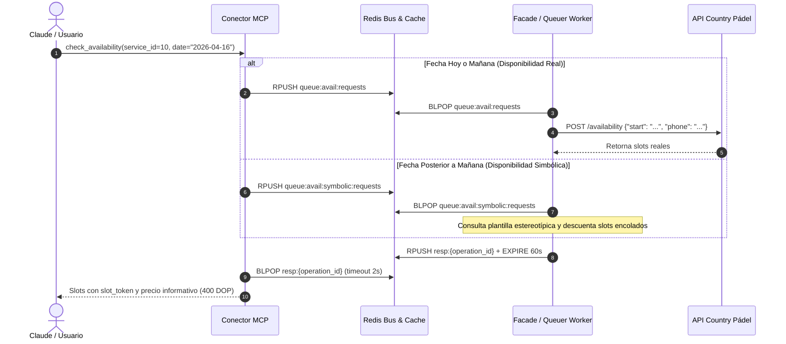
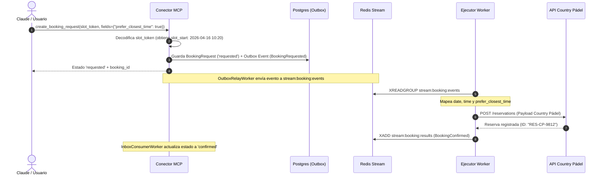

# Guía de Integración Facade / Upstream: Country Pádel (Servicio ID: 10)

> **Documento de Especificación de Mensajería e Integración.**  
> **Servicio:** Country Pádel (Santo Domingo Country Club)  
> **Service ID:** `10`  
> **Patrón:** `slot_object`  
> **Destinatario:** Desarrolladores e ingenieros del servicio Facade / Ejecutor Upstream de Atlas.

---

## 1. Ficha Técnica y Contrato del Servicio

El servicio de Pádel en el Santo Domingo Country Club opera bajo el patrón de turnos fijos de cancha (`slot_object`). La disponibilidad se consulta por fecha y teléfono de socio, y la reserva se formaliza por **cancha completa**, no por cantidad de personas ni mediante rastreo individual de miembros.

### 1.1 Parámetros Generales
| Parámetro | Valor | Descripción |
| :--- | :--- | :--- |
| **`service_id`** | `10` | Identificador único en el catálogo de servicios de Atlas. |
| **`pattern`** | `slot_object` | Reserva por turnos horarios en canchas de pádel. |
| **`request_ttl_seconds`** | `900` (15 min) | Vigencia del slot token criptográfico y del hold atómico en Redis. |
| **`payment_policy`** | `payment_link` | El club envía un enlace de pago seguro para completar y garantizar el turno. |
| **`cancellation_policy`** | 24 horas antes | Cancelación permitida sin penalidad hasta 24h antes del turno. |
| **`currency`** | `DOP` | Moneda oficial en pesos dominicanos. |
| **`rule_type`** | `today_and_tomorrow` | El club publica únicamente horarios para hoy y mañana; días posteriores corren por disponibilidad simbólica (Queuer). |
| **`has_scheduler`** | `true` | Admite agendamiento previo mediante el Queuer en fechas no publicadas todavía por el club. |

---

### 1.2 Regla de Tarifa Plana por Cancha
A diferencia de servicios como Golf (donde se cobra por jugador), en Country Pádel la tarifa es **por reserva de cancha completa**:

| Servicio | Tarifa | Base de Cálculo | Moneda |
| :--- | :---: | :---: | :---: |
| **Alquiler Cancha de Pádel** | **$400.00 DOP** | `per_booking` (por cancha/turno) | DOP |

* El conector MCP cotiza automáticamente **RD$ 400.00** por turno, independientemente de la cantidad de personas que jueguen en la cancha.

---

### 1.3 Ausencia de Carnets / Membresías en el Payload
En Country Pádel **no es necesario** pasar una lista de membresías ni números de carnet de jugadores:
- Se reserva la cancha completa, sin rastreo individual de integrantes.
- El sistema de reservas del club asocia la reserva automáticamente al número de membresía por defecto registrado en el perfil del socio autenticado (`user_phone` / `user_uuid`).

---

## 2. Flujo 1: Consulta de Disponibilidad (`check_availability`)

El conector MCP bifurca automáticamente la consulta de disponibilidad según la fecha solicitada:
1. **Hoy y Mañana (`date <= today + 1`):** Se enruta a `queue:avail:requests` para consultar disponibilidad real contra el API del club.
2. **Días Posteriores (`date > today + 1`):** Se enruta a `queue:avail:symbolic:requests` para que el Servicio de Reservas / Queuer retorne los slots estereotípicos estimados.



---

### 2.1 Mensaje que Recibe el Facade / Queuer (`queue:avail:requests` o `queue:avail:symbolic:requests`)

El conector MCP inserta mediante `RPUSH` un envelope estandarizado:

```json
{
  "operation_id": "op_avail_e83bc211a4e2",
  "type": "availability_request",
  "payload": {
    "service_id": 10,
    "combo_code": "COUNTRY_PADEL",
    "user_uuid": "c4d7e231-1829-4d6b-9c71-332998822001",
    "user_phone": "+18095551234",
    "user_email": "socio@countryclub.do",
    "date": "2026-04-16",
    "filters": {},
    "contract_version": "2026-11-04.1",
    "filter_hash": "a1b2c3d4e5f6789012345678abcdef01"
  },
  "created_at": "2026-11-04T16:00:00Z"
}
```

---

### 2.2 Payload que el Facade debe Enviar al API de Country Pádel

El Facade extrae la fecha solicitada y el teléfono del socio para invocar al backend del club:

```json
{
  "start": "2026-04-16T10:20:00Z",
  "phone": "+18095551234"
}
```

* **`start`**: Fecha y hora solicitada en formato ISO 8601 (o inicio del día).
* **`phone`**: Teléfono del socio en formato internacional (E.164).

---

### 2.3 Respuesta que el Facade / Queuer debe Devolver al MCP

El Facade debe depositar el resultado en `resp:{operation_id}` (o en `op:{operation_id}` si demora más de 2 segundos):

```json
{
  "operation_id": "op_avail_e83bc211a4e2",
  "status": "completed",
  "result_type": "availability",
  "service_id": 10,
  "contract_version": "2026-11-04.1",
  "filter_hash": "a1b2c3d4e5f6789012345678abcdef01",
  "as_of": "2026-11-04T16:00:01.200000Z",
  "slots": [
    {
      "offer_ref": "cp-slot-court1-1020",
      "slot_start": "2026-04-16T10:20:00Z",
      "slot_end": "2026-04-16T11:50:00Z",
      "resource_ref": "cancha-1",
      "resource_name": "Pista Panorámica 1",
      "is_estimated": false,
      "slot_type": "official",
      "notice": null,
      "attributes": {
        "court_type": "panoramica",
        "indoor": false
      }
    },
    {
      "offer_ref": "cp-slot-court2-1020",
      "slot_start": "2026-04-16T10:20:00Z",
      "slot_end": "2026-04-16T11:50:00Z",
      "resource_ref": "cancha-2",
      "resource_name": "Pista Techada 2",
      "is_estimated": false,
      "slot_type": "official",
      "notice": null,
      "attributes": {
        "court_type": "techada",
        "indoor": true
      }
    }
  ]
}
```

> **Campos Críticos de Retorno:**
> 1. **`echo` de claves de caché:** El Facade **debe retornar** `service_id`, `contract_version` y `filter_hash` tal como los recibió en la solicitud, para que el MCP guarde la respuesta en su caché determinista.
> 2. **`is_estimated`:**
>    - Si es `false` (horario oficial del club), el MCP adquirirá un hold atómico en Redis al momento de reservar.
>    - Si es `true` (slot simbólico del Queuer), el MCP **no** colocará hold físico y registrará la reserva para ser agendada en la cola del Queuer.

---

### 2.4 Respuesta de Fallo Upstream

Si la consulta falla o el backend del club responde con error:

```json
{
  "operation_id": "op_avail_e83bc211a4e2",
  "status": "failed",
  "result_type": "internal_error",
  "detail": "Timeout al conectar con el servidor de reservas del Country Club.",
  "error": "Timeout al conectar con el servidor de reservas del Country Club."
}
```
* **`result_type: "internal_error"`**: El MCP registrará el `detail` en los logs y retornará al usuario un mensaje genérico de dificultades técnicas.
* **`result_type: "error_to_user"`**: El MCP transmitirá el `detail` directamente al usuario (ej. *"El socio no cuenta con cuotas vigentes para consultar disponibilidad"*).

---

## 3. Flujo 2: Creación de Reserva (`create_booking_request`)



---

### 3.1 Evento Emitido por el MCP (`BookingRequested`) en `stream:booking:events`

```json
{
  "event_id": "evt_7b19a200f3c1",
  "event_type": "BookingRequested",
  "aggregate_id": "a1b2c3d4-e5f6-7890-abcd-ef1234567890",
  "correlation_id": "idemp_cp_20260416_01",
  "created_at": "2026-11-04T16:05:00Z",
  "payload": {
    "booking_id": "a1b2c3d4-e5f6-7890-abcd-ef1234567890",
    "user_uuid": "c4d7e231-1829-4d6b-9c71-332998822001",
    "user_phone": "+18095551234",
    "user_email": "socio@countryclub.do",
    "service_id": 10,
    "combo_code": "COUNTRY_PADEL",
    "contract_version_id": "99887766-5544-3322-1100-aabbccddeeff",
    "token_id": "tok_9f8e7d6c5b4a",
    "offer_ref": "cp-slot-court1-1020",
    "slot_start": "2026-04-16T10:20:00Z",
    "slot_end": "2026-04-16T11:50:00Z",
    "is_estimated": false,
    "applied_filters": {},
    "fields": {
      "prefer_closest_time": true,
      "email": "socio@countryclub.do",
      "notes": "Pista panorámica solicitada"
    },
    "expires_at": "2026-11-04T16:20:00Z"
  }
}
```

---

### 3.2 Payload que el Ejecutor debe Enviar al API de Country Pádel

El ejecutor descompone `slot_start` en `date` y `time`, toma el flag `prefer_closest_time` de `fields` (o usa `true` por defecto) y realiza la petición al club:

```json
{
  "date": "2026-04-16",
  "time": "10:20",
  "prefer_closest_time": true
}
```

* **`date`**: Fecha del turno en formato `YYYY-MM-DD`.
* **`time`**: Hora del turno en formato `HH:MM` (24 horas).
* **`prefer_closest_time`**: Booleano indicando flexibilidad de asignación en caso de ligera variación de minutos.

---

### 3.3 Evento de Respuesta del Ejecutor en `stream:booking:results`

#### A. En caso de Reserva Confirmada (`BookingConfirmed`):
```json
{
  "event_type": "BookingConfirmed",
  "booking_id": "a1b2c3d4-e5f6-7890-abcd-ef1234567890",
  "external_ref": "CP-RES-20260416-881",
  "assigned_details": {
    "court": "Pista Panorámica 1",
    "date": "2026-04-16",
    "time": "10:20",
    "payment_link": "https://pagos.countryclub.do/link/cp-9812"
  },
  "occurred_at": "2026-11-04T16:05:03Z"
}
```

#### B. En caso de Rechazo de la Sede (`BookingRejected`):
```json
{
  "event_type": "BookingRejected",
  "booking_id": "a1b2c3d4-e5f6-7890-abcd-ef1234567890",
  "reason": "La cancha seleccionada fue ocupada simultáneamente por un torneo del club.",
  "occurred_at": "2026-11-04T16:05:03Z"
}
```

---

## 4. Flujo 3: Cancelación de Reserva (`cancel_booking`)

### 4.1 Evento Emitido por el MCP (`CancellationRequested`)
```json
{
  "event_type": "CancellationRequested",
  "aggregate_id": "a1b2c3d4-e5f6-7890-abcd-ef1234567890",
  "payload": {
    "booking_id": "a1b2c3d4-e5f6-7890-abcd-ef1234567890",
    "external_ref": "CP-RES-20260416-881",
    "user_uuid": "c4d7e231-1829-4d6b-9c71-332998822001",
    "user_phone": "+18095551234",
    "user_email": "socio@countryclub.do",
    "service_id": 10,
    "reason": "Imprevisto laboral del socio."
  }
}
```

### 4.2 Confirmación de Cancelación del Ejecutor (`BookingCancelled`)
```json
{
  "event_type": "BookingCancelled",
  "booking_id": "a1b2c3d4-e5f6-7890-abcd-ef1234567890",
  "occurred_at": "2026-11-04T16:10:02Z"
}
```

---

## 5. Resumen de Diferencias con Country Golf (Servicio ID: 9)

| Característica | Country Golf (ID: 9) | Country Pádel (ID: 10) |
| :--- | :--- | :--- |
| **Dimensiones Upstream** | `course`, `holes_preference`, `party_size` | **Ninguna** (solo fecha y teléfono) |
| **Membresías** | Obligatorio: 1 membresía por jugador en `memberships` | **No requiere carnets** (cancha completa, membresía en cuenta) |
| **Base de Tarifa** | `per_person` (DOP 870 – 1,750 por jugador) | **`per_booking`** (DOP 400 plana por cancha) |
| **Campos de Reserva** | `memberships`, `holes_preference`, `email`, `notes` | `prefer_closest_time`, `email`, `notes` |
| **Payload Upstream Reserva** | `date`, `time`, `players`, `course`, `holes_preference`, `memberships` | `date`, `time`, `prefer_closest_time` |

