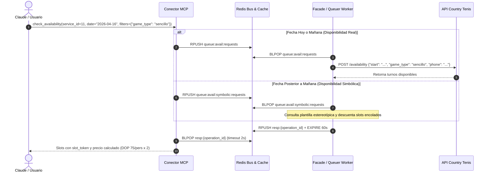
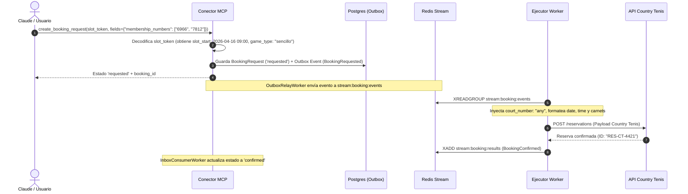

# Guía de Integración Facade / Upstream: Country Tennis (Servicio ID: 11)

> **Documento de Especificación de Mensajería e Integración.**  
> **Servicio:** Country Tennis (Santo Domingo Country Club)  
> **Service ID:** `11`  
> **Patrón:** `slot_object`  
> **Destinatario:** Desarrolladores e ingenieros del servicio Facade / Ejecutor Upstream de Atlas.

---

## 1. Ficha Técnica y Contrato del Servicio

El servicio de Tenis en el Santo Domingo Country Club opera bajo el patrón de turnos horarios en cancha (`slot_object`). La disponibilidad se consulta indicando la fecha, el teléfono del socio y la modalidad de juego (`game_type`), y la reserva requiere registrar los números de carnet de los jugadores participantes (2 para sencillo o 4 para dobles).

### 1.1 Parámetros Generales
| Parámetro | Valor | Descripción |
| :--- | :--- | :--- |
| **`service_id`** | `11` | Identificador único en el catálogo de servicios de Atlas. |
| **`pattern`** | `slot_object` | Reserva por turnos horarios en canchas de tenis. |
| **`request_ttl_seconds`** | `900` (15 min) | Vigencia del slot token criptográfico y del hold atómico en Redis. |
| **`payment_policy`** | `payment_link` | El club envía un enlace de pago seguro para completar y garantizar el turno. |
| **`cancellation_policy`** | 24 horas antes | Cancelación permitida sin penalidad hasta 24h antes del turno. |
| **`currency`** | `DOP` | Moneda oficial en pesos dominicanos. |
| **`rule_type`** | `today_and_tomorrow` | El club publica turnos para hoy y mañana; días posteriores corren por disponibilidad simbólica (Queuer). |
| **`has_scheduler`** | `true` | Admite agendamiento previo mediante el Queuer en fechas no publicadas todavía por el club. |

---

### 1.2 Dimensión de Consulta (`game_type`)
El conector MCP expone la dimensión `game_type` requerida para consultar disponibilidad:

* **Valores admitidos:**
  1. `'sencillo'` &rarr; Modalidad individual / singles (2 jugadores).
  2. `'dobles'` &rarr; Modalidad por parejas (4 jugadores).
* **Comportamiento:** `apply_mode = 'upstream_param'`. Se envía en el objeto `filters` de la solicitud para que el Facade consulte exactamente la disponibilidad de esa modalidad y el conector cotice la tarifa exacta.

---

### 1.3 Matriz de Precios Oficiales (Por Persona en DOP)
El conector MCP calcula el precio total multiplicando la tarifa unitaria según la modalidad de juego:

| Modalidad (`game_type`) | Jugadores | Tarifa Unitaria (DOP) | Base | Total Turno Estimado |
| :--- | :---: | :---: | :---: | :---: |
| **Tenis Sencillo** | 2 personas | **$75.00 DOP** | por persona | **$150.00 DOP** *(Tarifa base / starting price)* |
| **Tenis Dobles** | 4 personas | **$150.00 DOP** | por persona | **$600.00 DOP** |

---

### 1.4 Reglas para Carnets y Asignación de Cancha
1. **`membership_numbers`:**
   * Si la modalidad fue `'sencillo'`, el usuario debe suministrar exactamente **2 números de membresía**.
   * Si la modalidad fue `'dobles'`, el usuario debe suministrar exactamente **4 números de membresía**.
2. **`court_number`:**
   * **No se solicita al usuario** en Claude.
   * El Facade / Ejecutor asigna automáticamente `"court_number": "any"` por defecto al enviar la solicitud al API del club, permitiendo que el club asigne la cancha disponible más conveniente.

---

## 2. Flujo 1: Consulta de Disponibilidad (`check_availability`)

El conector MCP bifurca automáticamente la consulta de disponibilidad según la fecha solicitada:
1. **Hoy y Mañana (`date <= today + 1`):** Se enruta a `queue:avail:requests` para consultar disponibilidad real contra el API del club.
2. **Días Posteriores (`date > today + 1`):** Se enruta a `queue:avail:symbolic:requests` para que el Servicio de Reservas / Queuer retorne los slots estereotípicos estimados.



---

### 2.1 Mensaje que Recibe el Facade / Queuer (`queue:avail:requests` o `queue:avail:symbolic:requests`)

El conector MCP inserta mediante `RPUSH` en Redis:

```json
{
  "operation_id": "op_avail_91b8d200e4a7",
  "type": "availability_request",
  "payload": {
    "service_id": 11,
    "combo_code": "COUNTRY_TENNIS",
    "user_uuid": "c4d7e231-1829-4d6b-9c71-332998822001",
    "user_phone": "+18095551234",
    "user_email": "socio@countryclub.do",
    "date": "2026-04-16",
    "filters": {
      "game_type": "sencillo"
    },
    "contract_version": "2026-11-04.1",
    "filter_hash": "f7e8d9c0b1a234567890abcdef123456"
  },
  "created_at": "2026-11-04T17:00:00Z"
}
```

---

### 2.2 Payload que el Facade debe Enviar al API de Country Tenis

El Facade extrae los parámetros y realiza la petición al backend del club:

```json
{
  "start": "2026-04-16T09:00:00Z",
  "game_type": "sencillo",
  "phone": "+18095551234"
}
```

* **`start`**: Fecha y hora solicitada en formato ISO 8601.
* **`game_type`**: `"sencillo"` o `"dobles"`.
* **`phone`**: Teléfono del socio en formato internacional (E.164).

---

### 2.3 Respuesta que el Facade / Queuer debe Devolver al MCP

El Facade debe depositar el resultado en `resp:{operation_id}` (o en `op:{operation_id}` si demora más de 2 segundos):

```json
{
  "operation_id": "op_avail_91b8d200e4a7",
  "status": "completed",
  "result_type": "availability",
  "service_id": 11,
  "contract_version": "2026-11-04.1",
  "filter_hash": "f7e8d9c0b1a234567890abcdef123456",
  "as_of": "2026-11-04T17:00:01.300000Z",
  "slots": [
    {
      "offer_ref": "ct-slot-clay1-0900",
      "slot_start": "2026-04-16T09:00:00Z",
      "slot_end": "2026-04-16T10:30:00Z",
      "resource_ref": "cancha-tenis-1",
      "resource_name": "Cancha 1 (Arcilla)",
      "is_estimated": false,
      "slot_type": "official",
      "notice": null,
      "attributes": {
        "court_surface": "arcilla",
        "game_type": "sencillo"
      }
    },
    {
      "offer_ref": "ct-slot-hard2-0900",
      "slot_start": "2026-04-16T09:00:00Z",
      "slot_end": "2026-04-16T10:30:00Z",
      "resource_ref": "cancha-tenis-2",
      "resource_name": "Cancha 2 (Dura)",
      "is_estimated": false,
      "slot_type": "official",
      "notice": null,
      "attributes": {
        "court_surface": "dura",
        "game_type": "sencillo"
      }
    }
  ]
}
```

> **Campos Críticos de Retorno:**
> 1. **`echo` de claves de caché:** El Facade **debe retornar** `service_id`, `contract_version` y `filter_hash` tal como los recibió en la solicitud, para que el MCP pueble la caché determinista.
> 2. **`is_estimated`:**
>    - Si es `false` (turno oficial del club), el MCP tomará un hold atómico en Redis al momento de reservar.
>    - Si es `true` (slot simbólico del Queuer), el MCP **no** colocará hold físico y registrará la reserva para ser agendada en la cola del Queuer.

---

### 2.4 Respuesta de Fallo Upstream

Si la consulta falla o el backend del club responde con error:

```json
{
  "operation_id": "op_avail_91b8d200e4a7",
  "status": "failed",
  "result_type": "internal_error",
  "detail": "Error de comunicación con el servicio de canchas de tenis.",
  "error": "Error de comunicación con el servicio de canchas de tenis."
}
```
* **`result_type: "internal_error"`**: El MCP registrará el `detail` en sus logs internos y devolverá al usuario un mensaje genérico de dificultades técnicas.
* **`result_type: "error_to_user"`**: El MCP transmitirá el `detail` directamente al usuario (ej. *"No hay canchas disponibles para la modalidad seleccionada"*).

---

## 3. Flujo 2: Creación de Reserva (`create_booking_request`)



---

### 3.1 Evento Emitido por el MCP (`BookingRequested`) en `stream:booking:events`

```json
{
  "event_id": "evt_8c20b311e5a2",
  "event_type": "BookingRequested",
  "aggregate_id": "b2c3d4e5-f6a7-8901-bcde-f12345678901",
  "correlation_id": "idemp_ct_20260416_01",
  "created_at": "2026-11-04T17:05:00Z",
  "payload": {
    "booking_id": "b2c3d4e5-f6a7-8901-bcde-f12345678901",
    "user_uuid": "c4d7e231-1829-4d6b-9c71-332998822001",
    "user_phone": "+18095551234",
    "user_email": "socio@countryclub.do",
    "service_id": 11,
    "combo_code": "COUNTRY_TENNIS",
    "contract_version_id": "11223344-5566-7788-9900-aabbccddeeff",
    "token_id": "tok_1a2b3c4d5e6f",
    "offer_ref": "ct-slot-clay1-0900",
    "slot_start": "2026-04-16T09:00:00Z",
    "slot_end": "2026-04-16T10:30:00Z",
    "is_estimated": false,
    "applied_filters": {
      "game_type": "sencillo"
    },
    "fields": {
      "membership_numbers": ["6966", "7812"],
      "prefer_closest_time": false,
      "email": "socio@countryclub.do",
      "notes": "Preferencia por cancha de arcilla"
    },
    "expires_at": "2026-11-04T17:20:00Z"
  }
}
```

---

### 3.2 Payload que el Ejecutor debe Enviar al API de Country Tenis

El Ejecutor:
1. Extrae `date` (`"2026-04-16"`) y `time` (`"09:00"`) a partir de `slot_start`.
2. Asigna automáticamente `"court_number": "any"`.
3. Extrae `prefer_closest_time` de `fields` (o `false` por defecto).
4. Pasa la lista de carnets de `fields.membership_numbers`:

```json
{
  "date": "2026-04-16",
  "time": "09:00",
  "court_number": "any",
  "prefer_closest_time": false,
  "membership_numbers": ["6966", "7812"]
}
```

* **`date`**: Fecha del turno en formato `YYYY-MM-DD`.
* **`time`**: Hora del turno en formato `HH:MM` (24 horas).
* **`court_number`**: `"any"` (fijo por defecto).
* **`prefer_closest_time`**: Booleano (`false` por defecto).
* **`membership_numbers`**: Arreglo de strings con los carnets de los jugadores (2 para sencillo o 4 para dobles).

---

### 3.3 Evento de Respuesta del Ejecutor en `stream:booking:results`

#### A. En caso de Reserva Confirmada (`BookingConfirmed`):
```json
{
  "event_type": "BookingConfirmed",
  "booking_id": "b2c3d4e5-f6a7-8901-bcde-f12345678901",
  "external_ref": "CT-RES-20260416-552",
  "assigned_details": {
    "court": "Cancha 1 (Arcilla)",
    "date": "2026-04-16",
    "time": "09:00",
    "payment_link": "https://pagos.countryclub.do/link/ct-4421"
  },
  "occurred_at": "2026-11-04T17:05:03Z"
}
```

#### B. En caso de Rechazo de la Sede (`BookingRejected`):
```json
{
  "event_type": "BookingRejected",
  "booking_id": "b2c3d4e5-f6a7-8901-bcde-f12345678901",
  "reason": "Uno o más carnets ingresados no cuentan con membresía activa de tenis.",
  "occurred_at": "2026-11-04T17:05:03Z"
}
```

---

## 4. Flujo 3: Cancelación de Reserva (`cancel_booking`)

### 4.1 Evento Emitido por el MCP (`CancellationRequested`)
```json
{
  "event_type": "CancellationRequested",
  "aggregate_id": "b2c3d4e5-f6a7-8901-bcde-f12345678901",
  "payload": {
    "booking_id": "b2c3d4e5-f6a7-8901-bcde-f12345678901",
    "external_ref": "CT-RES-20260416-552",
    "user_uuid": "c4d7e231-1829-4d6b-9c71-332998822001",
    "user_phone": "+18095551234",
    "user_email": "socio@countryclub.do",
    "service_id": 11,
    "reason": "Cancelación solicitada por el socio."
  }
}
```

### 4.2 Confirmación de Cancelación del Ejecutor (`BookingCancelled`)
```json
{
  "event_type": "BookingCancelled",
  "booking_id": "b2c3d4e5-f6a7-8901-bcde-f12345678901",
  "occurred_at": "2026-11-04T17:10:02Z"
}
```

---

## 5. Cuadro Comparativo: Deportes del Santo Domingo Country Club

| Característica | Country Golf (ID: 9) | Country Pádel (ID: 10) | Country Tenis (ID: 11) |
| :--- | :--- | :--- | :--- |
| **Dimensiones Upstream** | `course`, `holes_preference`, `party_size` | **Ninguna** | `game_type` (`sencillo`, `dobles`) |
| **Membresías / Carnets** | 1 por jugador en `memberships` (1 a 4) | **No requiere** (cancha completa, membresía en cuenta) | 2 carnets para sencillo, 4 carnets para dobles en `membership_numbers` |
| **Asignación Cancha (`court_number`)** | N/A (selección de campo) | Asignada por el club | **Inyectada como `"any"` por defecto en el Facade** |
| **Base de Tarifa** | `per_person` (DOP 870 – 1,750 / pers.) | `per_booking` (DOP 400 plana por cancha) | **`per_person`** (DOP 75 sencillo, DOP 150 dobles) |
| **Payload Upstream Reserva** | `date`, `time`, `players`, `course`, `holes_preference`, `memberships` | `date`, `time`, `prefer_closest_time` | `date`, `time`, `court_number`, `prefer_closest_time`, `membership_numbers` |

