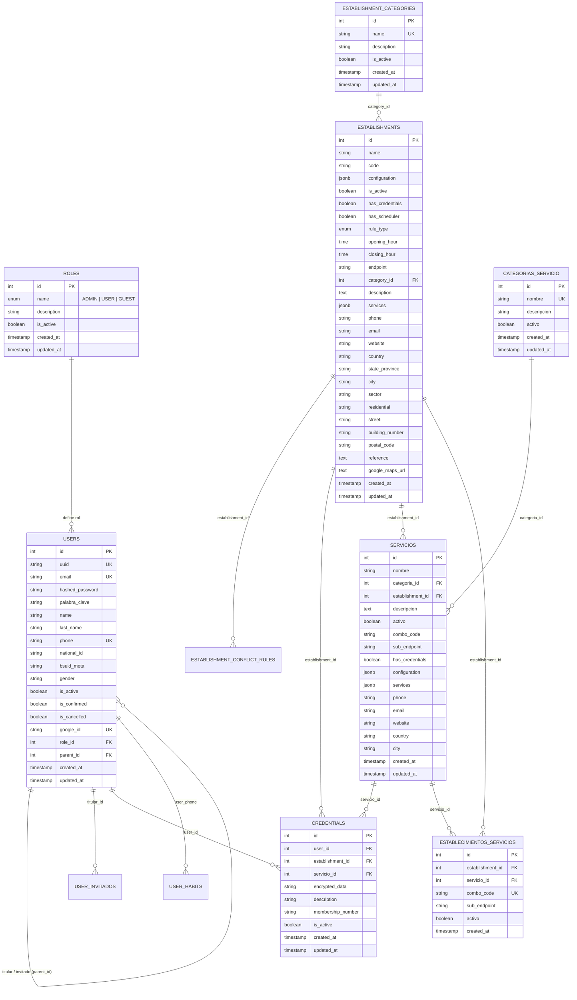

# Estructura de Modelos de Base de Datos: Usuarios, Establecimientos y Servicios

Este documento detalla la estructura, campos, tipos de datos, restricciones y relaciones de los modelos de base de datos que conforman los módulos centrales de **Usuarios**, **Establecimientos** y **Servicios** en **ATLAS-BACKEND**.

---

## 1. Diagrama Entidad - Relación (Mermaid)

---

## 2. Dominio de Usuarios e Identidad

### 2.1 Tabla: `users`
Modelo SQLModel: `User` ([database/models/users.py](file:///c:/Users/pluto/source/repos/ENSO/ATLAS-BACKEND/database/models/users.py))

Tabla principal que almacena los usuarios del sistema, sus credenciales básicas, jerarquía familiar/invitados y estado de verificación.

| Campo | Tipo SQL / Python | Nulo | Clave / Restricción | Descripción |
| :--- | :--- | :---: | :---: | :--- |
| `id` | `INTEGER` / `int` | No | **PK** (Auto) | Identificador autoincremental de la fila. |
| `uuid` | `VARCHAR` / `str` | No | Default UUID4 | Identificador público único para APIs y claims de tokens JWT (`sub`). |
| `email` | `VARCHAR` / `str` | No | **UNIQUE** (`uq_users_email`), Index | Correo electrónico principal del usuario. |
| `hashed_password` | `VARCHAR` / `str` | No | - | Hash Bcrypt de la contraseña del usuario. |
| `palabra_clave` | `VARCHAR(100)` / `str` | Sí | - | Palabra o frase de seguridad para recuperación de cuenta. |
| `name` | `VARCHAR(100)` / `str` | No | - | Nombre(s) del usuario. |
| `last_name` | `VARCHAR(100)` / `str` | No | - | Apellido(s) del usuario. |
| `phone` | `VARCHAR` / `str` | Sí | **UNIQUE** (`uq_users_phone`) | Número de teléfono / WhatsApp del usuario. |
| `national_id` | `VARCHAR(50)` / `str` | Sí | - | Documento nacional de identidad (Cédula / DNI / Pasaporte). |
| `bsuid_meta` | `VARCHAR(133)` / `str` | Sí | - | Identificador de usuario en plataformas o integraciones externas. |
| `gender` | `VARCHAR(20)` / `str` | Sí | - | Género del usuario (`M`, `F`, `otro`, etc.). |
| `is_active` | `BOOLEAN` / `bool` | No | Default `True` | Indica si la cuenta se encuentra habilitada para operar. |
| `is_confirmed` | `BOOLEAN` / `bool` | No | Default `False` | Indica si el usuario confirmó su correo electrónico. |
| `is_cancelled` | `BOOLEAN` / `bool` | No | Default `False` | Soft-delete: cuenta cancelada o eliminada por el usuario. |
| `google_id` | `VARCHAR` / `str` | Sí | **UNIQUE**, Index | Subject ID (`sub`) de Google OAuth para cuentas vinculadas. |
| `role_id` | `INTEGER` / `int` | Sí | **FK** `roles.id` | Rol asignado al usuario. |
| `parent_id` | `INTEGER` / `int` | Sí | **FK** `users.id` | Jerarquía familiar: referencia al usuario titular si este es un invitado. |
| `free_trial_limit` | `TIMESTAMP WITH TZ` | Sí | - | Fecha límite del periodo de prueba gratuito. |
| `created_at` | `TIMESTAMP WITH TZ` | No | Default `now(utc)` | Fecha y hora de registro. |
| `updated_at` | `TIMESTAMP WITH TZ` | No | OnUpdate `now(utc)` | Fecha y hora de la última modificación. |

> **Regla de Negocio:** Un usuario tiene su perfil completo (`is_profile_complete`) únicamente cuando tanto `phone` como `gender` tienen valor. Junto con `is_confirmed == True`, es requerido para realizar reservas.

---

### 2.2 Tabla: `roles`
Modelo SQLModel: `Role` ([database/models/roles.py](file:///c:/Users/pluto/source/repos/ENSO/ATLAS-BACKEND/database/models/roles.py))

Catálogo de roles del sistema.

| Campo | Tipo SQL / Python | Nulo | Clave / Restricción | Descripción |
| :--- | :--- | :---: | :---: | :--- |
| `id` | `INTEGER` / `int` | No | **PK** (Auto) | Identificador del rol. |
| `name` | `userrole` (Enum) | No | Enum | Valor del rol: `ADMIN`, `USER`, `GUEST`. |
| `description` | `VARCHAR(255)` / `str` | Sí | - | Descripción de los privilegios del rol. |
| `is_active` | `BOOLEAN` / `bool` | No | Default `True` | Si el rol está activo en el sistema. |
| `created_at` | `TIMESTAMP WITH TZ` | No | Default `now(utc)` | Fecha de creación. |
| `updated_at` | `TIMESTAMP WITH TZ` | No | OnUpdate `now(utc)` | Fecha de actualización. |

---

### 2.3 Tabla: `credentials`
Modelo SQLModel: `Credential` ([database/models/credentials.py](file:///c:/Users/pluto/source/repos/ENSO/ATLAS-BACKEND/database/models/credentials.py))

Credenciales cifradas (usuario/contraseña externa, PIN, membresía) que permiten a ATLAS autenticarse en los sistemas externos de clubes y sedes en nombre del usuario.

| Campo | Tipo SQL / Python | Nulo | Clave / Restricción | Descripción |
| :--- | :--- | :---: | :---: | :--- |
| `id` | `INTEGER` / `int` | No | **PK** (Auto) | Identificador de la credencial. |
| `user_id` | `INTEGER` / `int` | No | **FK** `users.id`, Index | Usuario propietario de las credenciales. |
| `establishment_id` | `INTEGER` / `int` | Sí | **FK** `establishments.id`, Index | Establecimiento al que pertenece la credencial. |
| `servicio_id` | `INTEGER` / `int` | Sí | **FK** `servicios.id`, Index | Servicio específico al que pertenece la credencial. |
| `encrypted_data` | `TEXT` / `str` | No | - | Datos de acceso cifrados simétricamente con Fernet. |
| `description` | `VARCHAR` / `str` | Sí | - | Descripción o alias de la credencial. |
| `membership_number` | `VARCHAR` / `str` | Sí | - | Número de socio o membresía visible. |
| `is_active` | `BOOLEAN` / `bool` | No | Default `True` | Estado de la credencial. |
| `created_at` | `TIMESTAMP WITH TZ` | No | Default `now(utc)` | Fecha de registro. |
| `updated_at` | `TIMESTAMP WITH TZ` | No | OnUpdate `now(utc)` | Fecha de actualización. |

> **Restricción Check (`chk_credentials_establishment_or_servicio`):** Exige que la credencial esté vinculada **exclusivamente a un establecimiento O a un servicio**, nunca a ambos al mismo tiempo ni a ninguno de los dos:
> `(establishment_id IS NOT NULL AND servicio_id IS NULL) OR (establishment_id IS NULL AND servicio_id IS NOT NULL)`

---

### 2.4 Tabla: `user_invitados`
Modelo SQLModel: `UserInvitado` ([database/models/user_invitados.py](file:///c:/Users/pluto/source/repos/ENSO/ATLAS-BACKEND/database/models/user_invitados.py))

Registro de invitados autorizados por un titular para recibir beneficios o reservas.

| Campo | Tipo SQL / Python | Nulo | Clave / Restricción | Descripción |
| :--- | :--- | :---: | :---: | :--- |
| `id` | `INTEGER` / `int` | No | **PK** (Auto) | Identificador. |
| `titular_id` | `INTEGER` / `int` | No | **FK** `users.id`, **UNIQUE** | Usuario socio titular responsable. |
| `phone` | `VARCHAR(20)` / `str` | No | **UNIQUE**, Index | Teléfono del invitado. |
| `nombre` | `VARCHAR(150)` / `str` | No | - | Nombre completo del invitado. |
| `activo` | `BOOLEAN` / `bool` | No | Default `True`, Index | Si la invitación está activa. |
| `motivo_inactivo` | `VARCHAR(50)` / `str` | Sí | Check constraint | `membresia_vencida`, `revocado`, `manual`. |
| `created_at` | `TIMESTAMP WITH TZ` | No | Default `now(utc)` | Fecha de creación. |
| `updated_at` | `TIMESTAMP WITH TZ` | No | OnUpdate `now(utc)` | Fecha de modificación. |

---

## 3. Dominio de Establecimientos

### 3.1 Tabla: `establishments`
Modelo SQLModel: `Establishment` ([database/models/establishments.py](file:///c:/Users/pluto/source/repos/ENSO/ATLAS-BACKEND/database/models/establishments.py))

Representa un club, centro deportivo o sede física donde se prestan servicios y se gestionan reservas.

| Campo | Tipo SQL / Python | Nulo | Clave / Restricción | Descripción |
| :--- | :--- | :---: | :---: | :--- |
| `id` | `INTEGER` / `int` | No | **PK** (Auto) | Identificador único del establecimiento. |
| `name` | `VARCHAR(150)` / `str` | No | - | Nombre comercial del establecimiento (ej. *Club Deportivo Sol*). |
| `code` | `VARCHAR(64)` / `str` | No | - | Código mnemotécnico o identificador corto (ej. `CDS_CENTRAL`). |
| `configuration` | `JSONB` / `dict \| list` | Sí | - | Parámetros específicos de integración, llaves o reglas del club. |
| `is_active` | `BOOLEAN` / `bool` | No | Default `True` | Habilitado para reservas y búsquedas. |
| `has_credentials` | `BOOLEAN` / `bool` | No | Default `True` | Si requiere credenciales de socio para interactuar con su API. |
| `has_scheduler` | `BOOLEAN` / `bool` | Sí | Default `False` | Si el club tiene soporte de agendador automatizado de tareas. |
| `rule_type` | `rule_type_enum` (Enum) | Sí | Enum | `only_today`, `today_and_tomorrow`, `hours_range`. |
| `opening_hour` | `TIME` / `time` | Sí | - | Hora de inicio de operaciones del club (ej. `06:00:00`). |
| `closing_hour` | `TIME` / `time` | Sí | - | Hora de fin de operaciones del club (ej. `23:00:00`). |
| `endpoint` | `VARCHAR(255)` / `str` | Sí | - | URL base o endpoint del servicio del establecimiento externo. |
| `category_id` | `INTEGER` / `int` | Sí | **FK** `establishment_categories.id` | Categoría a la que pertenece (ej. Club de Golf, Tenis, etc.). |
| `description` | `TEXT` / `str` | Sí | - | Descripción detallada de las instalaciones y normativas. |
| `services` | `JSONB` / `dict \| list` | Sí | - | Lista o metadata resumida de servicios disponibles. |
| `phone` | `VARCHAR(50)` / `str` | Sí | - | Teléfono de recepción o contacto. |
| `email` | `VARCHAR(255)` / `str` | Sí | - | Correo oficial del establecimiento. |
| `website` | `VARCHAR(500)` / `str` | Sí | - | Sitio web oficial. |
| `country` | `VARCHAR(100)` / `str` | Sí | - | País donde se ubica la sede. |
| `state_province` | `VARCHAR(100)` / `str` | Sí | - | Estado, provincia o región. |
| `city` | `VARCHAR(100)` / `str` | Sí | - | Ciudad. |
| `sector` | `VARCHAR(150)` / `str` | Sí | - | Sector o urbanización. |
| `residential` | `VARCHAR(150)` / `str` | Sí | - | Conjunto residencial o complejo. |
| `street` | `VARCHAR(150)` / `str` | Sí | - | Calle / Avenida. |
| `building_number` | `VARCHAR(50)` / `str` | Sí | - | Número de edificio o local. |
| `postal_code` | `VARCHAR(20)` / `str` | Sí | - | Código postal. |
| `reference` | `TEXT` / `str` | Sí | - | Indicaciones o referencias para llegar. |
| `google_maps_url` | `TEXT` / `str` | Sí | - | Enlace directo a la ubicación en Google Maps. |
| `created_at` | `TIMESTAMP WITH TZ` | No | Default `now(utc)` | Fecha de alta en el sistema. |
| `updated_at` | `TIMESTAMP WITH TZ` | No | OnUpdate `now(utc)` | Fecha de última edición. |

---

### 3.2 Tabla: `establishment_categories`
Modelo SQLModel: `EstablishmentCategories` ([database/models/establishment_categories.py](file:///c:/Users/pluto/source/repos/ENSO/ATLAS-BACKEND/database/models/establishment_categories.py))

Tipos o rubros de establecimientos (ej. *Club Social*, *Complejo Deportivo*, *Hotel & Resort*).

| Campo | Tipo SQL / Python | Nulo | Clave / Restricción | Descripción |
| :--- | :--- | :---: | :---: | :--- |
| `id` | `INTEGER` / `int` | No | **PK** (Auto) | Identificador de la categoría. |
| `name` | `VARCHAR(100)` / `str` | No | **UNIQUE** (`uq_establishment_categories_name`) | Nombre de la categoría. |
| `description` | `VARCHAR(255)` / `str` | Sí | - | Descripción del tipo de establecimiento. |
| `is_active` | `BOOLEAN` / `bool` | No | Default `True` | Estado de la categoría. |
| `created_at` | `TIMESTAMP WITH TZ` | No | Default `now(utc)` | Fecha de creación. |
| `updated_at` | `TIMESTAMP WITH TZ` | No | OnUpdate `now(utc)` | Fecha de actualización. |

---

### 3.3 Tabla: `establishment_conflict_rules`
Modelo SQLModel: `EstablishmentConflictRule` ([database/models/establishment_conflict_rules.py](file:///c:/Users/pluto/source/repos/ENSO/ATLAS-BACKEND/database/models/establishment_conflict_rules.py))

Reglas de validación para prevenir solapamiento o conflictos de reservas en un mismo establecimiento.

| Campo | Tipo SQL / Python | Nulo | Clave / Restricción | Descripción |
| :--- | :--- | :---: | :---: | :--- |
| `id` | `INTEGER` / `int` | No | **PK** (Auto) | Identificador. |
| `establishment_id` | `INTEGER` / `int` | No | **FK** `establishments.id` | Establecimiento al que aplica la regla. |
| `rule_name` | `VARCHAR` / `str` | No | - | Nombre o identificador de la regla (ej. `same_day_limit`). |
| `conflict_fields` | `JSON` / `List[str]` | No | - | Campos que determinan el conflicto (ej. `["user_id", "date", "time_slot"]`). |

---

## 4. Dominio de Servicios

### 4.1 Tabla: `servicios`
Modelo SQLModel: `Servicio` ([database/models/servicios.py](file:///c:/Users/pluto/source/repos/ENSO/ATLAS-BACKEND/database/models/servicios.py))

Representa un servicio o deporte específico ofrecido dentro de un establecimiento (ej. *Cancha de Pádel 1*, *Cancha de Tenis Arcilla*, *Piscina Semiolímpica*).

| Campo | Tipo SQL / Python | Nulo | Clave / Restricción | Descripción |
| :--- | :--- | :---: | :---: | :--- |
| `id` | `INTEGER` / `int` | No | **PK** (Auto) | Identificador único del servicio. |
| `nombre` | `VARCHAR(150)` / `str` | No | - | Nombre del servicio o cancha. |
| `categoria_id` | `INTEGER` / `int` | No | **FK** `categorias_servicio.id` | Categoría deportiva o de servicio (Tenis, Pádel, etc.). |
| `establishment_id` | `INTEGER` / `int` | No | **FK** `establishments.id` | Establecimiento al que pertenece el servicio. |
| `descripcion` | `TEXT` / `str` | Sí | - | Descripción detallada de las condiciones del servicio. |
| `activo` | `BOOLEAN` / `bool` | No | Default `True`, Index | Si el servicio está disponible para reservar. |
| `combo_code` | `VARCHAR(64)` / `str` | Sí | - | Código identificador en sistemas externos / combos. |
| `sub_endpoint` | `VARCHAR(255)` / `str` | Sí | - | Ruta relativa o sub-endpoint para consultar disponibilidad del servicio. |
| `has_credentials` | `BOOLEAN` / `bool` | No | Default `True` | Si el servicio exige credenciales específicas. |
| `configuration` | `JSONB` / `dict \| list` | Sí | - | Configuración técnica del servicio (duración de turnos, antelación). |
| `services` | `JSONB` / `dict \| list` | Sí | - | Sub-servicios o comodidades asociadas. |
| `phone` | `VARCHAR(50)` / `str` | Sí | - | Teléfono directo del servicio (si aplica). |
| `email` | `VARCHAR(255)` / `str` | Sí | - | Correo específico del servicio. |
| `website` | `VARCHAR(255)` / `str` | Sí | - | Enlace web del servicio. |
| `country` | `VARCHAR(100)` / `str` | Sí | - | País (si difiere o especifica la sede). |
| `city` | `VARCHAR(100)` / `str` | Sí | - | Ciudad. |
| `sector` | `VARCHAR(150)` / `str` | Sí | - | Sector. |
| `street` | `VARCHAR(150)` / `str` | Sí | - | Calle. |
| `building_number` | `VARCHAR(50)` / `str` | Sí | - | Número o ubicación interna en el complejo. |
| `postal_code` | `VARCHAR(20)` / `str` | Sí | - | Código postal. |
| `reference` | `TEXT` / `str` | Sí | - | Referencias de ubicación interna. |
| `google_maps_url` | `VARCHAR(500)` / `str` | Sí | - | URL de Google Maps específica. |
| `created_at` | `TIMESTAMP WITH TZ` | No | Default `now(utc)` | Fecha de registro. |
| `updated_at` | `TIMESTAMP WITH TZ` | No | OnUpdate `now(utc)` | Fecha de última edición. |

---

### 4.2 Tabla: `categorias_servicio`
Modelo SQLModel: `CategoriaServicio` ([database/models/categorias_servicio.py](file:///c:/Users/pluto/source/repos/ENSO/ATLAS-BACKEND/database/models/categorias_servicio.py))

Catálogo de categorías para clasificar los servicios (ej. *Tenis*, *Pádel*, *Golf*, *Squash*, *Fitness*).

| Campo | Tipo SQL / Python | Nulo | Clave / Restricción | Descripción |
| :--- | :--- | :---: | :---: | :--- |
| `id` | `INTEGER` / `int` | No | **PK** (Auto) | Identificador de la categoría de servicio. |
| `nombre` | `VARCHAR(100)` / `str` | No | **UNIQUE**, Index | Nombre de la categoría (ej. `PADEL`, `TENIS`). |
| `descripcion` | `VARCHAR(255)` / `str` | Sí | - | Descripción de la disciplina o categoría. |
| `activo` | `BOOLEAN` / `bool` | No | Default `True` | Estado de la categoría. |
| `created_at` | `TIMESTAMP WITH TZ` | No | Default `now(utc)` | Fecha de creación. |
| `updated_at` | `TIMESTAMP WITH TZ` | No | OnUpdate `now(utc)` | Fecha de actualización. |

---

### 4.3 Tabla: `establecimientos_servicios`
Modelo SQLModel: `EstablecimientoServicio` ([database/models/establecimientos_servicios.py](file:///c:/Users/pluto/source/repos/ENSO/ATLAS-BACKEND/database/models/establecimientos_servicios.py))

Tabla de vinculación explícita (M2M / asociación extendida) entre un establecimiento y los servicios que ofrece, permitiendo parametrizar códigos de combo y sub-endpoints por sede.

| Campo | Tipo SQL / Python | Nulo | Clave / Restricción | Descripción |
| :--- | :--- | :---: | :---: | :--- |
| `id` | `INTEGER` / `int` | No | **PK** (Auto) | Identificador de la asociación. |
| `establishment_id` | `INTEGER` / `int` | No | **FK** `establishments.id` | Establecimiento relacionado. |
| `servicio_id` | `INTEGER` / `int` | No | **FK** `servicios.id` | Servicio relacionado. |
| `activo` | `BOOLEAN` / `bool` | No | Default `True` | Si esta combinación está activa para operar. |
| `combo_code` | `VARCHAR(64)` / `str` | Sí | **UNIQUE** (`...combo_code_key`) | Código único de combo para el agendador o bot de reservas. |
| `sub_endpoint` | `VARCHAR(255)` / `str` | Sí | - | Endpoint particular para reservar este servicio en este establecimiento. |
| `created_at` | `TIMESTAMP WITH TZ` | Sí | Default `now(utc)` | Fecha de vinculación. |

> **Restricción Unique Compuesta (`uq_establecimiento_servicio`):** Garantiza que no se duplique la relación del mismo `establishment_id` con el mismo `servicio_id`.

---

## 5. Enums Principales

Definidos en [database/models/enums.py](file:///c:/Users/pluto/source/repos/ENSO/ATLAS-BACKEND/database/models/enums.py):

### `UserRole`
Utilizado en `roles.name`:
- `ADMIN`: Administrador con acceso completo al backend y dashboard.
- `USER`: Socio titular o usuario estándar de la plataforma.
- `GUEST`: Invitado vinculado a un titular.

### `RuleType`
Utilizado en `establishments.rule_type` para delimitar cuándo se permite reservar:
- `only_today`: Reservas limitadas al mismo día calendario.
- `today_and_tomorrow`: Reservas permitidas para hoy y el día siguiente.
- `hours_range`: Reservas restringidas a un rango horario específico.

### `JugadorCategoria`
Categorías de membresía o jugador en el ecosistema:
- `SOCIO`
- `INVITADO`
- `HOTEL`
- `EXTERNO`
- `OTRO`
