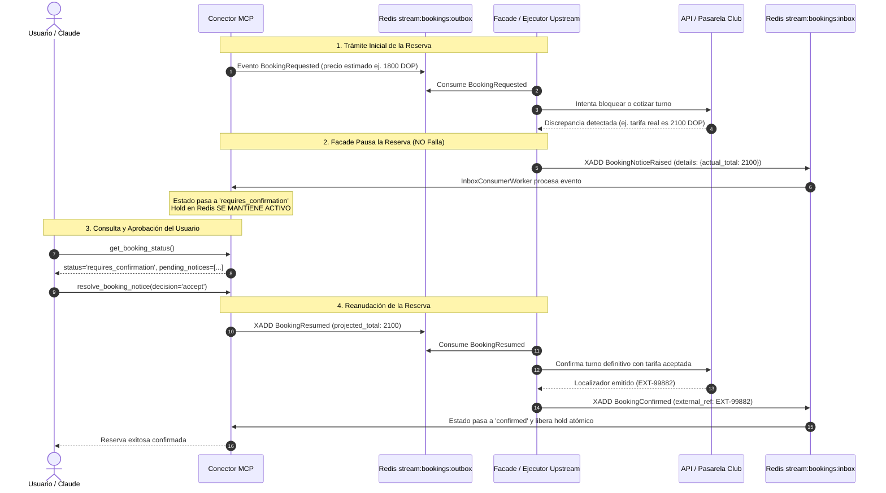

# Guía de Eventos Facade: Avisos, Discrepancias y Reanudación de Reservas

> **Documento de Especificación de Mensajería para Desarrolladores del Facade / Ejecutor Upstream.**  
> **Subsistemas:** Conector MCP Atlas ↔ Servicio Facade / Ejecutores Upstream.  
> **Canales:** Redis Streams (`stream:bookings:inbox` y `stream:bookings:outbox`).  
> **Estado:** Activo y disponible en producción / desarrollo.

---

## 1. Introducción y Propósito

En integraciones con sistemas de terceros y pasarelas de reservas de establecimientos físicos (clubes de pádel, golf, talleres, etc.), pueden ocurrir **incongruencias o discrepancias** entre las tarifas/condiciones cacheadas en Atlas y la realidad del upstream al momento de procesar la solicitud (por ejemplo: incremento esporádico de tarifa, cambio no sincronizado de franja horaria o reasignación de cancha).

Tradicionalmente, un error de este tipo obligaba al Facade a emitir `BookingFailed` o `BookingRejected`, provocando el descarte inmediato de la reserva y frustración en el usuario.

Con este nuevo mecanismo, **el Facade puede pausar el trámite de la reserva y levantar una alerta o aviso formal (`BookingNoticeRaised`)**. El Conector MCP pasa la reserva al estado `requires_confirmation`, conserva el hold atómico en Redis y le solicita aprobación al usuario mediante Claude. Si el usuario acepta, el Conector emite `BookingResumed` con el nuevo total acordado para que el Facade culmine la confirmación en el club.

---

## 2. Diagrama de Secuencia del Flujo Completo



---

## 3. Catálogo de Nuevos Eventos

### 3.1 Evento `BookingNoticeRaised` (Facade ➔ MCP Inbox)

* **Canal / Destino:** Redis Stream `stream:bookings:inbox`
* **Emisor:** Worker del Facade / Ejecutor Upstream.
* **Receptor:** `InboxConsumerWorker` del Conector MCP.
* **Efecto en MCP:**
  1. Inserta una entidad hija en la tabla `mcp.booking_notice`.
  2. Si `requires_action` es `true`, transiciona la reserva a `BookingStatus.REQUIRES_CONFIRMATION` (`"requires_confirmation"`).
  3. **El hold atómico en Redis NO se libera**; la cancha o slot permanece apartado para el usuario mientras este responde.

#### Payload JSON Canónico

```json
{
  "event_id": "a1b2c3d4-e5f6-7890-abcd-ef1234567890",
  "event_type": "BookingNoticeRaised",
  "aggregate_id": "d1e2f3a4-b5c6-4789-0123-abcdefabcdef",
  "payload": {
    "notice_id": "99aa88bb-77cc-66dd-55ee-44ff33aa22bb",
    "notice_type": "price_discrepancy",
    "message": "Grove Padel Club aplicó un ajuste en su tarifa para este turno: el costo real es RD$ 2,100.00 DOP (en vez del estimado de RD$ 1,800.00 DOP).",
    "details": {
      "expected_total": 1800.0,
      "actual_total": 2100.0,
      "currency": "DOP",
      "difference": 300.0
    },
    "requires_action": true
  }
}
```

#### Tipos de Avisos Admitidos (`notice_type`)

| `notice_type` | Cuándo Utilizarlo | Contenido Recomendado en `details` |
| :--- | :--- | :--- |
| **`price_discrepancy`** | La tarifa del club difiere de la calculada en Atlas. | `{"expected_total": float, "actual_total": float, "currency": "DOP", "difference": float}` |
| **`schedule_shift`** | Desfase sustancial de horario (**cambios superiores a 1 hora** respecto a la hora solicitada). | `{"requested_time": "15:00", "proposed_time": "17:00", "shift_minutes": 120}` |
| **`resource_reassigned`** | Cambio de pista asignada por mantenimiento o evento. | `{"requested_court": "Cancha 1", "assigned_court": "Cancha 3", "reason": "Mantenimiento"}` |
| **`general_notice`** | Requerimiento operativo del club que el usuario debe autorizar. | `{"condition": "deposito_garantia", "amount": 500.0}` |

> [!IMPORTANT]
> **Política de Tolerancia de Horario (40 minutos):**
> Por política de Atlas, existe una **tolerancia automática de hasta 40 minutos** en desplazamientos de horario. Si el club ofrece un turno dentro de esa ventana de 40 minutos (por ejemplo, el usuario solicitó las `15:00` y el club asigna `15:30` o `15:40`), el Facade **debe tramitar y confirmar la reserva directamente sin pausar el proceso ni emitir alertas**.
> El aviso `schedule_shift` está reservado **exclusivamente para cambios drásticos (más de 1 hora de desfase)** o cambios de fecha, donde es indispensable que el usuario revalide si aún tiene disponibilidad.

---

### 3.2 Evento `BookingResumed` (MCP Outbox ➔ Facade)

* **Canal / Destino:** Redis Stream `stream:bookings:outbox`
* **Emisor:** `OutboxRelayWorker` del Conector MCP (tras la invocación de `resolve_booking_notice(decision='accept')`).
* **Receptor:** Worker del Facade / Ejecutor Upstream.
* **Efecto en Facade:** Reanudar inmediatamente el flujo de creación en la API del club utilizando el nuevo `projected_total` y los identificadores de avisos aceptados.

#### Payload JSON Canónico

```json
{
  "event_id": "c3d4e5f6-a7b8-9012-cdef-1234567890ab",
  "event_type": "BookingResumed",
  "aggregate_id": "d1e2f3a4-b5c6-4789-0123-abcdefabcdef",
  "payload": {
    "booking_id": "d1e2f3a4-b5c6-4789-0123-abcdefabcdef",
    "user_uuid": "b8f2a1c0-4e3d-4c2b-9a1f-8e7d6c5b4a3f",
    "user_phone": "+18095551234",
    "user_email": "jugador@email.com",
    "service_id": 18,
    "combo_code": "GROVE_PADEL",
    "status": "accepted",
    "action": "accepted",
    "accepted_notice_ids": [
      "99aa88bb-77cc-66dd-55ee-44ff33aa22bb"
    ],
    "projected_total": 2100.0
  }
}
```

* **Nota Técnica:** En este evento, `projected_total` refleja el nuevo valor aprobado por el usuario (en este ejemplo, $2,100.00 DOP). El Facade debe enviar este monto al backend del club.

---

### 3.3 Evento `BookingRejected` por Decisión del Usuario (MCP Outbox ➔ Facade)

Si el usuario rechaza la alerta mediante `resolve_booking_notice(decision='reject')`, el Conector MCP marca la reserva como `rejected` y emite este evento.

* **Canal / Destino:** Redis Stream `stream:bookings:outbox`
* **Emisor:** Conector MCP.
* **Receptor:** Facade / Ejecutor Upstream.
* **Efecto en Facade:** Cancelar cualquier hold o bloqueo temporal en la pasarela del club y no reintentar la operación.

#### Payload JSON Canónico

```json
{
  "event_id": "e5f6a7b8-c9d0-1234-ef01-234567890abc",
  "event_type": "BookingRejected",
  "aggregate_id": "d1e2f3a4-b5c6-4789-0123-abcdefabcdef",
  "payload": {
    "booking_id": "d1e2f3a4-b5c6-4789-0123-abcdefabcdef",
    "user_uuid": "b8f2a1c0-4e3d-4c2b-9a1f-8e7d6c5b4a3f",
    "user_phone": "+18095551234",
    "user_email": "jugador@email.com",
    "service_id": 18,
    "combo_code": "GROVE_PADEL",
    "status": "rejected",
    "action": "rejected",
    "rejected_notice_ids": [
      "99aa88bb-77cc-66dd-55ee-44ff33aa22bb"
    ],
    "reason": "Reserva rechazada por el usuario al no aceptar las condiciones o tarifas notificadas."
  }
}
```

---

## 4. Ejemplos de Implementación en el Facade (Python)

### 4.1 Emitir Alerta de Discrepancia desde el Facade

```python
import json
from uuid import uuid4
import redis.asyncio as redis

async def emit_price_discrepancy_notice(
    redis_client: redis.Redis,
    booking_id: str,
    expected_total: float,
    actual_total: float,
    club_name: str = "Grove Padel Club",
    currency: str = "DOP",
):
    diff = round(actual_total - expected_total, 2)
    event_payload = {
        "event_id": str(uuid4()),
        "event_type": "BookingNoticeRaised",
        "aggregate_id": booking_id,
        "payload": {
            "notice_id": str(uuid4()),
            "notice_type": "price_discrepancy",
            "message": (
                f"{club_name} reporta una tarifa actualizada de {currency} {actual_total:,.2f} "
                f"para este turno (diferencia de {currency} {diff:,.2f} respecto al estimado inicial)."
            ),
            "details": {
                "expected_total": expected_total,
                "actual_total": actual_total,
                "currency": currency,
                "difference": diff,
            },
            "requires_action": True,
        },
    }

    # Publicar en el Inbox de MCP
    await redis_client.xadd(
        "stream:bookings:inbox",
        {"payload": json.dumps(event_payload)},
    )
```

### 4.2 Consumir `BookingResumed` en el Worker del Facade

```python
async def handle_outbox_event(event_type: str, payload: dict):
    if event_type == "BookingResumed":
        booking_id = payload["booking_id"]
        approved_total = payload.get("projected_total")
        
        # 1. Reanudar la llamada definitiva al club con el precio aprobado
        upstream_res = await call_club_booking_api(
            booking_id=booking_id,
            price=approved_total,
            user_phone=payload.get("user_phone"),
            user_email=payload.get("user_email"),
        )
        
        # 2. Si el club confirma, emitir BookingConfirmed al inbox
        if upstream_res.is_success:
            await emit_booking_confirmed(
                booking_id=booking_id,
                external_ref=upstream_res.locator,
                details=upstream_res.details,
            )
        else:
            await emit_booking_failed(
                booking_id=booking_id,
                reason=upstream_res.error_message,
            )
```

---

## 5. Reglas de Negocio y Consideraciones de Integración

1. **Vigencia del Hold y Expiración:**
   * Mientras la reserva está en `requires_confirmation`, el hold atómico en Redis sigue activo.
   * Si el usuario no responde antes de `expires_at` (o del TTL fijado por el club), el worker de expiración pasará la reserva a `expired`, liberando el hold automáticamente.
2. **Idempotencia:**
   * Todo mensaje debe incluir un `event_id` único (UUIDv4). Si el mensaje se reenvía por problemas de red, el Conector MCP descartará el duplicado transaccionalmente en la tabla `mcp.inbox_event`.
3. **Múltiples Avisos:**
   * Una misma reserva puede acumular avisos independientes si fuera necesario. La reserva solo se reanuda cuando todos los avisos con `requires_action: true` hayan sido aceptados.
4. **Reserva Rechazada por Usuario:**
   * Al recibir `BookingRejected` con `action: "rejected"`, el Facade debe abortar cualquier intento de cobro o retención de pista en el club.
5. **Criterio Operativo para Desplazamientos de Horario (`schedule_shift`):**
   * **Desfase $\le$ 40 minutos:** Se asume aceptado por política de producto (tolerancia transparente). El Facade confirma la reserva directamente sin solicitar revisión al usuario.
   * **Desfase $>$ 60 minutos (o cambio de fecha):** El Facade emite `BookingNoticeRaised` con `notice_type: "schedule_shift"` indicando `requested_time`, `proposed_time` y `shift_minutes` para que el cliente decida si aprueba el nuevo horario antes de apartarlo.

