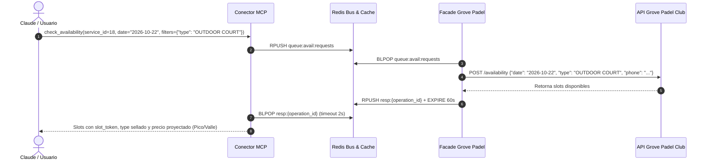
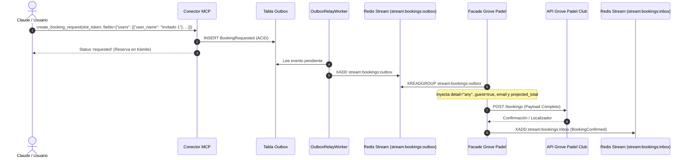

# Guía de Integración Facade / Upstream: Grove Padel Club (Servicio ID: 18)

> **Documento de Especificación de Mensajería e Integración.**  
> **Servicio:** Grove Padel Club  
> **Service ID:** `18`  
> **Patrón:** `slot_object`  
> **Destinatario:** Desarrolladores e ingenieros del servicio Facade / Ejecutor Upstream de Atlas.

---

## 1. Ficha Técnica y Contrato del Servicio

Grove Padel Club opera bajo el patrón de turnos por cancha de pádel (`slot_object`). La disponibilidad se consulta a nivel de tipo de cancha (`type`) para una fecha determinada y el teléfono del usuario. 

Grove Padel Club **exige estrictamente 4 jugadores por partido en cancha**. Por lo tanto, el esquema tarifario en Atlas se modela por **cancha completa (`calculation_basis: 'per_booking'`)**, reflejando directamente el valor total de los 4 cupos y distinguiendo de forma dinámica entre **Horario Pico** y **Horario Valle**, tanto entre semana como en fines de semana.

### 1.1 Parámetros Generales
| Parámetro | Valor | Descripción |
| :--- | :--- | :--- |
| **`service_id`** | `18` | Identificador único en el catálogo de servicios de Atlas. |
| **`pattern`** | `slot_object` | Reserva por turnos horarios en pistas de pádel. |
| **`request_ttl_seconds`** | `900` (15 min) | Vigencia del slot token criptográfico y del hold atómico en Redis. |
| **`payment_policy`** | `payment_link` | El club remite un enlace de pago digital seguro tras confirmar la solicitud. |
| **`cancellation_policy`**| 24 horas antes | Cancelación permitida sin penalidad hasta 24h antes del turno. |
| **`currency`** | `DOP` | Moneda oficial en pesos dominicanos. |
| **`rule_type`** | `None` | Sin esquema restrictivo de antelación; consultas van directo a disponibilidad real. |
| **`has_scheduler`** | `false` | No aplica Queuer de publicación previa; disponibilidad inmediata. |

---

### 1.2 Dimensión de Filtrado: Tipo de Cancha (`type`)

Grove Padel Club exige especificar el tipo de pista en la consulta de disponibilidad:

| Clave Dimensión (`key`) | Valores Admitidos (`value_key`) | Etiqueta en MCP / UI |
| :--- | :--- | :--- |
| **`type`** | `OUTDOOR COURT` | Cancha al aire libre (Outdoor Court) |
| | `COVERED COURT` | Cancha techada (Covered Court) |

* En `check_availability`, Claude o el usuario pueden enviar `filters: {"type": "OUTDOOR COURT"}` o `filters: {"type": "COVERED COURT"}`.
* El valor seleccionado viaja sellado dentro del `SlotToken` en `applied_filters["type"]` y se propaga automáticamente hacia el payload del evento de reserva.

---

### 1.3 Esquema Tarifario Dinámico: Cancha Completa (4 Jugadores)

Dado que las reservas de pádel en Grove exigen la ocupación total de la cancha (4 personas: 1 titular + 3 invitados), las tarifas se configuran a nivel de reserva completa (`calculation_basis: 'per_booking'`) según el día de la semana y la franja horaria:

```
┌─────────────────────────────────────────────────────────────────────────────────┐
│                    ESQUEMA TARIFARIO GROVE PADEL CLUB                           │
├────────────────────────┬─────────────────────────────┬──────────────────────────┤
│ DÍA DE LA SEMANA       │ FRANJA HORARIA              │ TARIFA (CANCHA COMPLETA) │
├────────────────────────┼─────────────────────────────┼──────────────────────────┤
│ Lunes a Viernes        │ 06:00 AM – 04:30 PM (Valle) │ RD$ 1,800.00 (4 x 450)   │
│ (Weekdays 1 a 5)       │ 04:30 PM – 11:00 PM (Pico)  │ RD$ 3,200.00 (4 x 800)   │
├────────────────────────┼─────────────────────────────┼──────────────────────────┤
│ Sábado y Domingo       │ 06:00 AM – 10:30 AM (Pico)  │ RD$ 3,200.00 (4 x 800)   │
│ (Weekdays 6 y 7)       │ 10:30 AM – 04:30 PM (Valle) │ RD$ 1,800.00 (4 x 450)   │
│                        │ 04:30 PM – 11:00 PM (Pico)  │ RD$ 3,200.00 (4 x 800)   │
└────────────────────────┴─────────────────────────────┴──────────────────────────┘
```

* **Cálculo de `projected_total`**:
  - Al estar configurado con `calculation_basis: 'per_booking'`, el motor de precios inyecta directamente el monto total de la cancha:
    - **Hora Pico**: **RD$ 3,200.00 DOP**
    - **Hora Valle**: **RD$ 1,800.00 DOP**
  - Esto evita discrepancias si no se envía `party_size` en la búsqueda de disponibilidad y asegura que el token contenga la cotización exacta para la totalidad de la partida.

---

## 2. Flujo 1: Consulta de Disponibilidad (`check_availability`)

Dado que Grove Padel Club tiene `rule_type: None`, todas las consultas van directamente a disponibilidad real a través de la cola principal de Redis.



---

### 2.1 Mensaje que Recibe el Facade (`queue:avail:requests`)

El conector MCP inserta mediante `RPUSH` el envelope canónico:

```json
{
  "operation_id": "op_avail_9a8b7c6d5e4f",
  "type": "availability_request",
  "payload": {
    "service_id": 18,
    "combo_code": "GROVE_PADEL",
    "user_uuid": "b8f2a1c0-4e3d-4c2b-9a1f-8e7d6c5b4a3f",
    "user_phone": "+18095551234",
    "user_email": "jugador@email.com",
    "date": "2026-10-22",
    "filters": {
      "type": "OUTDOOR COURT"
    },
    "contract_version": "2026-11-05.1",
    "filter_hash": "e3b0c44298fc1c149afbf4c8996fb92427ae41e4649b934ca495991b7852b855"
  },
  "created_at": "2026-11-05T14:00:00Z"
}
```

---

### 2.2 Payload que el Facade Envía al API de Grove Padel Club

El Facade extrae los parámetros requeridos por el backend del club:

```json
{
  "date": "2026-10-22",
  "type": "OUTDOOR COURT",
  "phone": "+18095551234"
}
```

* **`date`**: Fecha solicitada en formato `YYYY-MM-DD`.
* **`type`**: `"OUTDOOR COURT"` o `"COVERED COURT"`.
* **`phone`**: Teléfono del usuario obtenido de `payload.user_phone`.

---

### 2.3 Respuesta que el Facade Devuelve al MCP (`resp:{operation_id}`)

El Facade deposita la respuesta en Redis:

```json
{
  "operation_id": "op_avail_9a8b7c6d5e4f",
  "status": "completed",
  "result_type": "availability",
  "service_id": 18,
  "slots": [
    {
      "offer_ref": "grove_court_1_1500",
      "slot_start": "2026-10-22T15:00:00-04:00",
      "slot_end": "2026-10-22T16:30:00-04:00",
      "resource_ref": "cancha_1_outdoor",
      "resource_name": "Cancha 1 (Outdoor)",
      "attributes": {
        "type": "OUTDOOR COURT"
      }
    },
    {
      "offer_ref": "grove_court_2_1800",
      "slot_start": "2026-10-22T18:00:00-04:00",
      "slot_end": "2026-10-22T19:30:00-04:00",
      "resource_ref": "cancha_2_outdoor",
      "resource_name": "Cancha 2 (Outdoor)",
      "attributes": {
        "type": "OUTDOOR COURT"
      }
    }
  ]
}
```

* **Cómputo Tarifario Automático en MCP**:
  - Turno de las 15:00 (Jueves &rarr; Hora Valle): cotizado a **RD$ 1,800.00 / cancha**.
  - Turno de las 18:00 (Jueves &rarr; Hora Pico): cotizado a **RD$ 3,200.00 / cancha**.

---

## 3. Flujo 2: Creación de Reserva (`create_booking_request`)



---

### 3.1 Evento `BookingRequested` Emitido por MCP (Outbox Payload)

```json
{
  "booking_id": "d1e2f3a4-b5c6-4789-0123-abcdefabcdef",
  "user_uuid": "b8f2a1c0-4e3d-4c2b-9a1f-8e7d6c5b4a3f",
  "user_phone": "+18095551234",
  "user_email": "cristopherxanderazadiaz19111@gmail.com",
  "service_id": 18,
  "combo_code": "GROVE_PADEL",
  "contract_version_id": "3c8e4a91-72bb-4ef0-91cd-492e8fa6b001",
  "token_id": "tok_grove_1500",
  "offer_ref": "grove_court_1_1500",
  "slot_start": "2026-10-22T15:00:00-04:00",
  "slot_end": "2026-10-22T16:30:00-04:00",
  "is_estimated": false,
  "projected_total": 1800.0,
  "applied_filters": {
    "type": "OUTDOOR COURT"
  },
  "fields": {
    "users": [
      {
        "user_name": "Invitado 1"
      },
      {
        "user_name": "Invitado 2"
      },
      {
        "user_name": "Invitado 3"
      }
    ],
    "prefer_closest_time": true
  },
  "expires_at": "2026-10-22T14:15:00Z"
}
```

---

### 3.2 Lógica de Enriquecimiento e Inyección en el Facade

El Facade recibe el evento anterior y construye el payload final requerido por la API de Grove Padel Club:

```python
# Transformación en el Facade
def build_grove_reservation_payload(outbox_payload: dict) -> dict:
    slot_dt = datetime.fromisoformat(outbox_payload["slot_start"])
    fields = outbox_payload.get("fields", {})
    raw_users = fields.get("users", [])

    # 1. Inyectar guest: true (constante) a cada invitado
    enriched_users = [
        {
            "guest": True,
            "user_name": u.get("user_name", "").strip()
        }
        for u in raw_users
    ]

    return {
        "date": slot_dt.strftime("%Y-%m-%d"),
        "time": slot_dt.strftime("%H:%M"),
        "type": outbox_payload["applied_filters"].get("type", "OUTDOOR COURT"),
        "detail": "any",  # Constante inyectada por el Facade
        "projected_total": str(int(outbox_payload.get("projected_total", 1800))),
        "users": enriched_users,
        "email": outbox_payload.get("user_email"),
        "prefer_closest_time": fields.get("prefer_closest_time", True),
    }
```

---

### 3.3 Payload Final que se Envía a Grove Padel Club

```json
{
  "date": "2026-10-22",
  "time": "15:00",
  "type": "OUTDOOR COURT",
  "detail": "any",
  "projected_total": "1800",
  "users": [
    {
      "guest": true,
      "user_name": "Invitado 1"
    },
    {
      "guest": true,
      "user_name": "Invitado 2"
    },
    {
      "guest": true,
      "user_name": "Invitado 3"
    }
  ],
  "email": "cristopherxanderazadiaz19111@gmail.com",
  "prefer_closest_time": true
}
```

---

### 3.4 Mensaje de Respuesta del Facade al Worker Inbox (`stream:bookings:inbox`)

Una vez confirmada la reserva en el backend de Grove Padel, el Facade publica en `stream:bookings:inbox`:

```json
{
  "event_type": "BookingConfirmed",
  "booking_id": "d1e2f3a4-b5c6-4789-0123-abcdefabcdef",
  "external_ref": "GROVE-RES-2026-88123",
  "details": {
    "court_assigned": "Cancha 1 (Outdoor)",
    "confirmed_time": "15:00",
    "total_paid": "RD$ 1,800.00",
    "payment_status": "pending_link",
    "payment_link": "https://grovepadel.do/pay/res_88123"
  },
  "timestamp": "2026-10-22T14:02:15Z"
}
```

---

## 4. Matriz de Errores y Mapeo al Usuario

Si la solicitud falla en Grove Padel, el Facade debe reportar el resultado fallido con la distinción canónica:

| Código / Razón Grove Padel | `result_type` | `detail` (Mensaje al Usuario) | Explicación |
| :--- | :---: | :--- | :--- |
| `COURT_UNAVAILABLE` | `error_to_user` | `"La cancha seleccionada fue tomada por otro usuario justo antes de confirmar. Por favor, selecciona otro horario."` | Conflicto de turno simultáneo. |
| `INVALID_USERS_COUNT` | `error_to_user` | `"Grove Padel Club exige exactamente 4 jugadores en cancha. Debe incluir los 3 jugadores acompañantes en la reserva."` | Error en la lista de acompañantes. |
| `INVALID_DATE_TIME` | `error_to_user` | `"El horario solicitado se encuentra fuera de las horas de operación del club."` | Turno fuera de franja operativa. |
| `UPSTREAM_500_TIMEOUT` | `internal_error` | `"El servicio de Grove Padel Club se encuentra temporalmente inaccesible. Por favor intente más tarde."` | Caída de red o falla técnica del backend. |

