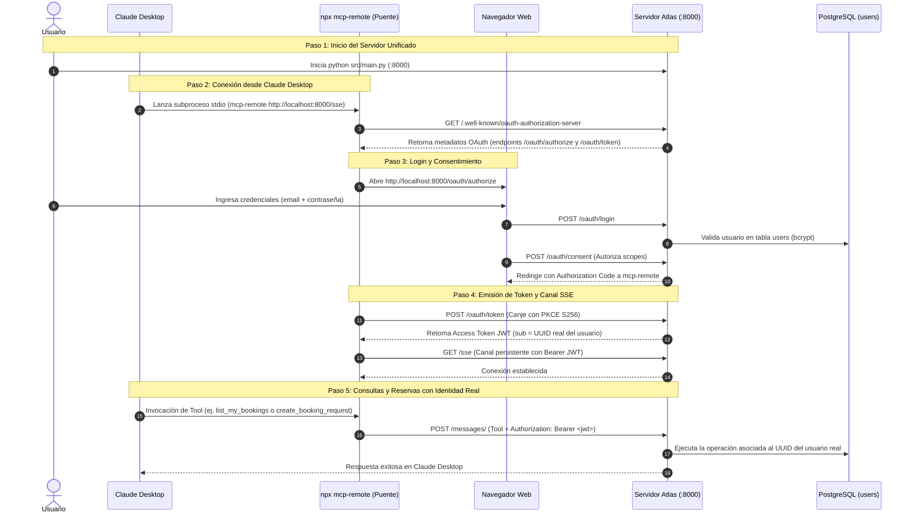

# Guía de Conexión: Claude Desktop con Atlas MCP y Autenticación OAuth 2.0

> **Documento de Instrucciones Operativas y Configuración Local.**  
> **Objetivo:** Conectar Claude Desktop al servidor local de Atlas utilizando el transporte HTTP/SSE y autenticación con identidad real de usuario (OAuth 2.0 / PKCE).

---

## 1. Arquitectura de Conexión Local



---

## 2. Paso 1: Iniciar el Servidor Unificado de Atlas

Abre una terminal en la raíz del proyecto (`atlas-mcp-conector`) con el entorno virtual activo:

```powershell
# Activar entorno virtual
.venv\Scripts\Activate.ps1

# Iniciar servidor unificado (FastAPI + OAuth + MCP SSE)
python src/main.py
```

El servidor quedará escuchando en `http://localhost:8000`.

### Verificación rápida en tu navegador:
* **Estado del conector:** Abre [http://localhost:8000/](http://localhost:8000/)  
  &rarr; Debe responder `{"status": "online", "service": "Atlas MCP Connector & OAuth 2.0 Server", ...}`.
* **Metadatos OAuth 2.0:** Abre [http://localhost:8000/.well-known/oauth-authorization-server](http://localhost:8000/.well-known/oauth-authorization-server)  
  &rarr; Debe responder con los endpoints de autorización y token locales.
* **Pantalla de login:** Abre [http://localhost:8000/oauth/authorize?client_id=claude-desktop&redirect_uri=http://localhost:8000/callback&response_type=code](http://localhost:8000/oauth/authorize?client_id=claude-desktop&redirect_uri=http://localhost:8000/callback&response_type=code)  
  &rarr; Verás la pantalla oficial de inicio de sesión de Atlas con diseño responsivo.

---

## 3. Paso 2: Configurar Claude Desktop

Claude Desktop se comunica con el servidor local a través de **`mcp-remote`** (puente oficial que enlaza la consola de Claude Desktop con el canal SSE HTTP y gestiona el flujo OAuth en el navegador).

1. Abre el archivo de configuración de Claude Desktop en Windows:
   * **Ruta:** `%APPDATA%\Claude\claude_desktop_config.json`  
     *(Normalmente: `C:\Users\<TuUsuario>\AppData\Roaming\Claude\claude_desktop_config.json`)*

2. Agrega el servidor `atlas`:

```json
{
  "mcpServers": {
    "atlas": {
      "command": "npx",
      "args": [
        "-y",
        "mcp-remote",
        "http://localhost:8000/sse",
        "--transport",
        "sse-only"
      ]
    }
  }
}
```

> [!TIP]
> * La URL del servidor (`http://localhost:8000/sse`) **debe ser el primer argumento posicional** después de `mcp-remote`.
> * El parámetro `--transport sse-only` le indica a `mcp-remote` que se conecte directamente por Server-Sent Events (SSE) sin intentar transmisiones HTTP streamable intermedias.
> * Requiere tener **Node.js** instalado en Windows (para ejecutar `npx`). Si ya tenías otros servidores en `claude_desktop_config.json`, añade `"atlas"` dentro de `"mcpServers"`.

---

## 4. Paso 3: Reiniciar Claude Desktop y Autenticarse

1. **Cierra completamente Claude Desktop** (asegúrate de que no quede en la bandeja del sistema).
2. **Abre Claude Desktop nuevamente**.
3. Al inicializarse, el conector `mcp-remote` detectará el servidor local y abrirá automáticamente tu navegador web por defecto con la pantalla de inicio de sesión de Atlas.
   * *Nota de seguridad y compatibilidad:* El conector levanta un puerto efímero de retorno local (ej. `http://localhost:18089/callback`). Nuestro servidor implementa **RFC 8252 Sección 7.3**, permitiendo dinámicamente cualquier puerto efímero asignado por el sistema en interfaces de loopback.
4. **Inicia sesión con tus credenciales registradas en la base de datos de Atlas**:
   * Introduce tu correo y contraseña (de cualquier usuario existente en la tabla `public.users`).
   * En la pantalla de consentimiento, haz clic en **"Permitir acceso"** para autorizar los permisos de lectura y creación de reservas (`bookings:read`, `bookings:write`, `profile`).
5. El navegador mostrará que la autorización fue exitosa y Claude Desktop completará la conexión.

---

## 5. Paso 4: Probar en el Chat de Claude Desktop

En una nueva conversación en Claude Desktop verás el ícono de herramientas (martillo) indicando que las 14 herramientas de Atlas están disponibles.

Prueba con instrucciones en lenguaje natural:

1. **Consulta de tus reservas:**
   > *"¿Cuáles son mis reservas activas registradas en Atlas?"*  
   > *(Claude ejecutará `list_my_bookings` pasando tu identidad real y te mostrará tus turnos).*

2. **Búsqueda y disponibilidad:**
   > *"Busca qué clubes de golf hay disponibles para el 20 de noviembre"*  
   > *(Claude ejecutará `search_businesses` y `check_availability`).*

3. **Creación de solicitud:**
   > *"Quiero solicitar una cita en VetMetro Ensanche Paraíso para mi perro que tiene tos leve"*  
   > *(Claude ejecutará `create_booking_request` registrando la reserva en segundo plano con tu UUID, email y teléfono reales).*

---

## 6. Alternativa de Pruebas: MCP Inspector

Si deseas inspeccionar el tráfico JSON-RPC o probar las herramientas en el navegador sin abrir Claude Desktop:

```powershell
npx @modelcontextprotocol/inspector http://localhost:8000/sse
```

Esto abrirá la consola de desarrollo interactiva donde puedes probar cada tool de forma aislada.

