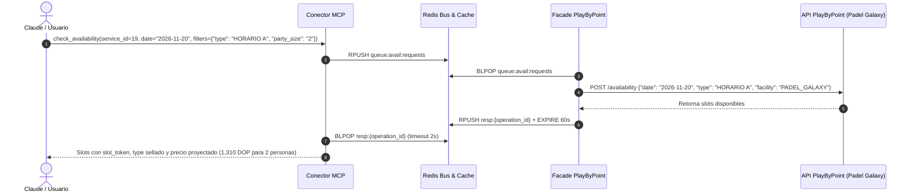
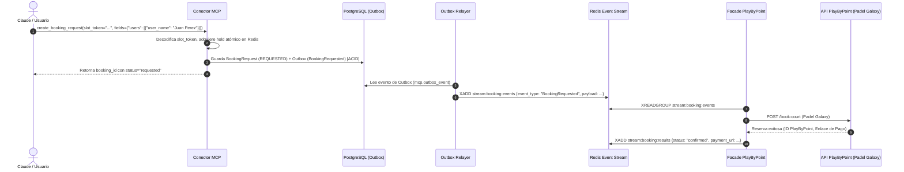

# Guía de Integración Facade / Upstream: Padel Galaxy (Servicio ID: 19)

> **Documento de Especificación de Mensajería e Integración.**  
> **Servicio:** Padel Galaxy  
> **Service ID:** `19`  
> **Pasarela Upstream:** PlayByPoint (`establishment_id: 13`, `sub_endpoint: 'PADEL_GALAXY'`, `combo_code: 'pgx'`)  
> **Patrón:** `slot_object`  
> **Destinatario:** Desarrolladores e ingenieros del servicio Facade / Ejecutor Upstream de Atlas.

---

## 1. Ficha Técnica y Contrato del Servicio

Padel Galaxy opera dentro de la pasarela **PlayByPoint** bajo el patrón de turnos por cancha de pádel (`slot_object`). La disponibilidad se consulta a nivel de tipo de horario (`type`: `HORARIO A` o `HORARIO B`) y opcionalmente por cantidad de jugadores (`party_size`: `1` a `4`) para una fecha determinada y el número de teléfono del usuario.

El club maneja partidos de **90 minutos** y admite una cantidad de **1 a 4 jugadores**. La tarifa es plana a **RD$ 655.00 por jugador por 90 minutos** (`calculation_basis: 'per_person'`).

### 1.1 Parámetros Generales
| Parámetro | Valor | Descripción |
| :--- | :--- | :--- |
| **`service_id`** | `19` | Identificador único en el catálogo de servicios de Atlas. |
| **`establishment_id`** | `13` (PlayByPoint) | Pasarela común PlayByPoint para múltiples clubes de pádel. |
| **`sub_endpoint`** | `PADEL_GALAXY` | Sub-endpoint identificador del club en PlayByPoint. |
| **`combo_code`** | `pgx` | Código de combinación del club. |
| **`pattern`** | `slot_object` | Reserva por turnos horarios en pistas de pádel. |
| **`request_ttl_seconds`** | `900` (15 min) | Vigencia del slot token criptográfico y del hold atómico en Redis. |
| **`payment_policy`** | `payment_link` | El club remite un enlace de pago digital seguro de PlayByPoint tras confirmar la solicitud. |
| **`cancellation_policy`**| 24 horas antes | Cancelación permitida sin penalidad hasta 24h antes del turno. |
| **`currency`** | `DOP` | Moneda oficial en pesos dominicanos. |
| **`rule_type`** | `None` | Sin esquema restrictivo de antelación; consultas van directo a disponibilidad real. |
| **`has_scheduler`** | `false` | No aplica Queuer de publicación previa; disponibilidad inmediata. |

---

### 1.2 Dimensiones de Filtrado de Disponibilidad

El contrato expone dos dimensiones en `mcp.contract_dimension`:

| Clave Dimensión (`key`) | Valores Admitidos (`value_key`) | Requerido | Etiqueta / Propósito |
| :--- | :--- | :--- | :--- |
| **`type`** | `HORARIO A`, `HORARIO B` | **Sí** (`true`) | **Tipo de Horario:** Configuración de franja o pistas requerida por la pasarela PlayByPoint para Padel Galaxy. |
| **`party_size`** | `1`, `2`, `3`, `4` | **No** (`false`, `allows_any: true`) | **Cantidad de Jugadores:** Permite proyectar la tarifa total calculada ($N \times \text{RD\$ 655.00}$) o consultar la tarifa unitaria por jugador. |

* En `check_availability`, Claude o el usuario pueden enviar:
  - Consulta general: `filters: {"type": "HORARIO A"}`
  - Consulta con aforo: `filters: {"type": "HORARIO A", "party_size": "2"}` o `filters: {"type": "HORARIO B", "party_size": 4}`.
* Ambos parámetros viajan sellados dentro del `SlotToken` en `applied_filters` y se propagan automáticamente hacia el payload del evento de reserva.

---

### 1.3 Esquema Tarifario Dinámico por Persona (`per_person`)

La tarifa oficial es de **RD$ 655.00 por jugador por 90 minutos** todos los días:

```
┌────────────────────────────────────────────────────────────────────────────────────────┐
│                        ESQUEMA TARIFARIO PADEL GALAXY                                  │
├────────────────────────┬─────────────────────────────┬─────────────────────────────────┤
│ DÍA DE LA SEMANA       │ FRANJA HORARIA              │ TARIFA POR PERSONA (DOP)        │
├────────────────────────┼─────────────────────────────┼─────────────────────────────────┤
│ Todos los días         │ Todo el día                 │ RD$ 655.00 por jugador (90 min) │
│ (Lunes a Domingo)      │ (00:00 – 24:00)             │                                 │
├────────────────────────┼─────────────────────────────┼─────────────────────────────────┤
│ Tarifa Fallback Base   │ Todo horario (prioridad 1)  │ RD$ 655.00 por persona          │
└────────────────────────┴─────────────────────────────┴─────────────────────────────────┘
```

#### Comportamiento del Cálculo de Precio:
1. **Consulta con `party_size` provisto (ej. 2 o 4 personas):**
   $$\text{total\_amount} = \text{amount} \times N = 655.00 \times N$$
   * *Ejemplo con 2 jugadores:* `1,310.00 DOP (655.00 DOP x 2 personas)`
   * *Ejemplo con 4 jugadores:* `2,620.00 DOP (655.00 DOP x 4 personas)`
   * Formato informativo: `"1,310.00 DOP (655.00 DOP x 2 personas)"`.
   * `projected_total` queda sellado en el `slot_token`.
2. **Consulta general (sin `party_size`):**
   * `total_amount = null`, `unit_amount = 655.00`.
   * Formato informativo: `"655.00 DOP por persona"`.

---

### 1.4 Formulario de Reserva y Capacidad Flexible (`1 a 4 Jugadores`)

El esquema del formulario de reserva (`booking_fields_schema`) contempla que:
* El titular de la cuenta autenticada es el **jugador 1**.
* El campo `users` es **opcional** y permite registrar de **0 a 3 acompañantes**:
  $$\text{Jugadores Totales} = 1 + \operatorname{len}(\text{users}) \in [1, 4]$$

```json
{
  "$schema": "http://json-schema.org/draft-07/schema#",
  "type": "object",
  "properties": {
    "users": {
      "type": "array",
      "title": "Jugadores Acompañantes",
      "description": "Padel Galaxy admite partidas de 1 a 4 jugadores. El titular autenticado de la cuenta es el primer jugador. Indique aquí de 0 a 3 acompañantes si asisten más personas.",
      "minItems": 0,
      "maxItems": 3,
      "items": {
        "type": "object",
        "required": ["user_name"],
        "properties": {
          "user_name": {
            "type": "string",
            "minLength": 2,
            "maxLength": 100,
            "description": "Nombre y apellido del jugador acompañante"
          }
        }
      }
    },
    "prefer_closest_time": {
      "type": "boolean",
      "default": true,
      "description": "Indica si se acepta el horario más cercano disponible en caso de leve desfase o discrepancia de turnos."
    }
  }
}
```

---

## 2. Flujo 1: Consulta de Disponibilidad (`check_availability`)

Dado que Padel Galaxy tiene `rule_type: None`, todas las consultas van directamente a disponibilidad real a través de la cola principal de Redis.



### 2.1 Mensaje en Cola de Redis (`queue:avail:requests`)

```json
{
  "operation_id": "op_pgx_98a7b6c5d4e3",
  "service_id": 19,
  "date": "2026-11-20",
  "establishment_id": 13,
  "sub_endpoint": "PADEL_GALAXY",
  "combo_code": "pgx",
  "user_phone": "+18095550199",
  "filters": {
    "type": "HORARIO A",
    "party_size": "2"
  }
}
```

### 2.2 Respuesta del Facade (`resp:{operation_id}`)

```json
{
  "status": "completed",
  "operation_id": "op_pgx_98a7b6c5d4e3",
  "slots": [
    {
      "offer_ref": "pbp:pgx:court1:20261120-0800",
      "slot_start": "2026-11-20T08:00:00",
      "slot_end": "2026-11-20T09:30:00",
      "resource_ref": "cancha_1",
      "resource_name": "Cancha 1",
      "attributes": {
        "type": "HORARIO A"
      }
    },
    {
      "offer_ref": "pbp:pgx:court2:20261120-0930",
      "slot_start": "2026-11-20T09:30:00",
      "slot_end": "2026-11-20T11:00:00",
      "resource_ref": "cancha_2",
      "resource_name": "Cancha 2",
      "attributes": {
        "type": "HORARIO A"
      }
    }
  ]
}
```

---

## 3. Flujo 2: Creación de Reserva Diferida (`create_booking_request`)



### 3.1 Payload del Evento `BookingRequested` en `stream:booking:events`

```json
{
  "event_id": "evt_pgx_1a2b3c4d",
  "event_type": "BookingRequested",
  "occurred_at": "2026-11-20T14:30:00Z",
  "payload": {
    "booking_id": "c1a2b3c4-d5e6-7f8a-9b0c-1d2e3f4a5b6c",
    "service_id": 19,
    "user_uuid": "e8a1f2b3-c4d5-6e7f-8a9b-0c1d2e3f4a5b",
    "user_phone": "+18095550199",
    "offer_ref": "pbp:pgx:court1:20261120-0800",
    "slot_start": "2026-11-20T08:00:00Z",
    "slot_end": "2026-11-20T09:30:00Z",
    "establishment_id": 13,
    "sub_endpoint": "PADEL_GALAXY",
    "combo_code": "pgx",
    "applied_filters": {
      "type": "HORARIO A",
      "party_size": "2"
    },
    "projected_total": 1310.0,
    "currency": "DOP",
    "fields": {
      "users": [
        {
          "user_name": "Juan Perez"
        }
      ],
      "prefer_closest_time": true
    }
  }
}
```

### 3.2 Notificación de Resultado por el Facade (`stream:booking:results`)

```json
{
  "event_type": "BookingConfirmed",
  "booking_id": "c1a2b3c4-d5e6-7f8a-9b0c-1d2e3f4a5b6c",
  "external_ref": "PBP-PGX-55123",
  "status": "confirmed",
  "payment_info": {
    "policy": "payment_link",
    "payment_url": "https://playbypoint.com/pay/pgx-55123",
    "currency": "DOP",
    "amount": 1310.0,
    "expires_at": "2026-11-20T15:30:00Z"
  },
  "message": "Turno confirmado en Padel Galaxy para 2 jugadores. Complete el pago mediante el enlace provisto."
}
```

---

## 4. Checklist de Validación para el Facade

- [x] Sub-endpoint configurado como `PADEL_GALAXY` con `combo_code = 'pgx'`.
- [x] Parámetro `type` admitiendo `HORARIO A` y `HORARIO B` en consultas upstream.
- [x] Reconocimiento de `party_size` (1 a 4) en dimensiones y `applied_filters`.
- [x] Procesamiento de `fields.users` admitiendo de 0 a 3 acompañantes (más el titular como primer jugador).
- [x] Consumo en `stream:booking:events` y emisión de respuesta en `stream:booking:results`.
- [x] Generación del enlace de pago de PlayByPoint (`payment_link`) en la respuesta de confirmación.
