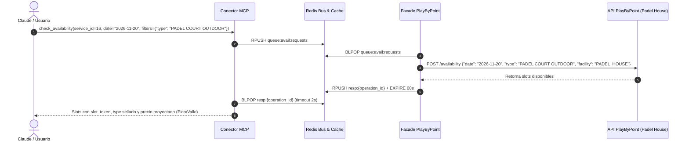
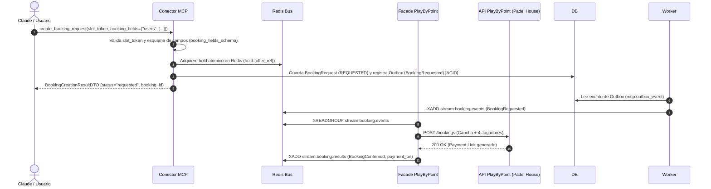

# Guía de Integración Facade / Upstream: Padel House (Servicio ID: 16)

> **Documento de Especificación de Mensajería e Integración.**  
> **Servicio:** Padel House  
> **Service ID:** `16`  
> **Pasarela Upstream:** PlayByPoint (`establishment_id: 13`, `sub_endpoint: 'PADEL_HOUSE'`, `combo_code: 'pho'`)  
> **Patrón:** `slot_object`  
> **Destinatario:** Desarrolladores e ingenieros del servicio Facade / Ejecutor Upstream de Atlas.

---

## 1. Ficha Técnica y Contrato del Servicio

Padel House opera dentro de la pasarela **PlayByPoint** bajo el patrón de turnos por cancha de pádel (`slot_object`). La disponibilidad se consulta a nivel de tipo de cancha (`type`) para una fecha determinada y el número de teléfono del usuario.

Padel House **requiere turnos de 90 minutos con 4 jugadores en cancha**. Por ello, el esquema tarifario en Atlas se modela por **cancha completa (`calculation_basis: 'per_booking'`)**, reflejando directamente el valor total de los 4 cupos y distinguiendo de forma dinámica entre **Horario Pico** y **Horario Valle**, tanto entre semana como en fines de semana.

### 1.1 Parámetros Generales
| Parámetro | Valor | Descripción |
| :--- | :--- | :--- |
| **`service_id`** | `16` | Identificador único en el catálogo de servicios de Atlas. |
| **`establishment_id`** | `13` (PlayByPoint) | Pasarela común PlayByPoint para múltiples clubes de pádel. |
| **`sub_endpoint`** | `PADEL_HOUSE` | Sub-endpoint identificador del club en PlayByPoint. |
| **`combo_code`** | `pho` | Código de combinación del club. |
| **`pattern`** | `slot_object` | Reserva por turnos horarios en pistas de pádel. |
| **`request_ttl_seconds`** | `900` (15 min) | Vigencia del slot token criptográfico y del hold atómico en Redis. |
| **`payment_policy`** | `payment_link` | El club remite un enlace de pago digital seguro de PlayByPoint tras confirmar la solicitud. |
| **`cancellation_policy`**| 24 horas antes | Cancelación permitida sin penalidad hasta 24h antes del turno. |
| **`currency`** | `DOP` | Moneda oficial en pesos dominicanos. |
| **`rule_type`** | `None` | Sin esquema restrictivo de antelación; consultas van directo a disponibilidad real. |
| **`has_scheduler`** | `false` | No aplica Queuer de publicación previa; disponibilidad inmediata. |

---

### 1.2 Dimensión de Filtrado: Tipo de Cancha (`type`)

Padel House exige especificar el tipo de pista en la consulta de disponibilidad:

| Clave Dimensión (`key`) | Valores Admitidos (`value_key`) | Etiqueta en MCP / UI |
| :--- | :--- | :--- |
| **`type`** | `PADEL COURT OUTDOOR` | Cancha al aire libre (Outdoor Court) |
| | `PADEL COURT INDOOR` | Cancha techada / interior (Indoor Court) |

* En `check_availability`, Claude o el usuario pueden enviar `filters: {"type": "PADEL COURT OUTDOOR"}` o `filters: {"type": "PADEL COURT INDOOR"}`.
* El valor seleccionado viaja sellado dentro del `SlotToken` en `applied_filters["type"]` y se propaga automáticamente hacia el payload del evento de reserva.

---

### 1.3 Esquema Tarifario Dinámico: Cancha Completa (90 mins, 4 Jugadores)

Dado que las reservas de pádel en Padel House son de 90 minutos y exigen 4 personas en pista (1 titular + 3 invitados), las tarifas se configuran a nivel de reserva completa (`calculation_basis: 'per_booking'`) según el día de la semana y la franja horaria:

```
┌────────────────────────────────────────────────────────────────────────────────────────┐
│                        ESQUEMA TARIFARIO PADEL HOUSE                                   │
├────────────────────────┬─────────────────────────────┬─────────────────────────────────┤
│ DÍA DE LA SEMANA       │ FRANJA HORARIA              │ TARIFA CANCHA (4 JUGADORES)     │
├────────────────────────┼─────────────────────────────┼─────────────────────────────────┤
│ Lunes a Viernes        │ 06:00 AM – 10:30 AM (Pico)  │ RD$ 4,400.00 (4 x RD$ 1,100.00) │
│ (Weekdays 1 a 5)       │ 10:30 AM – 04:30 PM (Valle) │ RD$ 3,200.00 (4 x RD$   800.00) │
│                        │ 04:30 PM – 10:30 PM (Pico)  │ RD$ 4,400.00 (4 x RD$ 1,100.00) │
├────────────────────────┼─────────────────────────────┼─────────────────────────────────┤
│ Sábado y Domingo       │ Todo el día                 │ RD$ 3,200.00 (4 x RD$   800.00) │
│ (Weekdays 6 y 7)       │ (06:00 AM – 10:30 PM)       │                                 │
├────────────────────────┼─────────────────────────────┼─────────────────────────────────┤
│ Tarifa Fallback Base   │ Todo horario (prioridad 1)  │ RD$ 3,200.00                    │
└────────────────────────┴─────────────────────────────┴─────────────────────────────────┘
```

* **Cálculo de `projected_total`**:
  - Al estar configurado con `calculation_basis: 'per_booking'`, el motor de precios inyecta directamente el monto total de la cancha:
    - **Hora Pico**: **RD$ 4,400.00 DOP**
    - **Hora Valle**: **RD$ 3,200.00 DOP**
  - Asegura que el token contenga la cotización exacta para la totalidad de la partida sin ambigüedades.

---

## 2. Flujo 1: Consulta de Disponibilidad (`check_availability`)

Dado que Padel House tiene `rule_type: None`, todas las consultas van directamente a disponibilidad real a través de la cola principal de Redis.



---

### 2.1 Mensaje que Recibe el Facade (`queue:avail:requests`)

El conector MCP inserta mediante `RPUSH` el envelope canónico:

```json
{
  "operation_id": "c1f7a0b2-8419-4b2a-bf39-4467ab21e901",
  "service_id": 16,
  "service_name": "Padel House",
  "establishment_id": 13,
  "endpoint": "playbypoint",
  "sub_endpoint": "PADEL_HOUSE",
  "date": "2026-11-20",
  "user_phone": "+18095551234",
  "user_email": "socio@atlas.com",
  "filters": {
    "type": "PADEL COURT OUTDOOR"
  },
  "party_size": null,
  "created_at": "2026-11-13T10:00:00.000000Z"
}
```

---

### 2.2 Respuesta que el Facade debe Publicar (`resp:{operation_id}`)

El Facade debe depositar en `resp:{operation_id}` una lista de slots disponibles. Cada slot debe contener la metadata de inicio, fin y el tipo de cancha:

```json
[
  {
    "start_time": "2026-11-20T08:00:00",
    "end_time": "2026-11-20T09:30:00",
    "resource_id": "cancha-outdoor-1",
    "resource_name": "Cancha Outdoor 1",
    "available": true,
    "slot_metadata": {
      "type": "PADEL COURT OUTDOOR",
      "court_number": 1,
      "duration_minutes": 90
    }
  },
  {
    "start_time": "2026-11-20T09:30:00",
    "end_time": "2026-11-20T11:00:00",
    "resource_id": "cancha-outdoor-2",
    "resource_name": "Cancha Outdoor 2",
    "available": true,
    "slot_metadata": {
      "type": "PADEL COURT OUTDOOR",
      "court_number": 2,
      "duration_minutes": 90
    }
  }
]
```

---

## 3. Flujo 2: Confirmación y Reserva (`create_booking_request`)

Una vez que Claude selecciona un slot, invoca la herramienta `create_booking_request` enviando el `slot_token` obtenido junto con los campos requeridos en el esquema del contrato (`booking_fields_schema`).



---

### 3.1 Esquema de `booking_fields` para Padel House

Padel House exige exactamente **3 jugadores acompañantes** (el usuario autenticado en Atlas es el 4to jugador):

```json
{
  "users": [
    { "user_name": "Pedro Martínez" },
    { "user_name": "Luis Sánchez" },
    { "user_name": "Andrés Gómez" }
  ],
  "prefer_closest_time": true
}
```

---

### 3.2 Mensaje que Recibe el Facade (`stream:booking:events`)

```json
{
  "request_id": "7b8a1c9e-3d4f-4e5a-8b6c-123456789abc",
  "service_id": 16,
  "service_name": "Padel House",
  "establishment_id": 13,
  "endpoint": "playbypoint",
  "sub_endpoint": "PADEL_HOUSE",
  "user_uuid": "e2a3b4c5-d6e7-48a9-b0c1-234567890def",
  "user_phone": "+18095551234",
  "user_email": "socio@atlas.com",
  "user_name": "Carlos Rodríguez",
  "slot": {
    "start_time": "2026-11-20T08:00:00",
    "end_time": "2026-11-20T09:30:00",
    "resource_id": "cancha-outdoor-1",
    "resource_name": "Cancha Outdoor 1",
    "applied_filters": {
      "type": "PADEL COURT OUTDOOR"
    },
    "projected_price": {
      "amount": 4400.00,
      "currency": "DOP",
      "calculation_basis": "per_booking",
      "label": "Hora Pico Mañana - Entre Semana (Cancha 4 Jugadores, RD$ 1,100/persona)"
    }
  },
  "booking_fields": {
    "users": [
      { "user_name": "Pedro Martínez" },
      { "user_name": "Luis Sánchez" },
      { "user_name": "Andrés Gómez" }
    ],
    "prefer_closest_time": true
  },
  "created_at": "2026-11-13T10:05:00.000000Z"
}
```

---

### 3.3 Evento de Confirmación que el Facade Publica (`booking:events`)

```json
{
  "request_id": "7b8a1c9e-3d4f-4e5a-8b6c-123456789abc",
  "event_type": "confirmed",
  "service_id": 16,
  "confirmation_code": "PH-20261120-8491",
  "payment_url": "https://book.padelhouseclub.com/pay/inv_84919284",
  "total_charged": 4400.00,
  "currency": "DOP",
  "message": "Reserva confirmada en Padel House (Cancha Outdoor 1). Turno de 08:00 AM a 09:30 AM.",
  "timestamp": "2026-11-13T10:05:03.000000Z"
}
```

---

## 4. Script de Migración / Seed

El script SQL ejecutable para configurar el contrato, dimensiones y reglas de precio de Padel House se encuentra en:
* [docs/seed_padel_house_service.sql](file:///c:/Users/pluto/source/repos/ENSO/atlas-mcp-conector/docs/seed_padel_house_service.sql)

---

## 5. Comparativa con otros Clubes de PlayByPoint

Todos los clubes PlayByPoint comparten la misma arquitectura técnica subyacente (`pattern = 'slot_object'`, pasarela común `establishment_id = 13`, `users: minItems 3, maxItems 3`), variando únicamente en:
1. **`service_id`** y **`sub_endpoint`** (ej. `PADEL_HOUSE`, `GROVE_PADEL_CLUB`, etc.).
2. **Valores de la dimensión `type`**:
   - Grove Padel: `OUTDOOR COURT` vs `COVERED COURT`.
   - Padel House: `PADEL COURT OUTDOOR` vs `PADEL COURT INDOOR`.
3. **Reglas de Precios**:
   - Grove Padel: Valle RD$ 1,800.00 / Pico RD$ 3,200.00.
   - Padel House: Valle RD$ 3,200.00 / Pico RD$ 4,400.00.

