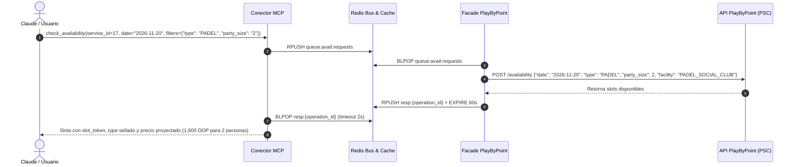
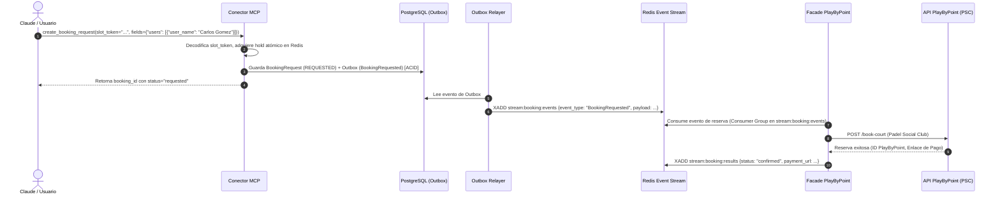

# Guía de Integración Facade / Upstream: Padel Social Club (Servicio ID: 17)

> **Documento de Especificación de Mensajería e Integración.**  
> **Servicio:** Padel Social Club  
> **Service ID:** `17`  
> **Pasarela Upstream:** PlayByPoint (`establishment_id: 13`, `sub_endpoint: 'PADEL_SOCIAL_CLUB'`, `combo_code: 'psc'`)  
> **Patrón:** `slot_object`  
> **Destinatario:** Desarrolladores e ingenieros del servicio Facade / Ejecutor Upstream de Atlas.

---

## 1. Ficha Técnica y Contrato del Servicio

Padel Social Club opera dentro de la pasarela **PlayByPoint** bajo el patrón de turnos por cancha de pádel (`slot_object`). La disponibilidad se consulta a nivel de tipo de cancha (`type`) y opcionalmente por cantidad de jugadores (`party_size`) para una fecha determinada y el número de teléfono del usuario.

A diferencia de otros clubes de pádel con cupo estricto de 4 jugadores fijos, **Padel Social Club tolera una cantidad flexible de 1 a 4 jugadores**. Por ello, el esquema tarifario en Atlas se modela por **persona (`calculation_basis: 'per_person'`)**, calculando el total dinámico cuando se indica el número de personas, o entregando la tarifa unitaria transparente cuando no se especifica.

### 1.1 Parámetros Generales
| Parámetro | Valor | Descripción |
| :--- | :--- | :--- |
| **`service_id`** | `17` | Identificador único en el catálogo de servicios de Atlas. |
| **`establishment_id`** | `13` (PlayByPoint) | Pasarela común PlayByPoint para múltiples clubes de pádel. |
| **`sub_endpoint`** | `PADEL_SOCIAL_CLUB` | Sub-endpoint identificador del club en PlayByPoint. |
| **`combo_code`** | `psc` | Código de combinación del club. |
| **`pattern`** | `slot_object` | Reserva por turnos horarios en pistas de pádel. |
| **`request_ttl_seconds`** | `900` (15 min) | Vigencia del slot token criptográfico y del hold atómico en Redis. |
| **`payment_policy`** | `payment_link` | El club remite un enlace de pago digital seguro de PlayByPoint tras confirmar la solicitud. |
| **`cancellation_policy`**| 24 horas antes | Cancelación permitida sin penalidad hasta 24h antes del turno. |
| **`currency`** | `DOP` | Moneda oficial en pesos dominicanos. |
| **`rule_type`** | `None` | Sin esquema restrictivo de antelación; consultas van directo a disponibilidad real. |
| **`has_scheduler`** | `false` | No aplica Queuer de publicación previa; disponibilidad inmediata. |

---

### 1.2 Dimensiones de Filtrado de Disponibilidad

El contrato expone dos dimensiones en `mcp.contract_dimension`:

| Clave Dimensión (`key`) | Valores Admitidos (`value_key`) | Requerido | Etiqueta / Propósito |
| :--- | :--- | :--- | :--- |
| **`type`** | `PADEL` | **Sí** (`true`) | **Tipo de Cancha:** Pistas reglamentarias de pádel. Requerido por el upstream de PlayByPoint. |
| **`party_size`** | `1`, `2`, `3`, `4` | **No** (`false`, `allows_any: true`) | **Cantidad de Jugadores:** Permite cotizar y proyectar la tarifa total calculada ($N \times \text{tarifa\_persona}$) o consultar disponibilidad general. |

* En `check_availability`, Claude o el usuario pueden enviar:
  - Consulta general: `filters: {"type": "PADEL"}`
  - Consulta con aforo: `filters: {"type": "PADEL", "party_size": "2"}` o `filters: {"type": "PADEL", "party_size": 4}`.
* Ambos parámetros viajan sellados dentro del `SlotToken` en `applied_filters` y se propagan automáticamente hacia el payload del evento de reserva.

---

### 1.3 Esquema Tarifario Dinámico por Persona (`per_person`)

Las tarifas se configuran con base por persona (`calculation_basis: 'per_person'`) según el día de la semana y la franja horaria:

```
┌────────────────────────────────────────────────────────────────────────────────────────┐
│                      ESQUEMA TARIFARIO PADEL SOCIAL CLUB                               │
├────────────────────────┬─────────────────────────────┬─────────────────────────────────┤
│ DÍA DE LA SEMANA       │ FRANJA HORARIA              │ TARIFA POR PERSONA (DOP)        │
├────────────────────────┼─────────────────────────────┼─────────────────────────────────┤
│ Lunes a Viernes        │ 06:00 AM – 04:30 PM (Valle) │ RD$   800.00 por persona        │
│ (Weekdays 1 a 5)       │ 04:30 PM – 10:00 PM (Pico)  │ RD$ 1,000.00 por persona        │
├────────────────────────┼─────────────────────────────┼─────────────────────────────────┤
│ Sábado y Domingo       │ Todo el día                 │ RD$   800.00 por persona        │
│ (Weekdays 6 y 7)       │ (06:00 AM – 10:00 PM)       │                                 │
├────────────────────────┼─────────────────────────────┼─────────────────────────────────┤
│ Tarifa Fallback Base   │ Todo horario (prioridad 1)  │ RD$   800.00 por persona        │
└────────────────────────┴─────────────────────────────┴─────────────────────────────────┘
```

#### Comportamiento del Cálculo de Precio:
1. **Consulta con `party_size` provisto (ej. 2 personas):**
   $$\text{total\_amount} = \text{amount} \times 2 = 800 \times 2 = 1,600.00\text{ DOP}$$
   * Formato informativo: `"1,600.00 DOP (800.00 DOP x 2 personas)"`.
   * `projected_total = 1600.0` (queda sellado en el token).
2. **Consulta general (sin `party_size`):**
   * `total_amount = null`, `unit_amount = 800.00` (o `1,000.00`).
   * Formato informativo: `"800.00 DOP por persona"`.

---

### 1.4 Formulario de Reserva y Capacidad Flexible (`1 a 4 Jugadores`)

El esquema del formulario de reserva (`booking_fields_schema`) contempla que:
* El titular de la cuenta autenticada es el **jugador 1**.
* El campo `users` es **opcional** y permite registrar de **0 a 3 acompañantes**:
  $$\text{Jugadores Totales} = 1 + \operatorname{len}(\text{users}) \in [1, 4]$$

```json
{
  "$schema": "http://json-schema.org/draft-07/schema#",
  "type": "object",
  "properties": {
    "users": {
      "type": "array",
      "title": "Jugadores Acompañantes",
      "description": "Padel Social Club admite partidas de 1 a 4 jugadores. El titular autenticado de la cuenta es el primer jugador. Indique aquí de 0 a 3 acompañantes si asisten más personas.",
      "minItems": 0,
      "maxItems": 3,
      "items": {
        "type": "object",
        "required": ["user_name"],
        "properties": {
          "user_name": {
            "type": "string",
            "minLength": 2,
            "maxLength": 100,
            "description": "Nombre y apellido del jugador acompañante"
          }
        }
      }
    },
    "prefer_closest_time": {
      "type": "boolean",
      "default": true,
      "description": "Indica si se acepta el horario más cercano disponible en caso de leve desfase o discrepancia de turnos."
    }
  }
}
```

---

## 2. Flujo 1: Consulta de Disponibilidad (`check_availability`)

Dado que Padel Social Club tiene `rule_type: None`, todas las consultas van directamente a disponibilidad real a través de la cola principal de Redis.



### 2.1 Mensaje en Cola de Redis (`queue:avail:requests`)

```json
{
  "operation_id": "op_98a7b6c5d4e3",
  "service_id": 17,
  "date": "2026-11-20",
  "establishment_id": 13,
  "sub_endpoint": "PADEL_SOCIAL_CLUB",
  "combo_code": "psc",
  "user_phone": "+18095550199",
  "filters": {
    "type": "PADEL",
    "party_size": "2"
  }
}
```

### 2.2 Respuesta del Facade (`resp:{operation_id}`)

```json
{
  "status": "completed",
  "operation_id": "op_98a7b6c5d4e3",
  "slots": [
    {
      "offer_ref": "pbp:psc:court1:20261120-0700",
      "slot_start": "2026-11-20T07:00:00",
      "slot_end": "2026-11-20T08:30:00",
      "resource_ref": "cancha_1",
      "resource_name": "Cancha 1",
      "attributes": {
        "type": "PADEL"
      }
    },
    {
      "offer_ref": "pbp:psc:court2:20261120-1700",
      "slot_start": "2026-11-20T17:00:00",
      "slot_end": "2026-11-20T18:30:00",
      "resource_ref": "cancha_2",
      "resource_name": "Cancha 2",
      "attributes": {
        "type": "PADEL"
      }
    }
  ]
}
```

---

## 3. Flujo 2: Creación de Reserva Diferida (`create_booking_request`)



---

## 4. Checklist de Validación para el Facade

- [x] Sub-endpoint configurado como `PADEL_SOCIAL_CLUB` con `combo_code = 'psc'`.
- [x] Parámetro `type = 'PADEL'` incluido en las peticiones upstream de disponibilidad y reserva.
- [x] Reconocimiento de `party_size` ('1' a '4') en dimensiones y `applied_filters`.
- [x] Procesamiento de `fields.users` admitiendo de 0 a 3 acompañantes (más el titular como primer jugador).
- [x] Generación del enlace de pago de PlayByPoint (`payment_link`) en la respuesta de confirmación.
