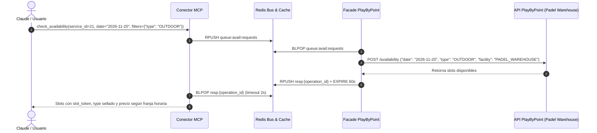
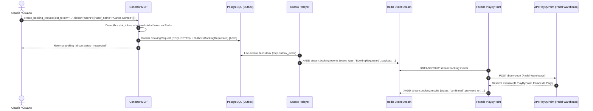

# Guía de Integración Facade / Upstream: Padel Warehouse (Servicio ID: 21)

> **Documento de Especificación de Mensajería e Integración.**  
> **Servicio:** Padel Warehouse  
> **Service ID:** `21`  
> **Pasarela Upstream:** PlayByPoint (`establishment_id: 13`, `sub_endpoint: 'PADEL_WAREHOUSE'`, `combo_code: 'pwh'`)  
> **Patrón:** `slot_object`  
> **Destinatario:** Desarrolladores e ingenieros del servicio Facade / Ejecutor Upstream de Atlas.

---

## 1. Ficha Técnica y Contrato del Servicio

Padel Warehouse opera dentro de la pasarela **PlayByPoint** bajo el patrón de turnos por cancha de pádel (`slot_object`). La disponibilidad se consulta a nivel de tipo de cancha / bloque horario (`type`: `OUTDOOR`, `HORARIO A` o `HORARIO B`) para una fecha determinada y el número de teléfono del usuario.

El club maneja partidos de **90 minutos** de duración con tarificación **por cancha completa** (`calculation_basis: 'per_booking'`), escalonada en 3 franjas horarias a lo largo del día.

A nivel de jugadores:
* **`OUTDOOR`**: Admite capacidad flexible de **1 a 4 jugadores** (titular + 0 a 3 acompañantes).
* **`HORARIO A`** y **`HORARIO B`**: Exigen obligatoriamente **4 jugadores** en cancha (titular + 3 acompañantes registrados).

> [!NOTE]
> Dado que la tarifa de Padel Warehouse es fija por turno de 90 minutos de cancha (`per_booking`) y no por persona, `party_size` no forma parte de las dimensiones de cotización en el contrato de este club (a diferencia de los servicios cotizados `per_person`, donde `party_size` se define obligatorio).

### 1.1 Parámetros Generales
| Parámetro | Valor | Descripción |
| :--- | :--- | :--- |
| **`service_id`** | `21` | Identificador único en el catálogo de servicios de Atlas. |
| **`establishment_id`** | `13` (PlayByPoint) | Pasarela común PlayByPoint para múltiples clubes de pádel. |
| **`sub_endpoint`** | `PADEL_WAREHOUSE` | Sub-endpoint identificador del club en PlayByPoint. |
| **`combo_code`** | `pwh` | Código de combinación del club. |
| **`pattern`** | `slot_object` | Reserva por turnos horarios en pistas de pádel. |
| **`request_ttl_seconds`** | `900` (15 min) | Vigencia del slot token criptográfico y del hold atómico en Redis. |
| **`payment_policy`** | `payment_link` | El club remite un enlace de pago digital seguro de PlayByPoint tras confirmar la solicitud. |
| **`cancellation_policy`**| 24 horas antes | Cancelación permitida sin penalidad hasta 24h antes del turno. |
| **`currency`** | `DOP` | Moneda oficial en pesos dominicanos. |
| **`rule_type`** | `None` | Sin esquema restrictivo de antelación; consultas van directo a disponibilidad real. |
| **`has_scheduler`** | `false` | No aplica Queuer de publicación previa; disponibilidad inmediata. |

---

### 1.2 Dimensión de Filtrado de Disponibilidad

El contrato expone una única dimensión obligatoria en `mcp.contract_dimension`:

| Clave Dimensión (`key`) | Valores Admitidos (`value_key`) | Requerido | Etiqueta / Propósito |
| :--- | :--- | :--- | :--- |
| **`type`** | `OUTDOOR`, `HORARIO A`, `HORARIO B` | **Sí** (`true`) | **Tipo de Cancha / Horario:** Configuración de cancha o franja horaria requerida por PlayByPoint. |

* En `check_availability`, Claude o el usuario envían:
  - Consulta Outdoor: `filters: {"type": "OUTDOOR"}`
  - Consulta Horario A: `filters: {"type": "HORARIO A"}`
  - Consulta Horario B: `filters: {"type": "HORARIO B"}`
* El parámetro seleccionado viaja sellado dentro del `SlotToken` en `applied_filters` y se propaga automáticamente hacia el payload del evento de reserva.

---

### 1.3 Esquema Tarifario Dinámico por Cancha Completa (`per_booking`, 90 min)

Las tarifas aplican por cancha completa de 90 minutos según la hora de inicio del turno:

```
┌────────────────────────────────────────────────────────────────────────────────────────┐
│                      ESQUEMA TARIFARIO PADEL WAREHOUSE (90 MINUTOS)                    │
├────────────────────────┬─────────────────────────────┬─────────────────────────────────┤
│ DÍA DE LA SEMANA       │ FRANJA HORARIA              │ TARIFA POR CANCHA COMPLETA      │
├────────────────────────┼─────────────────────────────┼─────────────────────────────────┤
│ Lunes a Domingo        │ 06:00 AM – 04:30 PM         │ RD$ 4,000.00                    │
│ Lunes a Domingo        │ 04:30 PM – 05:30 PM         │ RD$ 4,266.67                    │
│ Lunes a Domingo        │ 05:30 PM – 11:30 PM         │ RD$ 4,800.00                    │
├────────────────────────┼─────────────────────────────┼─────────────────────────────────┤
│ Tarifa Fallback Base   │ Todo horario (prioridad 1)  │ RD$ 4,000.00                    │
└────────────────────────┴─────────────────────────────┴─────────────────────────────────┘
```

#### Comportamiento del Cálculo de Precio:
* La base de cálculo es `'per_booking'`, por lo que el precio cotizado corresponde al valor total de la pista durante el bloque de 90 minutos.
* `total_amount` coincide exactamente con la tarifa de la franja correspondiente (`4,000.00`, `4,266.67` o `4,800.00 DOP`).
* El monto queda sellado en el `slot_token` emitido durante `check_availability` y viaja en `projected_total` en el evento de reserva.

---

### 1.4 Formulario de Reserva y Validación de Jugadores

El esquema del formulario de reserva (`booking_fields_schema`) contempla:
* El titular autenticado de la cuenta es el **jugador 1**.
* El campo `users` registra los acompañantes (`0 a 3` jugadores):
  - Para turnos **`OUTDOOR`**: Se admiten entre 0 y 3 acompañantes (partidas de 1 a 4 jugadores).
  - Para turnos **`HORARIO A`** y **`HORARIO B`**: El upstream de PlayByPoint exige 4 jugadores en cancha, por lo que deben suministrarse obligatoriamente los 3 acompañantes en `users`.

```json
{
  "$schema": "http://json-schema.org/draft-07/schema#",
  "type": "object",
  "properties": {
    "users": {
      "type": "array",
      "title": "Jugadores Acompañantes",
      "description": "El titular autenticado es el primer jugador. Para canchas OUTDOOR se admiten de 0 a 3 acompañantes (1 a 4 jugadores). Para turnos de HORARIO A y HORARIO B se requieren obligatoriamente 3 acompañantes (4 jugadores en total).",
      "minItems": 0,
      "maxItems": 3,
      "items": {
        "type": "object",
        "required": ["user_name"],
        "properties": {
          "user_name": {
            "type": "string",
            "minLength": 2,
            "maxLength": 100,
            "description": "Nombre y apellido del jugador acompañante"
          }
        }
      }
    },
    "prefer_closest_time": {
      "type": "boolean",
      "default": true,
      "description": "Indica si se acepta el horario más cercano disponible en caso de leve desfase o discrepancia de turnos."
    }
  }
}
```

---

## 2. Flujo 1: Consulta de Disponibilidad (`check_availability`)

Padel Warehouse posee `rule_type: None`, por lo que las consultas de disponibilidad no aplican filtros de antelación y van directo al Facade Upstream por Redis.



### 2.1 Mensaje en Cola de Redis (`queue:avail:requests`)

```json
{
  "operation_id": "op_pwh_44a1b2c3d4e5",
  "service_id": 21,
  "date": "2026-11-20",
  "establishment_id": 13,
  "sub_endpoint": "PADEL_WAREHOUSE",
  "combo_code": "pwh",
  "user_phone": "+18095550199",
  "filters": {
    "type": "OUTDOOR"
  }
}
```

### 2.2 Respuesta del Facade (`resp:{operation_id}`)

```json
{
  "status": "completed",
  "operation_id": "op_pwh_44a1b2c3d4e5",
  "slots": [
    {
      "offer_ref": "pbp:pwh:outdoor1:20261120-1000",
      "slot_start": "2026-11-20T10:00:00",
      "slot_end": "2026-11-20T11:30:00",
      "resource_ref": "cancha_outdoor_1",
      "resource_name": "Cancha Outdoor 1",
      "attributes": {
        "type": "OUTDOOR"
      }
    },
    {
      "offer_ref": "pbp:pwh:outdoor1:20261120-1730",
      "slot_start": "2026-11-20T17:30:00",
      "slot_end": "2026-11-20T19:00:00",
      "resource_ref": "cancha_outdoor_1",
      "resource_name": "Cancha Outdoor 1",
      "attributes": {
        "type": "OUTDOOR"
      }
    }
  ]
}
```

---

## 3. Flujo 2: Creación de Reserva Diferida (`create_booking_request`)



### 3.1 Payload del Evento `BookingRequested` en `stream:booking:events`

```json
{
  "event_id": "evt_pwh_7a8b9c0d",
  "event_type": "BookingRequested",
  "occurred_at": "2026-11-20T14:30:00Z",
  "payload": {
    "booking_id": "b2c3d4e5-f6a7-8b9c-0d1e-2f3a4b5c6d7e",
    "service_id": 21,
    "user_uuid": "e8a1f2b3-c4d5-6e7f-8a9b-0c1d2e3f4a5b",
    "user_phone": "+18095550199",
    "offer_ref": "pbp:pwh:outdoor1:20261120-1730",
    "slot_start": "2026-11-20T17:30:00Z",
    "slot_end": "2026-11-20T19:00:00Z",
    "establishment_id": 13,
    "sub_endpoint": "PADEL_WAREHOUSE",
    "combo_code": "pwh",
    "applied_filters": {
      "type": "OUTDOOR"
    },
    "projected_total": 4800.0,
    "currency": "DOP",
    "fields": {
      "users": [
        {
          "user_name": "Carlos Gomez"
        }
      ],
      "prefer_closest_time": true
    }
  }
}
```

### 3.2 Notificación de Resultado por el Facade (`stream:booking:results`)

```json
{
  "event_type": "BookingConfirmed",
  "booking_id": "b2c3d4e5-f6a7-8b9c-0d1e-2f3a4b5c6d7e",
  "external_ref": "PBP-PWH-77889",
  "status": "confirmed",
  "payment_info": {
    "policy": "payment_link",
    "payment_url": "https://playbypoint.com/pay/pwh-77889",
    "currency": "DOP",
    "amount": 4800.0,
    "expires_at": "2026-11-20T15:30:00Z"
  },
  "message": "Turno confirmado en Padel Warehouse (Cancha Outdoor 1). Complete el pago mediante el enlace provisto para formalizar la reserva."
}
```

---

## 4. Checklist de Validación para el Facade

- [x] Sub-endpoint configurado como `PADEL_WAREHOUSE` con `combo_code = 'pwh'`.
- [x] Parámetro `type` admitiendo `OUTDOOR`, `HORARIO A` y `HORARIO B` en consultas upstream.
- [x] Validación de aforo aguas arriba:
  - `OUTDOOR`: Admite de 1 a 4 jugadores (titular + 0 a 3 acompañantes).
  - `HORARIO A` y `HORARIO B`: Requiere 4 jugadores en total (titular + 3 acompañantes en `fields.users`).
- [x] Tarifas por turno completo de 90 min (`per_booking`): RD$ 4,000 (06:00-16:30), RD$ 4,266.67 (16:30-17:30) y RD$ 4,800 (17:30-23:30).
- [x] Consumo en `stream:booking:events` y emisión de respuesta en `stream:booking:results`.
- [x] Inclusión del enlace de pago de PlayByPoint (`payment_link`) en la respuesta de confirmación.
