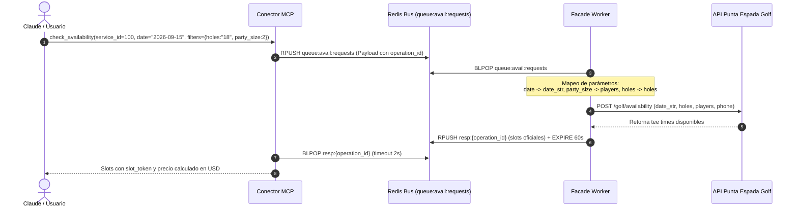
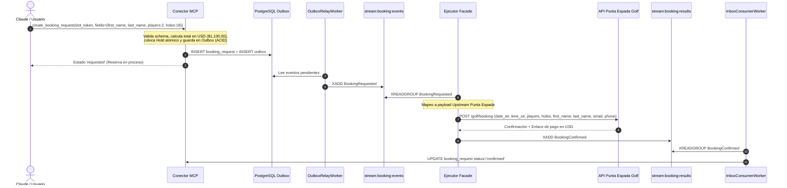

# Guía de Integración Facade / Upstream: Punta Espada Golf Club (Servicio ID: 100)

> **Documento de Especificación de Mensajería e Integración.**  
> **Servicio:** Punta Espada Golf Club  
> **Service ID:** `100`  
> **Establecimiento:** Punta Espada (ID: `93`, Código: `puesp`)  
> **Combo Code:** `puesp_golf`  
> **Patrón:** `slot_object`  
> **Moneda:** `USD` (Dólares estadounidenses)  
> **Destinatario:** Desarrolladores e ingenieros del servicio Facade / Ejecutor Upstream de Atlas.

---

## 1. Ficha Técnica y Contrato del Servicio

Punta Espada Golf Club (diseño Jack Nicklaus Signature en Cap Cana / Punta Cana) opera bajo el patrón de turnos horarios específicos (**`slot_object`**). La disponibilidad y las reservas de tee times se gestionan por fecha, cantidad de jugadores y hoyos, bajo un esquema tarifario oficial en dólares estadounidenses (**USD**).

### 1.1 Parámetros Generales
| Parámetro | Valor | Descripción |
| :--- | :--- | :--- |
| **`service_id`** | `100` | Identificador único en el catálogo de servicios de Atlas (`servicios.id = 100`). |
| **`establishment_id`** | `93` | Identificador del establecimiento (`establishments.id = 93`, código `'puesp'`). |
| **`combo_code`** | `puesp_golf` | Identificador mnemotécnico para enrutamiento en el bus. |
| **`pattern`** | `slot_object` | Reserva por turnos horarios de golf (tee times). |
| **`request_ttl_seconds`** | `900` (15 min) | Vigencia del slot token criptográfico y del hold atómico en Redis. |
| **`payment_policy`** | `payment_link` | El club formaliza la reserva emitiendo un enlace de pago digital seguro en **USD**. |
| **`cancellation_policy`** | 48 horas antes | Cancelación permitida sin penalidad hasta 48 horas antes del tee time reservado. |
| **`currency`** | `USD` | **Dólares estadounidenses**. Es el primer servicio multimoneda oficial del conector. |

---

### 1.2 Regla Operativa de Hoyos
> [!IMPORTANT]
> **Exclusividad de 18 Hoyos:**  
> Actualmente, la plataforma y sistema de reservas de Punta Espada Golf Club **solo admite reservas de 18 hoyos completos**. Las rondas de 9 hoyos no están disponibles ni contempladas en su API upstream. Tanto la dimensión de disponibilidad como el esquema de validación de reserva fuerzan `holes = 18`.

---

### 1.3 Dimensiones del Contrato (`applied_filters`)
El conector MCP expone 2 dimensiones clave para este servicio:

1. **`holes` (Recorrido de Hoyos):**
   * Valor único: `'18'` (18 Hoyos Completos - Recorrido reglamentario Jack Nicklaus Signature frente al mar Caribe).
   * `values_source`: `'inline'`
   * `apply_mode`: `'upstream_param'` (requerido para consultar disponibilidad al API del club).

2. **`party_size` (Cantidad de Jugadores / Players):**
   * Valores: `'1'`, `'2'`, `'3'`, `'4'` (de 1 a 4 jugadores).
   * `values_source`: `'inline'`
   * `apply_mode`: `'upstream_param'` (el Facade lo mapea al parámetro upstream `players`).
   * Permite calcular el total proyectado antes de reservar (`players * US$ 550.00`).

---

### 1.4 Matriz de Precios Oficiales (En USD)
El conector MCP calcula el precio total multiplicando la tarifa unitaria por el número de golfistas (`party_size` o `players`):

| Concepto / Recorrido | Moneda | Tarifa Unitaria | Base de Cálculo | Total Proyectado |
| :--- | :---: | :---: | :---: | :--- |
| **Green Fee 18 Hoyos** (1 Jugador) | **USD** | **$550.00** | por persona | **$550.00 USD** |
| **Green Fee 18 Hoyos** (2 Jugadores) | **USD** | **$550.00** | por persona | **$1,100.00 USD** |
| **Green Fee 18 Hoyos** (3 Jugadores) | **USD** | **$550.00** | por persona | **$1,650.00 USD** |
| **Green Fee 18 Hoyos** (4 Jugadores - Foursome) | **USD** | **$550.00** | por persona | **$2,200.00 USD** |

---

## 2. Flujo 1: Consulta de Disponibilidad (`check_availability`)



### 2.1 Mensaje que Recibe el Facade (`queue:avail:requests`)
El conector MCP inserta mediante `RPUSH` en la lista Redis `queue:avail:requests`:

```json
{
  "operation_id": "op_avail_puesp_994812",
  "type": "availability_request",
  "payload": {
    "service_id": 100,
    "combo_code": "puesp_golf",
    "user_uuid": "c4d7e231-1829-4d6b-9c71-332998822001",
    "user_phone": "+18095551234",
    "user_email": "carlos.gomez@example.com",
    "date": "2026-09-15",
    "filters": {
      "holes": "18",
      "party_size": 2
    },
    "contract_version": "2026-11-11.1",
    "filter_hash": "a4d9e03f19bc8821034feab990124312"
  },
  "created_at": "2026-11-11T14:30:00Z"
}
```

### 2.2 Mapeo Facade &rarr; Upstream Punta Espada Golf
El Facade adapta la solicitud al contrato exacto del API de Punta Espada:

| Campo API Punta Espada | Origen en Payload MCP | Tipo | Regla / Transformación | Ejemplo |
| :--- | :--- | :--- | :--- | :--- |
| **`date_str`** | `payload.date` | `string` | Fecha en formato `"YYYY-MM-DD"` | `"2026-09-15"` |
| **`holes`** | `payload.filters.holes` | `integer` | Valor numérico (fijo en `18`) | `18` |
| **`players`** | `payload.filters.party_size` | `integer` | Valor numérico (1 a 4) | `2` |
| **`phone`** | `payload.user_phone` | `string` | Teléfono internacional del usuario | `"+18095551234"` |

#### Payload enviado por el Facade al API Upstream:
```json
{
  "date_str": "2026-09-15",
  "holes": 18,
  "players": 2,
  "phone": "+18095551234"
}
```

### 2.3 Respuesta del Facade hacia MCP (`resp:{operation_id}`)
El Facade responde al conector MCP publicando en la clave efímera `resp:{operation_id}`:

```json
{
  "operation_id": "op_avail_puesp_994812",
  "status": "completed",
  "result_type": "availability",
  "service_id": 100,
  "contract_version": "2026-11-11.1",
  "filter_hash": "a4d9e03f19bc8821034feab990124312",
  "as_of": "2026-11-11T14:30:01Z",
  "slots": [
    {
      "offer_ref": "puesp-tee-20260915-0830",
      "slot_start": "2026-09-15T08:30:00-04:00",
      "slot_end": "2026-09-15T13:00:00-04:00",
      "resource_ref": "Punta Espada Golf Course",
      "resource_name": "Tee Time 08:30 AM (18 Hoyos)",
      "is_estimated": false,
      "slot_type": "official",
      "attributes": {
        "holes": 18,
        "players": 2
      }
    },
    {
      "offer_ref": "puesp-tee-20260915-0910",
      "slot_start": "2026-09-15T09:10:00-04:00",
      "slot_end": "2026-09-15T13:40:00-04:00",
      "resource_ref": "Punta Espada Golf Course",
      "resource_name": "Tee Time 09:10 AM (18 Hoyos)",
      "is_estimated": false,
      "slot_type": "official",
      "attributes": {
        "holes": 18,
        "players": 2
      }
    }
  ]
}
```

---

## 3. Flujo 2: Ciclo de Reserva (`create_booking_request`)



### 3.1 Evento Emitido por MCP (`stream:booking:events`)
El `OutboxRelayWorker` publica en el stream `stream:booking:events`:

* **`event_type`:** `"BookingRequested"`
* **Payload:**

```json
{
  "event_id": "9b12c3d4-e5f6-7890-abcd-ef0123456789",
  "aggregate_id": "c7a8b901-2345-6789-abcd-ef0123456789",
  "event_type": "BookingRequested",
  "correlation_id": "idemp-puesp-golf-88310",
  "payload": {
    "booking_id": "c7a8b901-2345-6789-abcd-ef0123456789",
    "user_uuid": "c4d7e231-1829-4d6b-9c71-332998822001",
    "user_phone": "18095551234",
    "user_email": "carlos.gomez@example.com",
    "service_id": 100,
    "combo_code": "puesp_golf",
    "contract_version_id": "a4d9e03f-19bc-8821-034f-eab990124312",
    "token_id": "tok_puesp_8849120",
    "offer_ref": "puesp-tee-20261120-0830",
    "slot_start": "2026-11-20T08:30:00-04:00",
    "slot_end": "2026-11-20T13:00:00-04:00",
    "is_estimated": false,
    "projected_total": 1100.0,
    "applied_filters": {
      "holes": "18",
      "party_size": 2
    },
    "fields": {
      "players": 2,
      "holes": 18,
      "first_name": "Carlos",
      "last_name": "Gómez",
      "notes": "Alquiler de dos sets de palos Callaway para diestros"
    },
    "expires_at": "2026-11-11T14:45:00Z"
  },
  "created_at": "2026-11-11T14:30:00Z"
}
```

---

### 3.2 Mapeo Facade / Ejecutor &rarr; Upstream Punta Espada (Payload de Reserva)

El Ejecutor construye el payload físico de reserva requerido por el API de Punta Espada:

| Campo API Upstream | Origen en `BookingRequested` | Regla / Transformación | Ejemplo |
| :--- | :--- | :--- | :--- |
| **`date_str`** | `payload.slot_start` | Extraer fecha `"YYYY-MM-DD"` | `"2026-11-20"` |
| **`time_str`** | `payload.slot_start` | Extraer hora local `"HH:MM"` | `"08:30"` |
| **`players`** | `payload.fields.players` o `applied_filters.party_size` | Entero (`int`) | `2` |
| **`holes`** | `payload.fields.holes` o `applied_filters.holes` | Entero fijo en `18` | `18` |
| **`first_name`** | `payload.fields.first_name` | String (o nombre de cuenta si se omitió) | `"Carlos"` |
| **`last_name`** | `payload.fields.last_name` | String (o apellido de cuenta si se omitió) | `"Gómez"` |
| **`email`** | `payload.user_email` | Correo del titular | `"carlos.gomez@example.com"` |
| **`phone`** | `payload.user_phone` | Teléfono de contacto (normalizado) | `"18095551234"` |

#### Payload enviado por el Facade a Punta Espada Golf:
```json
{
  "date_str": "2026-11-20",
  "time_str": "08:30",
  "players": 2,
  "holes": 18,
  "first_name": "Carlos",
  "last_name": "Gómez",
  "email": "carlos.gomez@example.com",
  "phone": "18095551234"
}
```

---

### 3.3 Respuestas del Ejecutor hacia MCP (`stream:booking:results`)

#### A. Caso Exitoso (`BookingConfirmed`)
Cuando Punta Espada confirma el tee time y emite el localizador y enlace de pago:

```json
{
  "event_id": "e1f2a3b4-5678-90ab-cdef-1234567890ab",
  "aggregate_id": "c7a8b901-2345-6789-abcd-ef0123456789",
  "event_type": "BookingConfirmed",
  "correlation_id": "idemp-puesp-golf-88310",
  "payload": {
    "booking_id": "c7a8b901-2345-6789-abcd-ef0123456789",
    "service_id": 100,
    "status": "confirmed",
    "external_ref": "PUESP-TEE-77210",
    "message": "Tee time confirmado en Punta Espada Golf Club para 2 jugadores (18 hoyos) a las 08:30 AM el 20/11/2026. Hemos enviado el enlace seguro de pago en USD a carlos.gomez@example.com para completar el Green Fee.",
    "payment_info": {
      "channel": "payment_link",
      "currency": "USD",
      "amount": 1100.00
    }
  },
  "created_at": "2026-11-11T14:30:05Z"
}
```

#### B. Caso Rechazado (`BookingRejected`)
Cuando el turno ya no está disponible o el club rechaza la solicitud:

```json
{
  "event_id": "f2a3b4c5-6789-01ab-cdef-2345678901bc",
  "aggregate_id": "c7a8b901-2345-6789-abcd-ef0123456789",
  "event_type": "BookingRejected",
  "correlation_id": "idemp-puesp-golf-88310",
  "payload": {
    "booking_id": "c7a8b901-2345-6789-abcd-ef0123456789",
    "service_id": 100,
    "status": "rejected",
    "error_code": "TEE_TIME_UNAVAILABLE",
    "reason": "El tee time de las 08:30 AM para 18 hoyos acaba de ser completado por otro grupo. Por favor elija otro horario.",
    "retryable": false
  },
  "created_at": "2026-11-11T14:30:04Z"
}
```

#### C. Caso de Discrepancia o Pausa (`BookingNoticeRaised`)
Si durante la confirmación el club reporta una variación en la tarifa (ej. temporada alta extraordinaria a US$ 600.00 por jugador) o ajuste de horario mayor a 1 hora, el Facade **no debe rechazar la reserva**, sino emitir un aviso para aprobación del usuario:

```json
{
  "event_id": "a3b4c5d6-7890-12ab-cdef-3456789012cd",
  "aggregate_id": "c7a8b901-2345-6789-abcd-ef0123456789",
  "event_type": "BookingNoticeRaised",
  "correlation_id": "idemp-puesp-golf-88310",
  "payload": {
    "notice_id": "88bb99cc-00dd-11ee-22ff-33aa44bb55cc",
    "notice_type": "price_discrepancy",
    "message": "Punta Espada Golf Club aplicó una tarifa de temporada especial: el costo total para 2 jugadores es de US$ 1,200.00 (en vez del estimado de US$ 1,100.00).",
    "details": {
      "expected_total": 1100.0,
      "actual_total": 1200.0,
      "currency": "USD",
      "difference": 100.0
    },
    "requires_action": true
  },
  "created_at": "2026-11-11T14:30:04Z"
}
```

Cuando el usuario aprueba la discrepancia vía Claude (`resolve_booking_notice`), el Conector MCP emite `BookingResumed` en `stream:booking:events` con el nuevo `projected_total`, permitiendo al Facade culminar la confirmación con el club.

---

## 4. Consideraciones Técnicas y Operativas

1. **Moneda USD Nativa:**
   * La tabla `mcp.service_pricing_policy` tiene `currency = 'USD'`.
   * El cálculo de cotizaciones proyectadas en `check_availability` y en `create_booking_request` produce strings como `"1100.00 USD (550.00 USD x 2 personas)"`.
   * Las pasarelas de pago y enlaces digitales enviados al usuario deben ser liquidados en **USD**.

2. **Formato de Teléfono:**
   * El conector almacena el teléfono en formato estándar (ej. `"18095551234"` o `"+18095551234"`).
   * Al invocar la disponibilidad upstream se provee `phone` con prefijo si aplica (`"+18095551234"`), y en reserva como `"18095551234"`.

3. **Política de 18 Hoyos:**
   * En caso de que el usuario o el asistente intente solicitar 9 hoyos, el schema de `booking_fields_schema` lo rechazará automáticamente (`enum: [18]`).
   * No se deben mapear solicitudes con `holes != 18` hacia el club.

4. **Tolerancia a Fallos e Idempotencia:**
   * El `correlation_id` acompaña todo el ciclo de vida de la reserva.
   * El Facade debe ser idempotente ante reintentos de `BookingRequested`.

