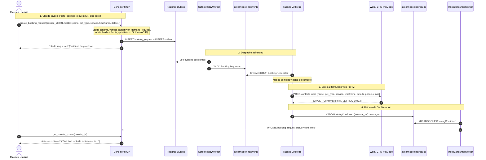

# Guía de Integración Facade / Upstream: VetMetro (Servicios ID: 101, 102, 103)

> **Documento de Especificación de Mensajería e Integración.**  
> **Establecimiento:** VetMetro (`id: 94`, `code: 'vemt'`)  
> **Sedes / Servicios:**
> * `service_id: 101` &rarr; VetMetro Ensanche Paraíso (`combo_code: 'vemt_paraiso'`)
> * `service_id: 102` &rarr; VetMetro Arroyo Hondo (`combo_code: 'vemt_arroyohondo'`)
> * `service_id: 103` &rarr; VetMetro Gazcue (`combo_code: 'vemt_gazcue'`)  
> **Patrón:** `on_demand_request` (solicitud bajo demanda / sin slots fijos de agenda)  
> **Destinatario:** Desarrolladores e ingenieros del servicio Facade / Ejecutor Upstream de Atlas.

---

## 1. Ficha Técnica y Contrato del Servicio

VetMetro es una red de clínicas veterinarias y centros de atención integral para mascotas. A diferencia de las instalaciones deportivas o de entretenimiento (golf, pádel, cine), su canal digital opera mediante **solicitudes bajo demanda (`on_demand_request`)**: los usuarios completan un formulario estructurado describiendo a su mascota, el servicio requerido y el marco de tiempo deseado, y el personal veterinario procesa la solicitud para contactar directamente al cliente o coordinar el ingreso.

### 1.1 Parámetros Generales
| Parámetro | Valor | Descripción |
| :--- | :--- | :--- |
| **`establishment_id`** | `94` | Identificador único de VetMetro (`code: 'vemt'`). |
| **`services`** | `101`, `102`, `103` | Sedes: Paraíso (`101`), Arroyo Hondo (`102`) y Gazcue (`103`). |
| **`pattern`** | **`on_demand_request`** | **No maneja slots horarios fijos**. Se tramita directamente con formulario. |
| **`request_ttl_seconds`** | `86400` (24 horas) | Vigencia máxima de la solicitud pendiente antes de expiración. |
| **`pricing_mode`** | `text_only` | Informativo (los costos se cotizan tras evaluación clínica presencial). |
| **`payment_policy`** | `pay_at_venue` | El pago se liquida en la clínica veterinaria o al prestarse el servicio. |
| **`cancellation_policy`**| Inmediata (`0h`) | Modificación o cancelación libre comunicándose directamente con la sede. |
| **`currency`** | `DOP` | Pesos dominicanos. |

---

## 2. Diferencias Clave del Patrón `on_demand_request` frente a `slot_object`

El patrón `on_demand_request` introduce optimizaciones críticas en el flujo de Atlas:

| Característica | Servicios `slot_object` (Cine, Golf, Pádel) | Servicios `on_demand_request` (VetMetro) |
| :--- | :--- | :--- |
| **Consulta de Disponibilidad** | Obligatoria: requiere slots horarios reales o estimados con `slot_token`. | **Opcional e informativa**: retorna `slots: []` y orienta a reservar directamente. |
| **Token Criptográfico** | Exige `slot_token` firmado e inmutable en `create_booking_request`. | **Sin `slot_token`**: se invoca con `service_id` y `fields`. |
| **Hold Atómico en Redis** | Bloquea el cupo o cancha por 15 minutos en Redis. | **Omitido**: no hay bloqueo de franja horaria en Redis. |
| **Validación de Datos** | Valida campos contra el JSON Schema del contrato. | Valida campos contra el JSON Schema del contrato. |
| **Transaccionalidad (ACID)** | Guarda en `mcp.booking_request` y encola en Outbox. | Guarda en `mcp.booking_request` y encola en Outbox. |
| **Mapeo Upstream** | Mapea fecha/hora del slot al API externo. | Mapea los campos del formulario (`fields`) al web form / CRM. |

---

## 3. Esquema del Formulario de Reserva (`booking_fields_schema`)

El contrato define las siguientes propiedades con validación estricta en el Conector MCP:

### 3.1 Campos Requeridos (`required`)
1. **`pet_type`** (`string`, enum):
   * `'Perro'`
   * `'Gato'`
   * `'Ave'`
   * `'Otro / exótico'`
2. **`service`** (`string`, enum de 11 subservicios oficiales):
   * `'Emergencia 24 horas'` *(Prioridad máxima de atención)*
   * `'Consulta y medicina general'`
   * `'Vacunación y prevención'`
   * `'Laboratorio y diagnóstico'`
   * `'Hospitalización'`
   * `'Grooming y spa'`
   * `'Hotel de mascotas'`
   * `'Servicio a domicilio'`
   * `'Tienda y farmacia'`
   * `'Cirugía'`
   * `'Negocio - criadero / rescate / pet-friendly'`
3. **`timeframe`** (`string`, enum):
   * `'Lo antes posible'`
   * `'Esta semana'`
   * `'Solo estoy cotizando'`
4. **`details`** (`string`):
   * Descripción de los síntomas, condición de la mascota, motivo de la consulta o peticiones específicas.

### 3.2 Campos Opcionales
* **`name`** (`string`): Nombre completo del propietario o contacto. Si se omite, se usa el de la cuenta de usuario.
* **`phone`** (`string`): Teléfono de contacto alternativo. Si se omite, se usa el teléfono de la cuenta (`user_phone`).
* **`email`** (`string`, format `email`): Correo de contacto alternativo. Si se omite, se usa el de la cuenta (`user_email`).

---

## 4. Diagrama de Secuencia del Flujo de Reserva



---

## 5. Especificación de Mensajería Redis

### 5.1 Evento Emitido por MCP (`stream:booking:events`)
El `OutboxRelayWorker` extrae el evento de la base de datos y lo publica en el canal Redis `stream:booking:events`:

* **`event_type`:** `"BookingRequested"`
* **Payload JSON Canónico:**

```json
{
  "event_id": "c1a2b3d4-e5f6-7890-abcd-112233445566",
  "aggregate_id": "b8f9a012-3456-7890-cdef-1234567890ab",
  "event_type": "BookingRequested",
  "correlation_id": "idemp-vetm-paraiso-99410",
  "payload": {
    "booking_id": "b8f9a012-3456-7890-cdef-1234567890ab",
    "user_uuid": "c4d7e231-1829-4d6b-9c71-332998822001",
    "user_phone": "18095551234",
    "user_email": "maria.gonzalez@gmail.com",
    "service_id": 101,
    "combo_code": "vemt_paraiso",
    "contract_version_id": "fe250aeb-8ce9-401a-9c12-35c0092ab9b3",
    "token_id": null,
    "offer_ref": null,
    "slot_start": null,
    "slot_end": null,
    "is_estimated": false,
    "projected_total": null,
    "applied_filters": {},
    "fields": {
      "name": "María González",
      "pet_type": "Perro",
      "service": "Consulta y medicina general",
      "timeframe": "Lo antes posible",
      "details": "Presenta tos leve y decaimiento desde ayer por la tarde"
    },
    "expires_at": "2026-11-13T11:30:00Z"
  },
  "created_at": "2026-11-12T11:30:00Z"
}
```

> [!NOTE]
> Observa que para `on_demand_request`, los atributos de slot (`token_id`, `offer_ref`, `slot_start`, `slot_end`, `projected_total`) son `null`. Toda la carga útil viaja dentro de `payload.fields` y los datos del usuario en `payload.user_phone` y `payload.user_email`.

---

### 5.2 Mapeo Facade &rarr; Formulario / Endpoint Web VetMetro

El Ejecutor Facade mapea los datos de `BookingRequested` hacia los campos esperados por la plataforma web o CRM de VetMetro:

| Campo Web VetMetro | Origen en `BookingRequested` | Regla / Fallback | Ejemplo |
| :--- | :--- | :--- | :--- |
| **`name`** | `payload.fields.name` | Si no está en `fields`, tomar el nombre de la cuenta | `"María González"` |
| **`pet_type`** | `payload.fields.pet_type` | Valor exacto del enum | `"Perro"` |
| **`service`** | `payload.fields.service` | Valor exacto del subservicio | `"Consulta y medicina general"` |
| **`timeframe`** | `payload.fields.timeframe` | Marco de tiempo de atención | `"Lo antes posible"` |
| **`details`** | `payload.fields.details` | Descripción de síntomas o motivo | `"Presenta tos leve y decaimiento..."` |
| **`phone`** | `payload.fields.phone` o `payload.user_phone` | Teléfono de contacto normalizado | `"18095551234"` |
| **`email`** | `payload.fields.email` o `payload.user_email` | Correo de notificación | `"maria.gonzalez@gmail.com"` |
| **`branch` / `sede`** | `payload.combo_code` | Identificación de sede según código | `"Ensanche Paraíso"` |

#### Payload enviado por el Facade al API / Web Form:
```json
{
  "name": "María González",
  "pet_type": "Perro",
  "service": "Consulta y medicina general",
  "timeframe": "Lo antes posible",
  "details": "Presenta tos leve y decaimiento desde ayer por la tarde",
  "phone": "18095551234",
  "email": "maria.gonzalez@gmail.com"
}
```

---

### 5.3 Respuestas del Ejecutor hacia MCP (`stream:booking:results`)

#### A. Caso Exitoso (`BookingConfirmed`)
Al recibir el acuse de recibo o identificador de solicitud del CRM de VetMetro, el Facade publica en `stream:booking:results`:

```json
{
  "event_id": "d2e3f4a5-6789-01ab-cdef-223344556677",
  "aggregate_id": "b8f9a012-3456-7890-cdef-1234567890ab",
  "event_type": "BookingConfirmed",
  "correlation_id": "idemp-vetm-paraiso-99410",
  "payload": {
    "booking_id": "b8f9a012-3456-7890-cdef-1234567890ab",
    "service_id": 101,
    "status": "confirmed",
    "external_ref": "VET-REQ-10492",
    "message": "Solicitud de atención para tu mascota recibida exitosamente en VetMetro Ensanche Paraíso (Ref: VET-REQ-10492). Nuestro equipo veterinario se comunicará contigo al 18095551234 para coordinar la cita.",
    "payment_info": {
      "channel": "on_site",
      "currency": "DOP",
      "amount": null
    }
  },
  "created_at": "2026-11-12T11:30:04Z"
}
```

#### B. Caso de Error o Rechazo (`BookingRejected`)
Si el sistema externo no responde o rechaza la solicitud (ej. sede cerrada por mantenimiento de emergencia):

```json
{
  "event_id": "f3a4b5c6-7890-12ab-cdef-334455667788",
  "aggregate_id": "b8f9a012-3456-7890-cdef-1234567890ab",
  "event_type": "BookingRejected",
  "correlation_id": "idemp-vetm-paraiso-99410",
  "payload": {
    "booking_id": "b8f9a012-3456-7890-cdef-1234567890ab",
    "service_id": 101,
    "status": "rejected",
    "error_code": "BRANCH_UNAVAILABLE",
    "reason": "La sede de Ensanche Paraíso no está recibiendo solicitudes en este momento por labores de mantenimiento. Por favor selecciona la sede de Arroyo Hondo o Gazcue.",
    "retryable": false
  },
  "created_at": "2026-11-12T11:30:05Z"
}
```

#### C. Caso de Aviso o Requerimiento Especial (`BookingNoticeRaised`)
Si el equipo veterinario o el sistema responde que se requiere una confirmación del usuario (por ejemplo, para procedimientos de cirugía que requieren ayuno previo de 12 horas o derivación a otra sede):

```json
{
  "event_id": "a4b5c6d7-8901-23ab-cdef-445566778899",
  "aggregate_id": "b8f9a012-3456-7890-cdef-1234567890ab",
  "event_type": "BookingNoticeRaised",
  "correlation_id": "idemp-vetm-paraiso-99410",
  "payload": {
    "notice_id": "99bb88cc-11aa-22bb-33cc-44dd55ee66ff",
    "notice_type": "clinical_prerequisite",
    "message": "VetMetro solicita confirmación: para el servicio de Cirugía se requiere que la mascota cumpla un ayuno sólido estricto de 12 horas antes de la intervención.",
    "details": {
      "fasting_hours": 12,
      "water_allowed_until_hours": 4
    },
    "requires_action": true
  },
  "created_at": "2026-11-12T11:30:05Z"
}
```

El usuario puede aceptar el aviso mediante `resolve_booking_notice(decision='accept')`, lo que emite `BookingResumed` para que el Facade culmine el registro.

---

## 6. Particularidades Operativas de las Sedes

| Sede | `service_id` | `combo_code` | Notas Operativas |
| :--- | :---: | :---: | :--- |
| **Ensanche Paraíso** | `101` | `vemt_paraiso` | Sede central con quirófano y laboratorio clínico de alta complejidad. |
| **Arroyo Hondo** | `102` | `vemt_arroyohondo` | Sede norte especializada en consultas generales, vacunas y grooming. |
| **Gazcue** | `103` | `vemt_gazcue` | Sede céntrica con atención de emergencias 24 horas y hospitalización. |

> [!TIP]
> **Atención de Emergencias 24 Horas:**  
> Cuando el campo `service` sea `"Emergencia 24 horas"`, el Facade debe priorizar la llamada HTTP o el webhook con un timeout reducido y alertar de inmediato al despacho de guardia veterinaria.

