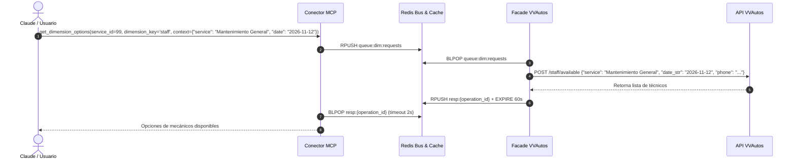
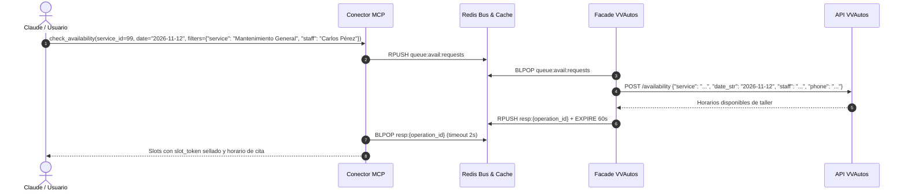

# Guía de Integración Facade / Upstream: VVAutos Taller (Servicio ID: 99)

> **Documento de Especificación de Mensajería e Integración.**  
> **Establecimiento:** VVAutos (`id: 92`, `code: 'VV'`)  
> **Servicio:** VVAutos Taller  
> **Service ID:** `99`  
> **Combo Code:** `vvautos_taller`  
> **Patrón:** `slot_object` (citas y turnos horarios de taller mecánico)  
> **Destinatario:** Desarrolladores e ingenieros del servicio Facade / Ejecutor Upstream de Atlas.

---

## 1. Ficha Técnica y Contrato del Servicio

VVAutos Taller es un centro de servicio automotriz especializado para agendamiento de turnos de mantenimiento preventivo, mecánica general, cristales y carrocería. Opera bajo el patrón de turnos fijos (`slot_object`).

### 1.1 Regla de Negocio Crítica: Exclusividad Marca VOLVO
> [!IMPORTANT]
> **VVAutos atiende EXCLUSIVAMENTE vehículos de la marca VOLVO.**  
> Todo vehículo registrado o seleccionado para la cita debe pertenecer a la gama Volvo (ej. *Volvo XC60, Volvo S60, Volvo XC90, Volvo XC40, Volvo C40, Volvo EX30*, etc.). El conector MCP y el contrato instruyen explícitamente al agente de IA (Claude) a comunicar esta restricción y rechazar o corregir vehículos de otras marcas antes de enviar la reserva.

### 1.2 Parámetros Generales
| Parámetro | Valor | Descripción |
| :--- | :--- | :--- |
| **`service_id`** | `99` | Identificador único del taller en el catálogo de Atlas. |
| **`combo_code`** | `vvautos_taller` | Código identificador en el bus de mensajería Redis. |
| **`pattern`** | `slot_object` | Citas con horario específico de ingreso a taller. |
| **`request_ttl_seconds`**| `900` (15 min) | Vigencia del slot token y tiempo para confirmar la cita. |
| **`pricing_mode`** | `text_only` | Informativo (los costos dependen del diagnóstico y repuestos). |
| **`payment_policy`** | `on_site` | El pago de mano de obra y piezas se efectúa directamente en el taller. |
| **`cancellation_policy`**| 2 horas antes | Cancelación o reprogramación permitida hasta 2h antes de la cita. |
| **`rule_type`** | `None` | Disponibilidad directa según agenda de citas del taller. |
| **`has_scheduler`** | `false` | Turnos inmediatos sin sistema Queuer. |

---

### 1.3 Dimensiones de Disponibilidad (`applied_filters`)

1. **`service` (Tipo de Servicio / Especialidad - Requerida):**
   * `values_source`: `'inline'`
   * `apply_mode`: `'upstream_param'`
   * Opciones admitidas:
     * `'Mantenimiento General'`: Mantenimiento preventivo, cambio de aceite y filtros.
     * `'Otros Servicios'`: Revisión mecánica y diagnóstico computarizado.
     * `'Cambio de Cristales'`: Sustitución y calibración de cristales y parabrisas Volvo.
     * `'Desabolladura y Pintura'`: Reparación de carrocería y pintura de alta gama.

2. **`staff` (Mecánico / Asesor Técnico - Opcional):**
   * `values_source`: `'separate_query'`
   * `apply_mode`: `'upstream_param'`
   * `depends_on`: `['service']`
   * `allows_any`: `true`
   * `resolver_ref`: `'vvautos_staff'`
   * Permite consultar la nómina de técnicos disponibles para el servicio y fecha seleccionada. Si el usuario no elige técnico, el taller asigna el disponible según la tanda.

---

## 2. Flujo 1: Consulta de Mecánicos / Staff (`get_dimension_options`)

Claude o el usuario pueden consultar qué técnicos atienden un tipo de servicio para una fecha dada:



### 2.1 Mensaje que Recibe el Facade (`queue:dim:requests`)
```json
{
  "service_id": 99,
  "combo_code": "vvautos_taller",
  "user_uuid": "c4d7e231-1829-4d6b-9c71-332998822001",
  "user_phone": "+18095551234",
  "dimension_key": "staff",
  "context": {
    "service": "Mantenimiento General",
    "date": "2026-11-12"
  },
  "context_hash": "b2c3d4e5f6a1...",
  "resolver_ref": "vvautos_staff"
}
```

### 2.2 Petición Upstream a VVAutos
```json
POST /taller/staff
{
  "service": "Mantenimiento General",
  "date_str": "2026-11-12",
  "phone": "+18095551234"
}
```

### 2.3 Respuesta del Facade en `resp:{operation_id}`
```json
{
  "status": "completed",
  "options": [
    {
      "value_key": "Carlos Pérez",
      "label": "Carlos Pérez",
      "description": "Técnico especialista en motores y mantenimiento preventivo Volvo.",
      "position": 1
    },
    {
      "value_key": "Miguel Santos",
      "label": "Miguel Santos",
      "description": "Asesor técnico y especialista en diagnóstico computarizado.",
      "position": 2
    }
  ]
}
```

---

## 3. Flujo 2: Consulta de Disponibilidad de Citas (`check_availability`)



### 3.1 Mensaje que Recibe el Facade (`queue:avail:requests`)
```json
{
  "operation_id": "op_avail_vva_001",
  "type": "availability_request",
  "payload": {
    "service_id": 99,
    "combo_code": "vvautos_taller",
    "user_uuid": "c4d7e231-1829-4d6b-9c71-332998822001",
    "user_phone": "+18095551234",
    "user_email": "gabriel@example.com",
    "date": "2026-11-12",
    "filters": {
      "service": "Mantenimiento General",
      "staff": "Carlos Pérez"
    },
    "contract_version": "2026-11-11.1",
    "filter_hash": "f7e8d9c0b1a2..."
  }
}
```

### 3.2 Petición Upstream a VVAutos
```json
POST /taller/availability
{
  "service": "Mantenimiento General",
  "date_str": "2026-11-12",
  "staff": "Carlos Pérez",
  "phone": "+18095551234"
}
```

### 3.3 Respuesta del Facade en `resp:{operation_id}`
```json
{
  "status": "completed",
  "slots": [
    {
      "offer_ref": "slot_vva_20261112_0800",
      "slot_start": "2026-11-12T08:00:00-04:00",
      "slot_end": "2026-11-12T09:30:00-04:00",
      "is_estimated": false,
      "attributes": {
        "service": "Mantenimiento General",
        "staff": "Carlos Pérez",
        "bay": "Bahía 2 - Mantenimiento"
      }
    },
    {
      "offer_ref": "slot_vva_20261112_1000",
      "slot_start": "2026-11-12T10:00:00-04:00",
      "slot_end": "2026-11-12T11:30:00-04:00",
      "is_estimated": false,
      "attributes": {
        "service": "Mantenimiento General",
        "staff": "Carlos Pérez",
        "bay": "Bahía 2 - Mantenimiento"
      }
    }
  ]
}
```

---

## 4. Flujo 3: Gestión de Vehículos con Reservation Objects

Para agendar en VVAutos, el sistema hace uso de las herramientas dedicadas a **Reservation Objects**:

### 4.1 Herramienta 1: `get_reservation_object_schemas`
Claude consulta los esquemas requeridos por el servicio 99:
```python
get_reservation_object_schemas(service_id=99)
```
* **Respuesta del Conector:**
  ```json
  {
    "service_id": 99,
    "schemas": [
      {
        "schema_id": 1,
        "schema_header": "vvautos_taller:vehiculo",
        "section_name": "Tus vehículos",
        "schema_fields": [
          {"field_name": "vehicle_model", "is_required": true, "high_variance_flag": false, "description": "Modelo del vehículo Volvo exclusivo"},
          {"field_name": "vehicle_plate", "is_required": true, "high_variance_flag": false, "description": "Placa del vehículo"},
          {"field_name": "vehicle_chassis", "is_required": true, "high_variance_flag": false, "description": "Número de chasis"},
          {"field_name": "vehicle_mileage", "is_required": true, "high_variance_flag": true, "description": "Kilometraje actual"}
        ]
      }
    ]
  }
  ```

### 4.2 Herramienta 2: `get_user_reservation_objects`
Claude consulta los vehículos que el usuario autenticado tiene en base de datos:
```python
get_user_reservation_objects(schema_header="vvautos_taller:vehiculo")
```
* **Respuesta del Conector:**
  ```json
  {
    "schema_header": "vvautos_taller:vehiculo",
    "section_name": "Tus vehículos",
    "user_phone": "+18094251911",
    "objects": [
      {
        "id": 19,
        "object_alias": "Mi Volvo S60 2023",
        "payload": {
          "vehicle_model": "Volvo S60 2023",
          "vehicle_plate": "C582741",
          "vehicle_chassis": "YV1FS1TK5P1234567",
          "vehicle_mileage": "31680"
        }
      }
    ]
  }
  ```

### 4.3 El Patrón Resolve or Create
Gracias al patrón **Resolve or Create**, Claude **no necesita** herramientas de creación o edición previas: envía la estructura adecuada en el campo `vehicle` de la reserva:
* **Vehículo Existente sin cambios (Variante B):**
  `{"schema_header": "vvautos_taller:vehiculo", "object_id": 19}`
* **Vehículo Existente con nuevo kilometraje (Variante C):**
  `{"schema_header": "vvautos_taller:vehiculo", "object_id": 19, "modifications_payload": {"vehicle_mileage": "34500"}}`
* **Vehículo Volvo Nuevo (Variante A):**
  ```json
  {
    "schema_header": "vvautos_taller:vehiculo",
    "object_id": null,
    "new_object_alias": "Mi Volvo XC60 Nuevo",
    "new_object_payload": {
      "vehicle_model": "Volvo XC60 2024",
      "vehicle_plate": "A987654",
      "vehicle_chassis": "YV1UZ1234L9876543",
      "vehicle_mileage": "12000"
    }
  }
  ```

---

## 5. Flujo 4: Creación de la Reserva (`create_booking_request`)

Una vez seleccionado el turno y el vehículo, Claude invoca `create_booking_request`. El conector MCP almacena la solicitud en estado `requested` y registra el evento `BookingRequested` en el Outbox.

### 5.1 Evento Emitido en Outbox (`BookingRequested`)
```json
{
  "event_id": "evt_vva_book_001",
  "event_type": "BookingRequested",
  "timestamp": "2026-11-12T14:00:00Z",
  "payload": {
    "booking_id": "9c8c153c-449d-44cb-92eb-b12fc0fd1a62",
    "user_uuid": "c4d7e231-1829-4d6b-9c71-332998822001",
    "user_phone": "+18095551234",
    "user_email": "gabriel@example.com",
    "service_id": 99,
    "combo_code": "vvautos_taller",
    "contract_version_id": "aa11bb22-3344-5566-7788-9900aabbccdd",
    "token_id": "tok_vva_1000",
    "offer_ref": "slot_vva_20261112_1000",
    "slot_start": "2026-11-12T10:00:00-04:00",
    "slot_end": "2026-11-12T11:30:00-04:00",
    "is_estimated": false,
    "projected_total": null,
    "applied_filters": {
      "service": "Mantenimiento General",
      "staff": "Carlos Pérez"
    },
    "fields": {
      "wash_vehicle": "Sí",
      "notes": "Revisión general preventiva y cambio de aceite",
      "country_code": "DO",
      "customer_name": "Gabriel Guzmán",
      "vehicle": {
        "schema_header": "vvautos_taller:vehiculo",
        "object_id": 19,
        "modifications_payload": {
          "vehicle_mileage": "34500"
        }
      }
    },
    "expires_at": "2026-11-12T14:15:00Z"
  }
}
```

### 5.2 Mapeo al Payload de Automatización de VVAutos
El Facade o Payload Builder (`VvautosTallerPayloadBuilder`) resuelve el objeto vehículo en base de datos (`ResolveOrCreateReservationObjectUseCase`) y construye la petición para el sistema del taller:
```json
POST /taller/booking
{
  "date": "2026-11-12",
  "time": "10:00",
  "service": "Mantenimiento General",
  "customer_name": "Gabriel Guzmán",
  "customer_email": "gabriel@example.com",
  "customer_phone": "18095551234",
  "country_code": "DO",
  "wash_vehicle": "Sí",
  "notes": "Revisión general preventiva y cambio de aceite",
  "vehicle": {
    "schema_header": "vvautos_taller:vehiculo",
    "object_id": 19,
    "modifications_payload": {
      "vehicle_mileage": "34500"
    },
    "new_object_alias": null,
    "new_object_payload": null
  }
}
```

---

## 6. Ciclo de Vida de Eventos Upstream hacia el Conector

### 6.1 Confirmación de Cita (`BookingConfirmed`)
```json
{
  "event_id": "evt_vva_conf_001",
  "event_type": "BookingConfirmed",
  "booking_id": "9c8c153c-449d-44cb-92eb-b12fc0fd1a62",
  "external_ref": "VVA-CITA-2026-8812",
  "confirmed_at": "2026-11-12T14:00:10Z"
}
```

### 6.2 Rechazo Upstream (`BookingRejected`)
```json
{
  "event_id": "evt_vva_rej_001",
  "event_type": "BookingRejected",
  "booking_id": "9c8c153c-449d-44cb-92eb-b12fc0fd1a62",
  "reason": "La bahía de mantenimiento general no se encuentra disponible para el horario seleccionado."
}
```

### 6.3 Aviso o Solicitud de Confirmación (`BookingNoticeRaised`)
Si ocurre un desfase superior a 60 minutos o el asesor seleccionado no está disponible:
```json
{
  "event_id": "evt_vva_not_001",
  "event_type": "BookingNoticeRaised",
  "booking_id": "9c8c153c-449d-44cb-92eb-b12fc0fd1a62",
  "notice_type": "schedule_shift",
  "previous_value": "10:00",
  "new_value": "11:30",
  "action_required": true,
  "message": "El turno de las 10:00 AM fue ocupado. Se propone reprogramar para las 11:30 AM con el mismo técnico. ¿Deseas confirmar el nuevo horario?"
}
```
* La reserva se pausa en `requires_confirmation`.
* El usuario revisa el aviso y reanuda con `resolve_booking_notice(accepted=True)`.
* El conector emite `BookingResumed` para que el Facade formalice la cita.

